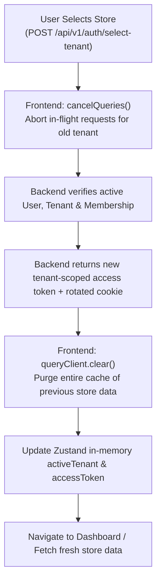

# Milestone 03 — Authentication & Session Management Architecture

## 1. Executive Summary

SAVDOCRM Milestone 03 delivers a production-grade, multi-tenant authentication and session management subsystem for retail store management. It implements a **Dual-Phase JWT Authentication Model** with cryptographically secure refresh token rotation, authenticated encryption for successor recovery during grace windows, token reuse compromise quarantine, server-side tenant isolation enforcement, and an in-memory frontend session architecture powered by HttpOnly cookies and TanStack Query.

---

## 2. Identity Domain Model

The Identity domain defines three persistent entities:

```
┌────────────────┐          ┌──────────────────────┐          ┌────────────────┐
│      User      │ 1      * │   TenantMembership   │ *      1 │     Tenant     │
│  (Global Identity)◄───────┤ (Membership Context) ├─────────►│(Tenancy Module)│
└───────┬────────┘          └──────────────────────┘          └────────────────┘
        │ 1
        │
        │ *
┌───────▼────────┐
│  RefreshToken  │
│(Session Family)│
└────────────────┘
```

### 2.1 User
A global account entity that can belong to multiple independent retail tenants.
- **Table**: `users`
- **Fields**: `id` (UUIDv4), `username` (unique), `email` (unique case-insensitive), `password_hash` (BCrypt cost 12), `first_name`, `last_name`, `phone_number`, `status` (`ACTIVE`, `SUSPENDED`), `email_verified` (boolean), audit timestamps (`created_at`, `updated_at`), optimistic locking (`version`).
- **Security Constraints**: Emails are trimmed and converted to lowercase upon entry; plaintext passwords are never logged, stored, or returned in DTOs.

### 2.2 TenantMembership
Links a global `User` to a specific `Tenant`.
- **Table**: `tenant_memberships`
- **Fields**: `id` (UUIDv4), `tenant_id` (UUIDv4 FK), `user_id` (UUIDv4 FK), `status` (`ACTIVE`, `INVITED`, `SUSPENDED`), audit timestamps, `version`.
- **Constraints**:
  - `uq_memberships_tenant_user`: Ensures a user can only have one membership per tenant.
  - `uq_memberships_tenant_id`: Composite candidate key for tenant-partitioned references.

### 2.3 RefreshToken
Opaque cryptographically secure session record with token family tracking and encrypted successor token storage.
- **Table**: `refresh_tokens`
- **Fields**:
  - `id` (UUIDv4)
  - `user_id` (UUIDv4 FK)
  - `token_hash` (VARCHAR(64) SHA-256)
  - `token_family` (UUIDv4)
  - `tenant_id` (UUIDv4 nullable)
  - `revoked` (boolean)
  - `revoked_at` (TIMESTAMP WITH TIME ZONE)
  - `revoked_reason` (VARCHAR(100))
  - `successor_token_encrypted` (TEXT, AES-256-GCM encrypted payload)
  - `successor_token_hash` (VARCHAR(64) SHA-256 of successor)
  - `expires_at` (TIMESTAMP WITH TIME ZONE)
  - `created_at` (TIMESTAMP WITH TIME ZONE)
  - `created_ip` (VARCHAR(50))
  - `user_agent` (TEXT)
- **Security**: Raw refresh tokens (32 secure random bytes, Base64URL encoded) are never persisted in plaintext. The token itself is stored as a SHA-256 hash. When rotated, its successor is encrypted using AES-256-GCM with a server-derived key for short-lived grace-window idempotent recovery.

---

## 3. Token Storage Architecture

| Token Type | Storage Medium | Delivery Mechanism | Lifetime | Scope / Purpose |
| :--- | :--- | :--- | :--- | :--- |
| **Access Token** | **In-Memory Only** (Zustand state variable) | JSON response body (`accessToken`) | 15 minutes (900s) | Stateless API authorization header (`Bearer <token>`). Cleared on tab close / reload. |
| **Refresh Token** | **HttpOnly Cookie** (`savdocrm_refresh_token`) | `Set-Cookie` HTTP header | 30 days (2,592,000s) | Token rotation and silent session restoration. Inaccessible to JavaScript / XSS. |

### Cookie Configuration: Development vs Production

```yaml
# Development (application-dev.yml)
jwt:
  cookie-name: savdocrm_refresh_token
  cookie-secure: false          # Permitted for plain HTTP on localhost
  cookie-same-site: Lax         # Allows top-level navigation while preventing CSRF
  cookie-path: /api/v1/auth     # Restricts cookie scope exclusively to auth endpoints

# Production (application-prod.yml)
jwt:
  cookie-name: savdocrm_refresh_token
  cookie-secure: true           # Enforces HTTPS transmission only
  cookie-same-site: Lax
  cookie-path: /api/v1/auth
```

---

## 4. Deployment Topologies, Cookie SameSite & CSRF Strategy

### Topology A: Same-Site Cross-Origin Deployment
- **Architecture**: Frontend at `https://app.savdocrm.com` and backend API at `https://api.savdocrm.com`. Both share the registrable domain `savdocrm.com` (Same-Site).
- **Cookie Policy**: `SameSite=Lax; Secure; HttpOnly; Path=/api/v1/auth`.
- **CSRF Defense**: Modern browsers do not attach `SameSite=Lax` cookies to cross-site `POST` requests. In addition, the backend enforces explicit `Origin` validation against the configured `cors.allowed-origins`.

### Topology B: Cross-Site Deployment
- **Architecture**: Frontend at `https://store-app.com` and backend at `https://savdocrm-api.com` (different registrable domains).
- **Cookie Policy**: Requires `SameSite=None; Secure; HttpOnly; Path=/api/v1/auth`.
- **CSRF Defense**:
  1. **Strict Origin Validation**: `AuthCookieService.validateOriginForCookieAuth` rejects any cookie-bearing request whose `Origin` does not strictly match `cors.allowed-origins`.
  2. **Preflight Enforcement**: Requests carry custom headers or JSON payloads that mandate CORS preflight checks (`OPTIONS`), verified against explicit origin whitelists without wildcards.
  3. **Path Scoping**: Cookies are restricted exclusively to `/api/v1/auth`, ensuring business API endpoints are protected strictly by in-memory Bearer tokens.

---

## 5. Refresh Token Grace Window & Cryptographic Successor Recovery

```
Client Request with Old Token T0
           │
           ▼
[PESSIMISTIC_WRITE Row Lock on T0] (PostgreSQL SELECT ... FOR UPDATE)
           │
           ├─► Is T0 valid (not revoked, not expired)?
           │      └─► Proceed with normal rotation:
           │            1. Generate new raw T1.
           │            2. Save T1 (hash = H(T1)).
           │            3. Encrypt raw T1 via AES-256-GCM.
           │            4. Update T0: revoked=true, reason="Rotated",
           │               successor_token_encrypted=enc(T1), successor_token_hash=H(T1).
           │            5. Deliver T1 in HttpOnly Set-Cookie + fresh access token.
           │
           └─► Is T0 revoked?
                  │
                  ├─► Reason == "Rotated" AND elapsed <= 10 seconds?
                  │      │
                  │      └─► (CONCURRENCY GRACE WINDOW):
                  │            1. Decrypt raw T1 from T0.successor_token_encrypted.
                  │            2. Verify H(T1) == T0.successor_token_hash.
                  │            3. Verify T1 exists, is valid, and belongs to same family.
                  │            4. Return IDEMPOTENT result:
                  │               Deliver T1 in HttpOnly Set-Cookie + fresh access token.
                  │               **NO NEW REFRESH TOKEN IS MINTED.**
                  │
                  └─► Reason != "Rotated" OR elapsed > 10 seconds?
                         │
                         └─► (TOKEN REUSE DETECTED / ATTACK):
                               1. Quarantine: revoke entire token family in DB.
                               2. Throw 401 Unauthorized ("Token reuse detected").
                               3. Terminate all sessions in the family.
```

### Security Properties Guaranteed:
1. **No Token Forking / Replay Inflation**: A replayed old token can never produce a new or branched refresh token. It only reproduces the exact successor $T_1$ idempotently.
2. **Security at Rest**: Raw tokens are never stored in plaintext. $T_1$'s active record contains only its SHA-256 hash. $T_0$'s record contains $T_1$ encrypted using authenticated AES-256-GCM with a server-derived secret key.
3. **Serialized Database Locking**: PostgreSQL row locking ensures that parallel threads for the same token execute sequentially without race conditions.
4. **Immediate Family Quarantine**: When an old token is presented after the 10-second grace window, the entire family is revoked, neutralizing compromised tokens.

---

## 6. Global Token vs Tenant-Scoped Token Architecture

SAVDOCRM strictly distinguishes between global identity and active tenant authorization:

| Dimension | Global Login Token | Tenant-Scoped Token |
|---|---|---|
| **Endpoint Source** | `POST /api/v1/auth/login` | `POST /api/v1/auth/select-tenant` or `POST /api/v1/auth/register` |
| **Token Claims** | `userId`, `email`, `sub` (`tenantId` and `membershipId` are **null**) | `userId`, `email`, `sub`, `tenantId`, `membershipId` |
| **Permissions** | Profile lookup (`GET /api/v1/auth/me`), store selection (`POST /select-tenant`) | Full store management operations (`/api/v1/branches`, etc.) |
| **Tenancy Enforcement** | `TenantContextHolder` is **NOT** bound | `TenantContextHolder.setContext(TenantContext.of(tenantId))` |
| **Missing Context** | Accessing business APIs fails closed with `403 Forbidden` (`Tenant Context Missing`) | Executes safely within isolated tenant scope |
| **Client Headers** | Client headers like `X-Tenant-Id` are **never trusted** | Context is strictly derived from the cryptographically verified JWT |

---

## 7. Tenant Switching & Query Cache Isolation



---

## 8. Logout & Session Revocation

When `POST /api/v1/auth/logout` is called:
1. The backend extracts the refresh token from the HttpOnly cookie.
2. `AuthService.logout` queries the token family and executes:
   ```sql
   UPDATE refresh_tokens SET revoked = true, revoked_at = now(), revoked_reason = 'User logout' WHERE token_family = :family;
   ```
   **The entire token family is revoked**, preventing any token from that session from ever restoring access.
3. The response returns `Set-Cookie: savdocrm_refresh_token=; Path=/api/v1/auth; Max-Age=0; HttpOnly; SameSite=...`.
4. Logout is publicly accessible and succeeds even if the caller's access token is expired.
5. On the frontend, `queryClient.cancelQueries()`, `useAuthStore.clearAuth()`, and `queryClient.clear()` purge all client-side state.

---

## 9. Test Verification Summary

The test suite validates all security guarantees against PostgreSQL 16 Testcontainers:
- **Backend Tests**: 43 / 43 passed (0 failures)
  - `shouldRecoverOriginalRawSuccessorTokenViaHttpOnlyCookieDuringGracePeriodWithoutCreatingNewToken`
  - `shouldHandleConcurrentRefreshRequestsGracefully`
  - `shouldDetectRefreshTokenReuseOutsideGracePeriodAndRevokeEntireFamily`
  - `shouldFailClosedWhenGlobalTokenAccessesTenantProtectedBranchEndpoint`
  - `shouldRejectGlobalTokenEvenWithXTenantIdHeader`
  - `shouldAllowTenantScopedTokenToAccessBranchEndpoint`
  - `shouldRejectTenantTokenWithMismatchingMembershipIdClaim`
  - `shouldRevokeEntireSessionFamilyOnLogoutAndPreventRestoringSession`
  - `shouldRejectCookieRefreshWithDisallowedOriginDueToCsrfProtection`
  - `shouldRejectRequestsWhenUserIsSuspended`
  - `shouldRejectRequestsWhenTenantIsSuspended`
  - `shouldRejectRequestsWhenMembershipIsSuspended`
  - ArchUnit architecture enforcement rules
- **Frontend Tests**: 12 / 12 passed (0 failures) across 4 Vitest test suites
- **Build**: `./gradlew build` and `npm run build` both succeeded with zero errors.
