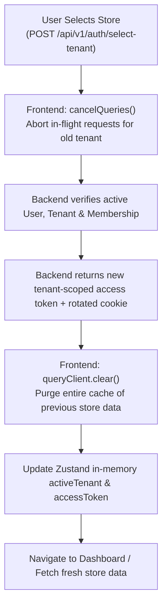

# Milestone 03 — Authentication & Session Management Architecture

## 1. Executive Summary

SAVDOCRM Milestone 03 delivers a production-grade, multi-tenant authentication and session management subsystem for retail store management. It implements a **Dual-Phase JWT Authentication Model** with cryptographically secure refresh token rotation, authenticated encryption for successor recovery during grace windows, token reuse compromise quarantine, server-side tenant isolation enforcement, and an in-memory frontend session architecture powered by HttpOnly cookies and TanStack Query.

---

## 2. Identity Domain Model

The Identity domain defines three persistent entities:

```
┌────────────────┐          ┌──────────────────────┐          ┌────────────────┐
│      User      │ 1      * │   TenantMembership   │ *      1 │     Tenant     │
│  (Global Identity)◄───────┤ (Membership Context) ├─────────►│(Tenancy Module)│
└───────┬────────┘          └──────────────────────┘          └────────────────┘
        │ 1
        │
        │ *
┌───────▼────────┐
│  RefreshToken  │
│(Session Family)│
└────────────────┘
```

### 2.1 User
A global account entity that can belong to multiple independent retail tenants.
- **Table**: `users`
- **Fields**: `id` (UUIDv4), `username` (unique), `email` (unique case-insensitive), `password_hash` (BCrypt cost 12), `first_name`, `last_name`, `phone_number`, `status` (`ACTIVE`, `SUSPENDED`), `email_verified` (boolean), audit timestamps (`created_at`, `updated_at`), optimistic locking (`version`).
- **Security Constraints**: Emails are trimmed and converted to lowercase upon entry; plaintext passwords are never logged, stored, or returned in DTOs.

### 2.2 TenantMembership
Links a global `User` to a specific `Tenant`.
- **Table**: `tenant_memberships`
- **Fields**: `id` (UUIDv4), `tenant_id` (UUIDv4 FK), `user_id` (UUIDv4 FK), `status` (`ACTIVE`, `INVITED`, `SUSPENDED`), audit timestamps, `version`.
- **Constraints**:
  - `uq_memberships_tenant_user`: Ensures a user can only have one membership per tenant.
  - `uq_memberships_tenant_id`: Composite candidate key for tenant-partitioned references.

### 2.3 RefreshToken
Opaque cryptographically secure session record with token family tracking and encrypted successor token storage.
- **Table**: `refresh_tokens`
- **Fields**:
  - `id` (UUIDv4)
  - `user_id` (UUIDv4 FK)
  - `token_hash` (VARCHAR(64) SHA-256)
  - `token_family` (UUIDv4)
  - `tenant_id` (UUIDv4 nullable)
  - `revoked` (boolean)
  - `revoked_at` (TIMESTAMP WITH TIME ZONE)
  - `revoked_reason` (VARCHAR(100))
  - `successor_token_encrypted` (TEXT, AES-256-GCM encrypted payload)
  - `successor_token_hash` (VARCHAR(64) SHA-256 of successor)
  - `expires_at` (TIMESTAMP WITH TIME ZONE)
  - `created_at` (TIMESTAMP WITH TIME ZONE)
  - `created_ip` (VARCHAR(50))
  - `user_agent` (TEXT)
- **Security**: Raw refresh tokens (32 secure random bytes, Base64URL encoded) are never persisted in plaintext. The token itself is stored as a SHA-256 hash. When rotated, its successor is encrypted using AES-256-GCM with a server-derived key for short-lived grace-window idempotent recovery.

---

## 3. Token Storage Architecture

| Token Type | Storage Medium | Delivery Mechanism | Lifetime | Scope / Purpose |
| :--- | :--- | :--- | :--- | :--- |
| **Access Token** | **In-Memory Only** (Zustand state variable) | JSON response body (`accessToken`) | 15 minutes (900s) | Stateless API authorization header (`Bearer <token>`). Cleared on tab close / reload. |
| **Refresh Token** | **HttpOnly Cookie** (`savdocrm_refresh_token`) | `Set-Cookie` HTTP header | 30 days (2,592,000s) | Token rotation and silent session restoration. Inaccessible to JavaScript / XSS. |

### Cookie Configuration: Development vs Production

```yaml
# Development (application-dev.yml)
jwt:
  cookie-name: savdocrm_refresh_token
  cookie-secure: false          # Permitted for plain HTTP on localhost
  cookie-same-site: Lax         # Allows top-level navigation while preventing CSRF
  cookie-path: /api/v1/auth     # Restricts cookie scope exclusively to auth endpoints

# Production (application-prod.yml)
jwt:
  cookie-name: savdocrm_refresh_token
  cookie-secure: true           # Enforces HTTPS transmission only
  cookie-same-site: Lax
  cookie-path: /api/v1/auth
```

---

## 4. Deployment Topologies, Cookie SameSite & CSRF Strategy

### Topology A: Same-Site Cross-Origin Deployment
- **Architecture**: Frontend at `https://app.savdocrm.com` and backend API at `https://api.savdocrm.com`. Both share the registrable domain `savdocrm.com` (Same-Site).
- **Cookie Policy**: `SameSite=Lax; Secure; HttpOnly; Path=/api/v1/auth`.
- **CSRF Defense**: Modern browsers do not attach `SameSite=Lax` cookies to cross-site `POST` requests. In addition, the backend enforces explicit `Origin` validation against the configured `cors.allowed-origins`.

### Topology B: Cross-Site Deployment
- **Architecture**: Frontend at `https://store-app.com` and backend at `https://savdocrm-api.com` (different registrable domains).
- **Cookie Policy**: Requires `SameSite=None; Secure; HttpOnly; Path=/api/v1/auth`.
- **CSRF Defense**:
  1. **Strict Origin & Referer Validation**: `AuthCookieService.validateOriginForCookieAuth` protects `/refresh` and `/logout`:
     - Rejects `Origin: null` (used in sandboxed iframe / data URI attacks) with `403 Forbidden`.
     - Validates `Origin` against `cors.allowed-origins` using exact scheme, host, and port matching.
     - Falls back to `Referer` if `Origin` is omitted, parsing and validating the origin against the allowlist.
     - Strictly rejects any cookie-bearing request where both `Origin` and `Referer` are missing.
     - Strictly forbids wildcard `'*'` origins when credentials are enabled.
  2. **Preflight Enforcement**: Requests carry custom headers or JSON payloads that mandate CORS preflight checks (`OPTIONS`), verified against explicit origin allowlists without wildcards.
  3. **Path Scoping**: Cookies are restricted exclusively to `/api/v1/auth`, ensuring business API endpoints are protected strictly by in-memory Bearer tokens.

---

## 5. Refresh Token Security Protocol, Key Management & Replay Analysis

### 5.1 The Replay Threat During Server Grace Windows
In traditional server-side grace windows, when token $T_0$ is rotated to $T_1$, the server accepts $T_0$ for a brief period (e.g. 10s) and returns $T_1$.
**Critical Threat**: If an attacker steals $T_0$, they can replay $T_0$ during the 10-second grace window after legitimate rotation. Because bearer tokens possess no sender-identity proof, the server cannot distinguish between:
1. A legitimate concurrent browser request or lost-response retry.
2. A replay attack by an attacker holding the stolen bearer credential.

Neither row-level locking (`PESSIMISTIC_WRITE`) nor AES-256-GCM encryption solves this threat:
- Row-level locking only serializes database operations.
- AES-256-GCM only guarantees confidentiality and integrity at rest in PostgreSQL; it does not authenticate the requester.

### 5.2 Selected Defense Architecture
To minimize replay risk while preserving seamless multi-tab usability, SAVDOCRM implements a multi-layer defense:

1. **Frontend Cross-Tab & Single-Flight Coordination (Web Locks API + BroadcastChannel)**:
   - Modern browsers coordinate refresh calls across all open tabs using the **Web Locks API** (`navigator.locks.request('savdocrm_refresh_lock', ...)`).
   - Only one tab across all windows executes `/api/v1/auth/refresh` at any time.
   - When the active tab finishes, it broadcasts `REFRESH_SUCCESS` with the new access token via `BroadcastChannel`.
   - Queued tabs acquire the lock, detect that the token was already refreshed, and reuse the new token without sending any additional network requests.
   - If the active tab closes or crashes, the browser engine automatically releases the Web Lock, avoiding deadlocks.
   - Within each tab, an Axios concurrency queue (`isRefreshing` + `failedQueue`) serializes concurrent 401 interceptor executions.

2. **Backend Client Session Verification During Grace Window**:
   - When a revoked token is presented within the 10-second grace window:
     - The server verifies client context: `token.created_ip == request.ip` and `token.user_agent == request.userAgent`.
     - **Second-Client Replay Detection**: If an attacker from a different IP or User-Agent presents $T_0$, the server immediately detects the replay, **revokes the entire token family**, and returns `401 Unauthorized`.
     - **Same-Session Concurrency / Lost Response**: If client fingerprint matches, the successor $T_1$ is recovered from authenticated AES-256-GCM storage and returned in `Set-Cookie`.

3. **Cryptographic Key Management (HKDF & Key Rotation)**:
   - Token encryption key is derived using RFC 5869 **HKDF-SHA256** with domain separation (`savdocrm-hkdf-token-encryption-salt-v1` and dedicated context info).
   - Dedicated configuration property `jwt.encryption-secret` decouples token encryption from JWT signing (`jwt.secret`).
   - **Key Versioning & Keyring**: Encrypted tokens carry a version prefix (e.g. `v1:<payload>`, `v2:<payload>`). During key rotation, `TokenEncryptionService.rotateKey(newVersion, newSecret)` registers the new active key while retaining historical keys in a keyring. Existing active sessions encrypted under historical keys decrypt seamlessly without interruption.

4. **Encrypted Successor Database Cleanup**:
   - `successor_token_encrypted` is only required during the 10-second grace window. Retaining recoverable token plaintext in PostgreSQL indefinitely is a security liability.
   - Automatic cleanup is executed during token rotation and via `AuthService.cleanupExpiredSuccessorTokens(Instant cutoff)`:
     - Sets `successor_token_encrypted = NULL` for all tokens where `revoked = true` and `revoked_at < cutoff`.
     - Preserves `successor_token_hash` (SHA-256) permanently for security auditing, forensic lineage analysis, and reuse detection.

5. **Residual Risks & Trade-Offs**:
   - **Same-IP/Same-UA Replay Window**: If an attacker on the same NAT IP (e.g. corporate WiFi) also spoofs the victim's User-Agent header, they could theoretically replay $T_0$ within the 10-second window. Cryptographically unforgeable proof-of-possession would require sender-constraining (DPoP, RFC 9449). However, DPoP introduces high architectural overhead (WebCrypto key management, client-side proof signing per request, nonce stores, and replay caches) that was deemed disproportionate for a browser SaaS already fortified by HttpOnly SameSite=Lax Secure cookies, exact Origin validation, and Web Locks.
   - **Lost Response Availability Trade-Off**: If a network failure occurs after server commit and retry happens after the 10s grace window has elapsed (or if IP changed), the server treats the request as reuse and revokes the family. The user must re-authenticate (login). In financial and CRM enterprise SaaS, security (preventing replay attacks) strictly takes precedence over rare transient network reconnects.

---

## 6. Global Token vs Tenant-Scoped Token Architecture

SAVDOCRM strictly distinguishes between global identity and active tenant authorization:

| Dimension | Global Login Token | Tenant-Scoped Token |
|---|---|---|
| **Endpoint Source** | `POST /api/v1/auth/login` | `POST /api/v1/auth/select-tenant` or `POST /api/v1/auth/register` |
| **Token Claims** | `userId`, `email`, `sub` (`tenantId` and `membershipId` are **null**) | `userId`, `email`, `sub`, `tenantId`, `membershipId` |
| **Permissions** | Profile lookup (`GET /api/v1/auth/me`), store selection (`POST /select-tenant`) | Full store management operations (`/api/v1/branches`, etc.) |
| **Tenancy Enforcement** | `TenantContextHolder` is **NOT** bound | `TenantContextHolder.setContext(TenantContext.of(tenantId))` |
| **Missing Context** | Accessing business APIs fails closed with `403 Forbidden` (`Tenant Context Missing`) | Executes safely within isolated tenant scope |
| **Client Headers** | Client headers like `X-Tenant-Id` are **never trusted** | Context is strictly derived from the cryptographically verified JWT |

---

## 7. Tenant Switching & Query Cache Isolation



---

## 8. Logout & Session Revocation

When `POST /api/v1/auth/logout` is called:
1. The backend extracts the refresh token from the HttpOnly cookie.
2. `AuthService.logout` queries the token family and executes:
   ```sql
   UPDATE refresh_tokens SET revoked = true, revoked_at = now(), revoked_reason = 'User logout' WHERE token_family = :family;
   ```
   **The entire token family is revoked**, preventing any token from that session from ever restoring access.
3. The response returns `Set-Cookie: savdocrm_refresh_token=; Path=/api/v1/auth; Max-Age=0; HttpOnly; SameSite=...`.
4. Logout is publicly accessible and succeeds even if the caller's access token is expired.
5. On the frontend, `queryClient.cancelQueries()`, `useAuthStore.clearAuth()`, and `queryClient.clear()` purge all client-side state.

---

## 9. Test Verification Summary

The test suite validates all security guarantees against PostgreSQL 16 Testcontainers:
- **Backend Tests**: 57 / 57 passed (0 failures)
  - `shouldRecoverOriginalRawSuccessorTokenViaHttpOnlyCookieDuringGracePeriodWithoutCreatingNewToken`
  - `shouldHandleConcurrentRefreshRequestsGracefully`
  - `shouldDetectRefreshTokenReuseOutsideGracePeriodAndRevokeEntireFamily`
  - `shouldDetectRefreshTokenReplayBySecondClientAndRevokeEntireFamily`
  - `shouldRecoverSuccessorDuringNetworkFailureOrLostResponseFromSameBrowserSession`
  - `shouldRejectExpiredRefreshToken`
  - `shouldAllowSuccessorRecoveryAcrossEncryptionKeyRotation`
  - `shouldRejectCookieRefreshWithMissingOriginAndMissingReferer`
  - `shouldRejectCookieRefreshWithNullOrigin`
  - `shouldRejectCookieRefreshWithUnauthorizedReferer`
  - `shouldAllowCookieRefreshWithAuthorizedRefererFallback`
  - `shouldCleanUpExpiredEncryptedSuccessorMaterialWhilePreservingTokenHash`
  - `shouldFailClosedWhenGlobalTokenAccessesTenantProtectedBranchEndpoint`
  - `shouldRejectGlobalTokenEvenWithXTenantIdHeader`
  - `shouldAllowTenantScopedTokenToAccessBranchEndpoint`
  - `shouldRejectTenantTokenWithMismatchingMembershipIdClaim`
  - `shouldRevokeEntireSessionFamilyOnLogoutAndPreventRestoringSession`
  - `shouldRejectCookieRefreshWithDisallowedOriginDueToCsrfProtection`
  - `shouldRejectRequestsWhenUserIsSuspended`
  - `shouldRejectRequestsWhenTenantIsSuspended`
  - `shouldRejectRequestsWhenMembershipIsSuspended`
  - `TokenEncryptionServiceTest` (HKDF key derivation, unique IV per encryption, authenticated decryption, key rotation with multiple key versions, legacy payload compatibility)
  - ArchUnit architecture enforcement rules
- **Frontend Tests**: 14 / 14 passed (0 failures) across 4 Vitest test suites
  - Cross-tab refresh coordination using Web Locks API
  - Token reuse on concurrent tab wake-up
  - BroadcastChannel synchronization (`REFRESH_SUCCESS`, `AUTH_CLEARED`)
  - Single-flight 401 response queue
  - Tenant switching cache eviction
- **Build**: `./gradlew test` and `npm run build` both succeeded with zero errors.
