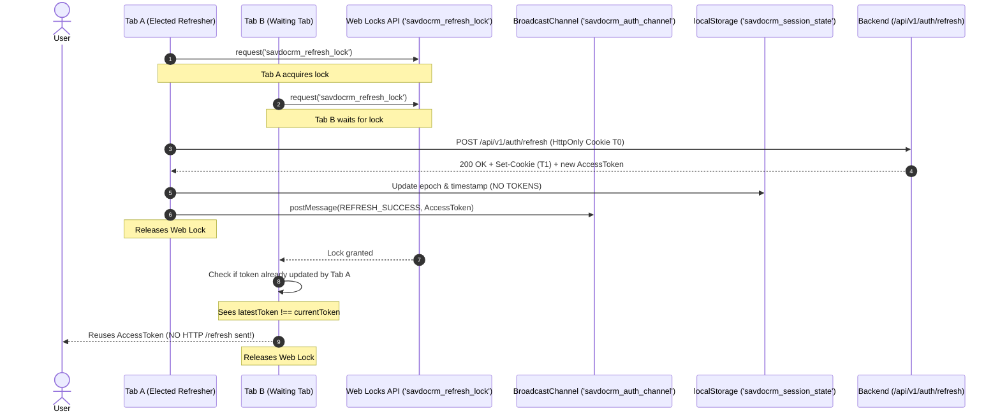

# Milestone 03 — Authentication & Session Management Architecture

## 1. Executive Summary

SAVDOCRM Milestone 03 delivers a production-grade, multi-tenant authentication and session management subsystem for retail store management. It implements a **Stateless Dual-Phase JWT Authentication Model** with **Strict Single-Use Refresh Token Rotation (RTR)**, immediate token reuse compromise quarantine, row-level PostgreSQL locking (`PESSIMISTIC_WRITE`), trusted reverse proxy IP resolution, strict CSRF origin validation, and client-side cross-tab coordination powered by the Web Locks API, BroadcastChannel, and in-memory Zustand state.

---

## 2. Identity Domain Model

The Identity domain defines three persistent entities:

```
┌────────────────┐          ┌──────────────────────┐          ┌────────────────┐
│      User      │ 1      * │   TenantMembership   │ *      1 │     Tenant     │
│  (Global Identity)◄───────┤ (Membership Context) ├─────────►│(Tenancy Module)│
│                │          │                      │          │(Active Store)  │
└───────┬────────┘          └──────────────────────┘          └────────────────┘
        │ 1
        │
        │ *
┌───────▼────────┐
│  RefreshToken  │
│(Session Family)│
└────────────────┘
```

### 2.1 User
A global account entity that can belong to multiple independent retail tenants.
- **Table**: `users`
- **Fields**: `id` (UUIDv4), `username` (unique), `email` (unique case-insensitive), `password_hash` (BCrypt cost 12), `first_name`, `last_name`, `phone_number`, `status` (`ACTIVE`, `SUSPENDED`), `email_verified` (boolean), audit timestamps (`created_at`, `updated_at`), optimistic locking (`version`).
- **Security Constraints**: Emails are trimmed and converted to lowercase upon entry; plaintext passwords are never logged, stored, or returned in DTOs.

### 2.2 TenantMembership
Links a global `User` to a specific `Tenant`.
- **Table**: `tenant_memberships`
- **Fields**: `id` (UUIDv4), `tenant_id` (UUIDv4 FK), `user_id` (UUIDv4 FK), `status` (`ACTIVE`, `INVITED`, `SUSPENDED`), audit timestamps, `version`.
- **Constraints**:
  - `uq_memberships_tenant_user`: Ensures a user can only have one membership per tenant.
  - `uq_memberships_tenant_id`: Composite candidate key for tenant-partitioned references.

### 2.3 RefreshToken
Opaque cryptographically secure session record with token family tracking and strict single-use rotation semantics.
- **Table**: `refresh_tokens`
- **Fields**:
  - `id` (UUIDv4)
  - `user_id` (UUIDv4 FK)
  - `token_hash` (VARCHAR(64) SHA-256)
  - `token_family` (UUIDv4)
  - `tenant_id` (UUIDv4 nullable)
  - `revoked` (boolean)
  - `revoked_at` (TIMESTAMP WITH TIME ZONE)
  - `revoked_reason` (VARCHAR(100))
  - `successor_token_hash` (VARCHAR(64) SHA-256 of successor token, retained for cryptographic audit lineage)
  - `expires_at` (TIMESTAMP WITH TIME ZONE)
  - `created_at` (TIMESTAMP WITH TIME ZONE)
  - `created_ip` (VARCHAR(50))
  - `user_agent` (TEXT)
- **Security**: Raw refresh tokens (32 secure random bytes, Base64URL encoded) are never persisted in plaintext. The token itself is stored as a SHA-256 hash. When consumed, the token is revoked with `revoked_reason = 'Rotated'` and its successor's hash is stored in `successor_token_hash` to preserve cryptographic audit lineage without storing sensitive raw token material.

---

## 3. Token Storage Architecture

| Token Type | Storage Medium | Delivery Mechanism | Lifetime | Scope / Purpose |
| :--- | :--- | :--- | :--- | :--- |
| **Access Token** | **In-Memory Only** (Zustand state variable) | JSON response body (`accessToken`) | 15 minutes (900s) | Stateless API authorization header (`Bearer <token>`). Cleared on tab close / reload. |
| **Refresh Token** | **HttpOnly Cookie** (`savdocrm_refresh_token`) | `Set-Cookie` HTTP header | 30 days (2,592,000s) | Token rotation and silent session restoration. Inaccessible to JavaScript / XSS. |

### Cookie Configuration: Development vs Production

```yaml
# Development (application-dev.yml)
jwt:
  cookie-name: savdocrm_refresh_token
  cookie-secure: false          # Permitted for plain HTTP on localhost
  cookie-same-site: Lax         # Allows top-level navigation while preventing CSRF
  cookie-path: /api/v1/auth     # Restricts cookie scope exclusively to auth endpoints

# Production (application-prod.yml)
jwt:
  cookie-name: savdocrm_refresh_token
  cookie-secure: true           # Enforces HTTPS transmission only
  cookie-same-site: Lax
  cookie-path: /api/v1/auth
```

---

## 4. Deployment Topologies, Cookie SameSite & CSRF Strategy

### Topology A: Same-Site Cross-Origin Deployment
- **Architecture**: Frontend at `https://app.savdocrm.com` and backend API at `https://api.savdocrm.com`. Both share the registrable domain `savdocrm.com` (Same-Site).
- **Cookie Policy**: `SameSite=Lax; Secure; HttpOnly; Path=/api/v1/auth`.
- **CSRF Defense**: Modern browsers do not attach `SameSite=Lax` cookies to cross-site `POST` requests. In addition, the backend enforces explicit `Origin` validation against configured `cors.allowed-origins`.

### Topology B: Cross-Site Deployment
- **Architecture**: Frontend at `https://store-app.com` and backend at `https://savdocrm-api.com` (different registrable domains).
- **Cookie Policy**: Requires `SameSite=None; Secure; HttpOnly; Path=/api/v1/auth`.
- **CSRF Defense**:
  1. **Strict Origin & Referer Validation**: `AuthCookieService.validateOriginForCookieAuth` protects `/refresh` and `/logout`:
     - Rejects `Origin: null` (used in sandboxed iframe / data URI attacks) with `403 Forbidden`.
     - Validates `Origin` against `cors.allowed-origins` using exact scheme, host, and port matching.
     - Falls back to `Referer` if `Origin` is omitted, parsing and validating the origin against the allowlist.
     - Strictly rejects any cookie-bearing request where both `Origin` and `Referer` are missing.
     - Strictly forbids wildcard `'*'` origins when credentials are enabled.
  2. **Preflight Enforcement**: Requests carry custom headers or JSON payloads that mandate CORS preflight checks (`OPTIONS`), verified against explicit origin allowlists without wildcards.
  3. **Path Scoping**: Cookies are restricted exclusively to `/api/v1/auth`, ensuring business API endpoints are protected strictly by in-memory Bearer tokens.

---

## 5. Strict Single-Use Refresh Token Protocol & Concurrency Hardening

### 5.1 Protocol Specification

The refresh token subsystem enforces strict single-use semantics:

1. **Exact Single-Use**: A refresh token can be successfully consumed exactly once.
2. **Zero Grace Window**: Any grace window recovery is removed. A revoked refresh token is NEVER accepted and NEVER returns its successor.
3. **Immediate Family Revocation on Replay**: Any attempt to consume an already-revoked refresh token is treated as an active session compromise signal. The server immediately revokes the **entire token family**:
   ```sql
   UPDATE refresh_tokens SET revoked = true, revoked_at = now(), revoked_reason = 'Token reuse detected' WHERE token_family = :family;
   ```
4. **PostgreSQL Row-Level Locking**: Concurrency is serialized at the database layer using pessimistic write locks (`findByTokenHashWithLock` with `LockModeType.PESSIMISTIC_WRITE` generating `SELECT ... FOR UPDATE`).
5. **Transactional Consistency**: Marked with `@Transactional(noRollbackFor = BadCredentialsException.class)` so that compromise quarantine (family revocation) commits to PostgreSQL even when throwing `401 Unauthorized` (`BadCredentialsException`).

### 5.2 Intentional Lost Response Behavior

If the backend successfully commits token rotation to the database but the HTTP response is lost over the network (e.g., client drops connection, socket timeout, Wi-Fi blip):
- The browser still possesses the old refresh token $T_0$.
- Retrying $T_0$ is treated by the server as a replay attempt because $T_0$ was already rotated to $T_1$ and marked revoked.
- The server revokes the entire token family (invalidating $T_1$ as well) and returns `401 Unauthorized`.
- The user must re-authenticate (login).

**Security-First Rationale**: In enterprise retail SaaS, bearer tokens cannot prove sender identity over shared public IPs or corporate NATs. Silently recovering sessions on old token presentation would re-open the replay window for attackers possessing stolen tokens. Compromise isolation strictly takes precedence over transient network reconnection.

### 5.3 Client-Side Cross-Tab Coordination (Web Locks API + BroadcastChannel)

To prevent race conditions between browser tabs without server-side grace windows, the frontend implements multi-tier synchronization:



1. **Web Locks API (`navigator.locks.request('savdocrm_refresh_lock', ...)`):**
   - Mutual exclusion across all tabs and windows under the same origin.
   - Only one tab initiates the HTTP refresh call.
   - **Tab Crash Resilience**: If the holding tab crashes or terminates, the browser engine automatically releases the Web Lock.
2. **Post-Acquisition Verification:**
   - After acquiring the lock, a waiting tab inspects `useAuthStore.getState().accessToken` and the shared session epoch. If another tab already rotated the token, it reuses the fresh in-memory access token without sending any network request.
3. **BroadcastChannel Synchronization (`savdocrm_auth_channel`):**
   - A successful refresh emits `REFRESH_SUCCESS` carrying the new `accessToken` and `activeTenant`.
   - **Critical Security Invariant**: The `refreshToken` is **NEVER** broadcast over `BroadcastChannel`. It remains exclusively in the browser's HttpOnly cookie jar.
   - A failed refresh emits `AUTH_CLEARED`, immediately wiping state and clearing queries across all tabs.
4. **Missed Broadcast Defense & Zero Token Persistence:**
   - A non-token shared session metadata record is maintained in `localStorage` (`savdocrm_session_state: { state: 'AUTHENTICATED' | 'UNAUTHENTICATED', timestamp, refreshEpoch }`).
   - If a tab was backgrounded or asleep and missed an `AUTH_CLEARED` broadcast, its request interceptor checks `getSharedSessionState()`. If marked `UNAUTHENTICATED`, the tab aborts immediately without attempting to reuse stale in-memory tokens.
   - Neither access tokens nor refresh tokens are EVER stored in `localStorage` or `sessionStorage`.
5. **Fallback Strategy**:
   - For environments lacking the Web Locks API, the client falls back to an in-tab single-flight concurrency queue (`isRefreshing` + `failedQueue`).

---

## 6. Reverse Proxy & Trusted Client IP Resolution

In cloud and containerized deployments, backend applications run behind reverse proxies or load balancers (e.g., NGINX, AWS ALB, Cloudflare).
- To prevent IP spoofing in audit logs and security telemetry, `ClientIpResolver` inspects `X-Forwarded-For` **only when the direct connection originates from a configured trusted proxy** (`security.trusted-proxies`).
- If an untrusted direct client provides an `X-Forwarded-For` header, it is completely ignored, and `request.getRemoteAddr()` is recorded.

---

## 7. Database Migration & Safe Retention Cleanup

### 7.1 Liquibase Changeset Summary
1. `v1.0.0-05-create-refresh-tokens`: Created `refresh_tokens` table with SHA-256 token hashing, `token_family`, tenant context, and revocation metadata.
2. `v1.0.0-06-add-successor-token-encrypted`: Added encrypted successor token columns (deprecated).
3. `v1.0.0-07-remove-successor-token-encrypted`: Safely drops `successor_token_encrypted` column while preserving `successor_token_hash` for audit and security analysis. Rollback re-adds the column as nullable.

### 7.2 Retention & Cleanup Strategy
- Active tokens remain valid until expiration.
- Rotated tokens are preserved with their `successor_token_hash`, revocation timestamp, and revocation reason for compromise analysis and forensic auditing.
- `AuthService.cleanupExpiredRevokedTokens(Instant cutoff)` purges revoked tokens where `expires_at < cutoff` (e.g., older than 90 days), preserving audit integrity while bounding table growth.

---

## 8. Global Token vs Tenant-Scoped Token Architecture

SAVDOCRM strictly distinguishes between global identity and active tenant authorization:

| Dimension | Global Login Token | Tenant-Scoped Token |
|---|---|---|
| **Endpoint Source** | `POST /api/v1/auth/login` | `POST /api/v1/auth/select-tenant` or `POST /api/v1/auth/register` |
| **Token Claims** | `userId`, `email`, `sub` (`tenantId` and `membershipId` are **null**) | `userId`, `email`, `sub`, `tenantId`, `membershipId` |
| **Permissions** | Profile lookup (`GET /api/v1/auth/me`), store selection (`POST /select-tenant`) | Full store management operations (`/api/v1/branches`, etc.) |
| **Tenancy Enforcement** | `TenantContextHolder` is **NOT** bound | `TenantContextHolder.setContext(TenantContext.of(tenantId))` |
| **Missing Context** | Accessing business APIs fails closed with `403 Forbidden` (`Tenant Context Missing`) | Executes safely within isolated tenant scope |
| **Client Headers** | Client headers like `X-Tenant-Id` are **never trusted** | Context is strictly derived from the cryptographically verified JWT |

---

## 9. Verification & Test Evidence

All protocol behaviors are verified against real PostgreSQL 16 Testcontainers:
- **Strict single-use rotation**: Consumes old token, issues new token, marks old as `Rotated` with successor hash.
- **Immediate replay detection**: Replaying an old token returns 401 Unauthorized and revokes the whole family.
- **Concurrent requests**: Two simultaneous requests with the same old token result in exactly one 200 OK and one 401 replay detection revoking the family.
- **Lost response recovery failure**: Retrying old token after network loss revokes family and requires re-login.
- **Logout family revocation**: Calling `/logout` revokes all family tokens and clears the HttpOnly cookie (`Max-Age=0`).
- **CSRF defenses**: Exact Origin validation, `Origin: null` rejection, authorized Referer fallback, rejection when both are missing on cookie requests, and wildcard origin prohibition.
- **Frontend coordination**: 18 Vitest tests validating in-tab queue, Web Locks mutual exclusion, BroadcastChannel event sync, missed broadcast protection, and zero token storage.
