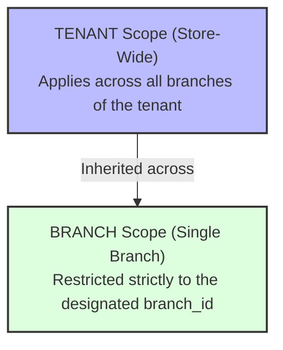
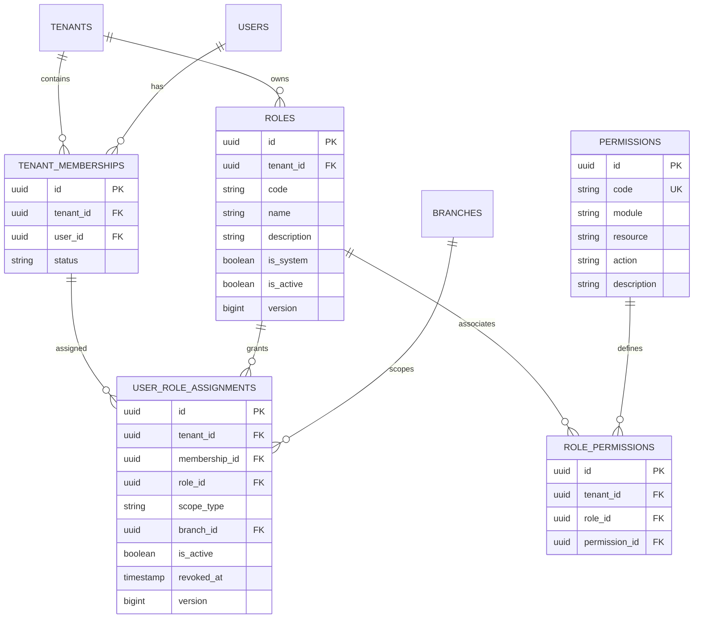

# SAVDOCRM — Milestone 04: Role-Based Access Control (RBAC) & Scoped Permission Management Architecture

- **Status**: Core Domain & Authorization Engine Implemented & Verified (M04.3)
- **Version**: 1.3.0
- **Context**: Milestone 04 — Identity & Access Management (IAM)
- **Related ADRs**: [ADR-0005](file:///home/izzatbek/Desktop/crm/docs/architecture/decisions/ADR-0005-stateless-jwt-dual-phase-authentication.md), [ADR-0006](file:///home/izzatbek/Desktop/crm/docs/architecture/decisions/ADR-0006-strict-single-use-refresh-token-rotation.md), [ADR-0007](file:///home/izzatbek/Desktop/crm/docs/architecture/decisions/ADR-0007-rbac-scope-and-concurrency-architecture.md)

---

## 1. Executive Summary & Architectural Philosophy

Milestone 04 establishes a production-grade, enterprise-ready Role-Based Access Control (RBAC) and Scoped Permission Management system for SAVDOCRM.

### 1.1 Strict Separation of Concerns (Authentication vs. Authorization)
- **Authentication (Milestone 03)**: Answers *"Who is the user, and what tenant are they accessing?"* — Validates identity via credentials, generates dual-phase access tokens, maintains strict single-use refresh token rotation (RTR) with zero grace window in `HttpOnly` cookies, and enforces live user, tenant, and membership status checks on every request.
- **Authorization (Milestone 04)**: Answers *"What is this identity permitted to execute, and on which resource boundary?"* — Evaluates whether the authenticated identity, operating within an active `TenantMembership`, possesses an active role granting the specific permission within the target resource scope.

Authentication logic in `AuthService` and `JwtAuthenticationFilter` remains untouched; authorization is implemented as a dedicated subsystem that consumes the verified identity context (`UserPrincipal`, `TenantContextHolder`).

### 1.2 Core Architectural Invariants
1. **Permission-Based Authorization**: Business services and REST endpoints authorize against atomic, fine-grained capabilities in canonical `<module>.<resource>.<action>` format (`catalog.products.create`, `sales.orders.read`), never against role names (`hasRole('ADMIN')` is prohibited in business logic).
2. **Explicit Scope Hierarchy**: Roles are assigned at either `TENANT` or `BRANCH` scope in Milestone 04. Access to a specific branch must be explicitly assigned; cross-branch or cross-tenant access is strictly denied.
3. **Fail-Closed Execution**: If tenant context, membership status, role assignment, or permission cannot be definitively resolved, access is immediately denied (`403 Forbidden`).
4. **Zero-Trust Multi-Tenancy**: Database-level composite foreign keys (`tenant_id, id`) prevent cross-tenant role assignments directly at the PostgreSQL storage engine level.
5. **Concurrency-Safe Last Active Owner Protection**: Every active tenant must maintain at least one active `OWNER`. Concurrency-safe serialization via row-level locking (`PESSIMISTIC_WRITE`) on the parent `Tenant` row prevents simultaneous administrative actions from leaving a tenant orphaned.
6. **Zero Stale Permission Window (Request-Scoped Memoization)**: To ensure immediate propagation of role deactivations, permission revocations, and membership suspensions without distributed cache invalidation anomalies, permission checks are evaluated from indexed PostgreSQL tables and memoized strictly for the lifespan of a single HTTP request.
7. **Privilege Escalation Prevention (Containment Rule)**: An administrator can only grant permissions that they themselves actively possess, and only an active `OWNER` can manage or assign the `OWNER` role.

---

## 2. Bounded Context & Module Design

### 2.1 Placement Analysis: Identity Module vs. Dedicated Context
In SAVDOCRM's modular monolith architecture:
- `modules/identity` owns `User`, `TenantMembership`, and `RefreshToken`.
- `modules/tenancy` owns `Tenant` and `Branch`.
- `modules/identity` (IAM) manages `Permission`, `Role`, `RolePermission`, and `UserRoleAssignment`.

**Decision**: Place RBAC within `com.savdocrm.modules.identity` under dedicated authorization packages (`domain.rbac`, `infrastructure.rbac`, `application.rbac`, `web.rbac`). 

**DDD Aggregate Boundary Rationale**:
- `TenantMembership` is the identity anchor linking `User` and `Tenant`.
- `UserRoleAssignment` links a `TenantMembership` to a `Role` with an optional `Branch` scope.
- To preserve Clean Architecture and avoid tight JPA entity coupling across bounded contexts, `UserRoleAssignment` references `Branch` **strictly by UUID identifier**, backed by composite foreign keys at the database level (`fk_assignments_branch` referencing `branches(tenant_id, id)`). No cross-module JPA entity traversal (`assignment.getBranch().getName()`) is permitted.

---

## 3. Scope Model & Evaluation Hierarchy

### 3.1 Architectural Scope Decision: PLATFORM vs. TENANT Separation
- **Tenant Authorization**: All tenant roles, role permissions, and user role assignments reside within the tenant boundary. The `roles.tenant_id` column is **strictly `UUID NOT NULL`**. There is **no nullable `tenant_id` shortcut**.
- **Platform Authorization Isolation**: Platform administration (SaaS super-admins managing billing, tenant provisioning, and global platform monitoring) operates outside tenant boundaries. Platform RBAC is **explicitly isolated and deferred** to a future platform operations milestone. Tenant REST APIs (`/api/v1/...`) execute strictly within tenant context and have zero access to or awareness of platform administration roles.

### 3.2 Architectural Scope Decision: Deferral of Warehouse Scope
- **Inspection of Milestone 01–03 Codebase**: In the current system, the `tenancy` module contains `Tenant` and `Branch`. The `inventory` module has not yet been implemented, and **no `warehouses` table exists** in PostgreSQL.
- **Integrity Requirement**: Introducing a loose `warehouse_id UUID` column in `user_role_assignments` without a backing table would violate relational integrity, make tenant/branch ownership validation impossible, and create an unvalidated foreign reference.
- **Decision**: In Milestone 04, the supported and assignable scopes are strictly **`TENANT`** and **`BRANCH`**. The `WAREHOUSE` scope is **explicitly deferred** until the Inventory & Warehouse bounded context is introduced in a future milestone. When `warehouses` is created with composite keys `(tenant_id, branch_id, id)`, the schema can be safely expanded via a standard Liquibase migration.



### 3.3 Scope Evaluation Rules
1. **`TENANT` Scope (Store-Wide)**: Grants the assigned permissions across the entire tenant, including all current and future branches. Roles such as `OWNER`, `ADMIN`, `ACCOUNTANT`, and `VIEWER` typically operate at `TENANT` scope.
2. **`BRANCH` Scope (Branch-Specific)**: Restricts the assigned permissions strictly to operations targeting the specified `branch_id`. Roles such as `MANAGER` and `CASHIER` are typically assigned at `BRANCH` scope.
3. **Scope Inheritance**: A user holding a permission at `TENANT` scope automatically satisfies branch-level permission checks for any branch within that tenant (`hasBranchPermission(permission, branchId)` evaluates to `true`). A user holding a permission only at `BRANCH` scope satisfies checks only when the requested resource belongs to that specific branch.
4. **Additive Scope Evaluation**: If a user holds multiple assignments (e.g., `MANAGER` on Branch A and `CASHIER` on Branch B), permissions are evaluated additively: the user has manager capabilities on Branch A and cashier capabilities on Branch B.

---

## 4. Domain Model & Relational Schema



### 4.1 Permission Entity (Master Catalog)
Represents an atomic, immutable capability. Permissions are system-defined and cannot be created, modified, or deleted by tenant administrators.
- `id`: UUID (Primary Key)
- `code`: VARCHAR(150) (Globally unique, immutable identifier, e.g. `catalog.products.create`)
- `module`: VARCHAR(50) (Logical functional grouping: `catalog`, `inventory`, `sales`, `purchases`, `parties`, `finance`, `tenancy`, `identity`, `system`, `analytics`)
- `resource`: VARCHAR(50) (Target domain entity: `products`, `orders`, `users`, `branches`, etc.)
- `action`: VARCHAR(50) (Capability: `read`, `create`, `update`, `delete`, `manage`, `refund`, etc.)
- `description`: VARCHAR(255) (Operational context)
- `created_at`: TIMESTAMP WITH TIME ZONE (Auditing)
- `updated_at`: TIMESTAMP WITH TIME ZONE (Auditing)
- Constraint: `chk_permissions_code_format` enforcing `code = (module || '.' || resource || '.' || action)`

### 4.2 Role Entity
Represents a collection of permissions within a tenant.
- `id`: UUID (Primary Key)
- `tenant_id`: UUID (Tenant ownership; **strictly NOT NULL**; foreign key to `tenants(id)`)
- `code`: VARCHAR(50) (Role code within tenant: `OWNER`, `ADMIN`, `CUSTOM_ROLE`)
- `name`: VARCHAR(100) (Display label)
- `description`: TEXT
- `is_system`: BOOLEAN (True for built-in template roles; prevents deletion and code changes)
- `is_active`: BOOLEAN (Allows soft deactivation of custom roles)
- `created_at`, `updated_at`, `created_by`, `updated_by`, `version`: Audit timestamps and optimistic locking version

### 4.3 RolePermission Entity
Maps permissions to roles within a tenant.
- `id`: UUID (Primary Key)
- `tenant_id`: UUID (Foreign key to `tenants(id)`)
- `role_id`: UUID (Foreign key to `roles(tenant_id, id)`)
- `permission_id`: UUID (Foreign key to `permissions(id)`)
- `created_at`: TIMESTAMP WITH TIME ZONE
- Unique Constraint: `(role_id, permission_id)`

### 4.4 UserRoleAssignment Entity
Binds a role to a tenant membership with explicit scope parameters.
- `id`: UUID (Primary Key)
- `tenant_id`: UUID (Tenant context for composite foreign key validation)
- `membership_id`: UUID (Foreign key to `tenant_memberships(tenant_id, id)`)
- `role_id`: UUID (Foreign key to `roles(tenant_id, id)`)
- `scope_type`: VARCHAR(30) (Enumeration: `TENANT` or `BRANCH`)
- `branch_id`: UUID (Nullable; strictly `NOT NULL` if `scope_type == 'BRANCH'`; foreign key to `branches(tenant_id, id)`)
- `assigned_by`: UUID (`user_id` of the administrator granting the assignment)
- `assigned_at`: TIMESTAMP WITH TIME ZONE
- `revoked_at`: TIMESTAMP WITH TIME ZONE (Nullable; set upon revocation for audit lineage)
- `is_active`: BOOLEAN (True for active assignments)
- `version`: BIGINT (Optimistic locking)

---

## 5. Built-in Role Templates & Permission Catalog

### 5.1 System Roles vs. Custom Roles Lifecycle & Enforcement Layers

| Dimension | System Roles (`is_system = true`) | Custom Roles (`is_system = false`) |
| :--- | :--- | :--- |
| **Origin** | Seeded automatically on tenant provisioning | Created by tenant administrators with `identity.roles.manage` |
| **Role Codes** | `OWNER`, `ADMIN`, `MANAGER`, `CASHIER`, `WAREHOUSE_MANAGER`, `ACCOUNTANT`, `VIEWER` | Tenant-defined (alphanumeric, uppercase, e.g. `SHIFT_SUPERVISOR`) |
| **Code Mutability** | **Immutable** — Cannot be renamed | Mutable before assignment / immutable code after creation |
| **Deletability** | **Prohibited** — Can never be deleted (`DELETE` returns 400/403) | Allowed only if 0 assignments exist (`fk_assignments_role` RESTRICT) |
| **Permission Mutability** | **Immutable** for `OWNER` (always holds all permissions). Read-only for standard system roles in M04 to prevent policy drift. | Fully customizable via `PUT /api/v1/roles/{id}/permissions` |
| **Scope Applicability** | Pre-configured defaults (`OWNER`/`ADMIN` -> `TENANT`; `MANAGER`/`CASHIER` -> `BRANCH`) | Assigned as `TENANT` or `BRANCH` at assignment time |

#### Architectural Distinction: Database Guarantees vs. Application-Level Enforcement
1. **Database-Level Protection**:
   - `roles.code` uniqueness per tenant (`uq_roles_tenant_code`).
   - Composite foreign key integrity (`uq_roles_tenant_id` ensuring tenant isolation).
   - Foreign key delete restriction (`fk_assignments_role ON DELETE RESTRICT` preventing physical deletion of any role that has active or historical assignments).
2. **Application-Level Protection (Domain Service Layer)**:
   - The `is_system` column is a database-persisted boolean flag. The database storage engine itself does not contain procedural triggers or row-level security blocking direct SQL `UPDATE` or `DELETE` on system roles.
   - **Enforcement Layer Responsibility**: Application services (`RoleService`, `AuthorizationService` in M04.4) explicitly enforce immutability:
     - `updateRole`: Rejects code rename or parameter modification for roles where `is_system == true`.
     - `deleteRole`: Explicitly rejects deletion for roles where `is_system == true` with `SystemRoleImmutableException` (HTTP 400/403).
     - `updateRolePermissions`: Rejects permission alteration on system role templates.
   - **Trigger Avoidance Rationale**: Database triggers are deliberately avoided for the modular monolith MVP. Triggers obscure business rules in database-specific procedural code, impede automated testing with standard ORM fixtures, complicate Liquibase migrations and rollbacks, and distribute authorization logic across disparate runtime tiers. Application-level enforcement keeps all domain invariants explicit, testable, and maintainable.

### 5.2 Privilege Escalation Prevention (Guards)
To eliminate administrative privilege escalation vulnerabilities:
1. **The Containment Rule (Grant-What-You-Hold)**:
   A user creating or modifying a custom role, or assigning a role to another user, can only grant permissions that they themselves actively possess. An administrator without `finance.expenses.read` cannot create a role granting `finance.expenses.read`, nor assign such a role to any user.
2. **Owner Protection Guard**:
   Only an active `OWNER` can create an `OWNER` role assignment. An `ADMIN` cannot assign the `OWNER` role, nor revoke an `OWNER` role.
3. **Self-Elevation Guard**:
   A user cannot assign roles to themselves, nor modify their own active role assignments (`targetMembership.userId != currentPrincipal.userId`).
4. **Owner Permission Invariant**:
   The `OWNER` system role contains the full set of all system permissions. No permission can be removed from `OWNER`.

### 5.3 Canonical 33-Permission Catalog

The system catalog uses the strictly canonical `<module>.<resource>.<action>` dot notation:

| Module | Resource | Action | Canonical Code | Description | Built-in Role Grants |
| :--- | :--- | :--- | :--- | :--- | :--- |
| `analytics` | `dashboard` | `read` | `analytics.dashboard.read` | View operational dashboard metrics and KPIs | OWNER, ADMIN, MANAGER, ACCOUNTANT, VIEWER |
| `analytics` | `reports` | `read` | `analytics.reports.read` | View business, sales, and analytics reports | OWNER, ADMIN, MANAGER, ACCOUNTANT, VIEWER |
| `catalog` | `products` | `read` | `catalog.products.read` | View catalog products, prices, barcodes | OWNER, ADMIN, MANAGER, CASHIER, WAREHOUSE_MANAGER, VIEWER |
| `catalog` | `products` | `create` | `catalog.products.create` | Create new catalog products | OWNER, ADMIN, MANAGER |
| `catalog` | `products` | `update` | `catalog.products.update` | Update existing products and prices | OWNER, ADMIN, MANAGER |
| `catalog` | `products` | `delete` | `catalog.products.delete` | Delete or archive catalog products | OWNER, ADMIN |
| `catalog` | `categories` | `read` | `catalog.categories.read` | View catalog product categories | OWNER, ADMIN, MANAGER, CASHIER, WAREHOUSE_MANAGER, VIEWER |
| `catalog` | `categories` | `manage` | `catalog.categories.manage` | Create, update, delete product categories | OWNER, ADMIN |
| `inventory` | `stock` | `read` | `inventory.stock.read` | View inventory stock levels and movements | OWNER, ADMIN, MANAGER, WAREHOUSE_MANAGER, VIEWER |
| `inventory` | `adjustments` | `create` | `inventory.adjustments.create` | Perform stock adjustments and write-offs | OWNER, ADMIN, WAREHOUSE_MANAGER |
| `inventory` | `transfers` | `create` | `inventory.transfers.create` | Initiate and approve inter-branch transfers | OWNER, ADMIN, MANAGER, WAREHOUSE_MANAGER |
| `sales` | `orders` | `read` | `sales.orders.read` | View sales orders and POS transactions | OWNER, ADMIN, MANAGER, CASHIER, ACCOUNTANT, VIEWER |
| `sales` | `orders` | `create` | `sales.orders.create` | Process POS checkout and create orders | OWNER, ADMIN, MANAGER, CASHIER |
| `sales` | `refunds` | `create` | `sales.refunds.create` | Process sales returns and payment refunds | OWNER, ADMIN, MANAGER |
| `purchases` | `orders` | `read` | `purchases.orders.read` | View supplier purchase orders | OWNER, ADMIN, MANAGER, WAREHOUSE_MANAGER, ACCOUNTANT, VIEWER |
| `purchases` | `orders` | `create` | `purchases.orders.create` | Create purchase orders for suppliers | OWNER, ADMIN, MANAGER |
| `purchases` | `receipts` | `create` | `purchases.receipts.create` | Receive goods against supplier purchase orders | OWNER, ADMIN, WAREHOUSE_MANAGER |
| `parties` | `customers` | `read` | `parties.customers.read` | View customer directory and purchase history | OWNER, ADMIN, MANAGER, CASHIER, ACCOUNTANT, VIEWER |
| `parties` | `customers` | `manage` | `parties.customers.manage` | Create, update, and manage customer records | OWNER, ADMIN, MANAGER |
| `parties` | `suppliers` | `read` | `parties.suppliers.read` | View supplier directory and contact details | OWNER, ADMIN, MANAGER, WAREHOUSE_MANAGER, ACCOUNTANT, VIEWER |
| `parties` | `suppliers` | `manage` | `parties.suppliers.manage` | Create, update, and manage supplier records | OWNER, ADMIN |
| `finance` | `accounts` | `read` | `finance.accounts.read` | View financial accounts and payment methods | OWNER, ADMIN, ACCOUNTANT |
| `finance` | `expenses` | `read` | `finance.expenses.read` | View expense logs and payment records | OWNER, ADMIN, ACCOUNTANT, VIEWER |
| `finance` | `expenses` | `create` | `finance.expenses.create` | Record business operating expenses | OWNER, ADMIN, ACCOUNTANT |
| `tenancy` | `branches` | `read` | `tenancy.branches.read` | View store branch details and locations | OWNER, ADMIN, MANAGER, CASHIER, WAREHOUSE_MANAGER, ACCOUNTANT, VIEWER |
| `tenancy` | `branches` | `manage` | `tenancy.branches.manage` | Create, update, and deactivate branches | OWNER, ADMIN |
| `identity` | `users` | `read` | `identity.users.read` | View store team members and status | OWNER, ADMIN, MANAGER, VIEWER |
| `identity` | `users` | `manage` | `identity.users.manage` | Invite, activate, and suspend memberships | OWNER, ADMIN |
| `identity` | `roles` | `read` | `identity.roles.read` | View roles and permission mappings | OWNER, ADMIN, MANAGER, VIEWER |
| `identity` | `roles` | `manage` | `identity.roles.manage` | Create custom roles and configure permissions | OWNER, ADMIN |
| `system` | `audit_logs` | `read` | `system.audit_logs.read` | View system security audit logs | OWNER, ADMIN, ACCOUNTANT |
| `system` | `settings` | `read` | `system.settings.read` | View store configuration and system settings | OWNER, ADMIN |
| `system` | `settings` | `manage` | `system.settings.manage` | Modify store configuration and system settings | OWNER |

### 5.4 Permission Catalog Lifecycle & Evolution
- **Master Authority**: The `permissions` table is populated strictly by system Liquibase migrations (`v1.0.0-13-seed-permissions-catalog.xml`). Tenant administrators cannot insert, update, or delete rows in `permissions` (no public REST mutation endpoints exist for the permission catalog).
- **Naming Convention Enforced by DB**: The `chk_permissions_code_format` constraint physically guarantees `code = module || '.' || resource || '.' || action`.
- **Database Protection Against Deletion**: Foreign key constraint `fk_role_permissions_perm` enforces `ON DELETE RESTRICT`. A permission cannot be deleted while referenced by any role across any tenant.
- **Deprecation Lifecycle**: If a capability becomes obsolete in future versions, it is never physically deleted. It is marked as deprecated or inactive in the catalog, remaining in `permissions` for historical lineage and audit integrity.
- **Future Milestone Evolution**:
  - When new modules are implemented (e.g., Warehouse Management, Loyalty), new permissions are introduced via versioned Liquibase changesets.
  - New permissions are automatically added **exclusively to the immutable `OWNER` role** for all existing tenants via migration scripts.
  - New permissions are **never automatically granted to existing custom roles**, strictly upholding the principle of least privilege. Custom roles require explicit administrative reconfiguration to receive newly introduced capabilities.

---

## 6. Physical Database Schema & Liquibase Migrations

All relational tables enforce strict tenant isolation via composite primary keys, composite unique constraints, and composite foreign keys established across Milestones 01–04.

### 6.1 Migration Sequence & File Manifest
The Liquibase migration suite in `backend/src/main/resources/db/changelog/` executes in strict numerical sequence:
1. `00-baseline.xml`: System metadata initialization
2. `01-create-tenants.xml`: Tenants table
3. `02-create-branches.xml`: Branches table with `uq_branches_tenant_id (tenant_id, id)`
4. `03-create-users.xml`: Users table
5. `04-create-tenant-memberships.xml`: Tenant memberships with `uq_memberships_tenant_id (tenant_id, id)`
6. `05-create-refresh-tokens.xml`: Refresh tokens table
7. `06-add-successor-token-encrypted.xml`: Successor token fields
8. `07-remove-successor-token-encrypted.xml`: Successor encryption decommissioning
9. `08-add-refresh-tokens-cleanup-index.xml`: Retention cleanup composite index
10. `09-create-permissions.xml`: Permissions table, module/resource indexes, format check constraint
11. `10-create-roles.xml`: Roles table, `uq_roles_tenant_code`, `uq_roles_tenant_id`, indexes
12. `11-create-role-permissions.xml`: Role-permission mappings with composite FK `(tenant_id, role_id)`
13. `12-create-user-role-assignments.xml`: User role assignments with composite FKs, scope constraints, and partial unique indexes
14. `13-seed-permissions-catalog.xml`: Seeds the 33 canonical system permissions
15. `14-seed-system-roles.xml`: Seeds 7 system roles and permission associations for all existing tenants
16. `15-harden-rbac-foreign-keys.xml`: Hardens `fk_role_permissions_perm`, `fk_assignments_role`, and `fk_assignments_branch` to `ON DELETE RESTRICT` to preserve historical audit records and catalog integrity

### 6.2 Liquibase Physical DDL Definition

```sql
-- 1. permissions table (platform-wide immutable master catalog)
CREATE TABLE permissions (
    id UUID PRIMARY KEY,
    code VARCHAR(150) NOT NULL,
    module VARCHAR(50) NOT NULL,
    resource VARCHAR(50) NOT NULL,
    action VARCHAR(50) NOT NULL,
    description VARCHAR(255) NOT NULL,
    created_at TIMESTAMP WITH TIME ZONE DEFAULT CURRENT_TIMESTAMP NOT NULL,
    updated_at TIMESTAMP WITH TIME ZONE DEFAULT CURRENT_TIMESTAMP NOT NULL,
    CONSTRAINT uq_permissions_code UNIQUE (code),
    CONSTRAINT chk_permissions_code_format CHECK (code = (module || '.' || resource || '.' || action))
);
CREATE INDEX idx_permissions_module ON permissions(module);
CREATE INDEX idx_permissions_resource ON permissions(resource);
CREATE INDEX idx_permissions_mod_res ON permissions(module, resource);

-- 2. roles table (tenant-scoped, tenant_id strictly NOT NULL)
CREATE TABLE roles (
    id UUID PRIMARY KEY,
    tenant_id UUID NOT NULL,
    code VARCHAR(50) NOT NULL,
    name VARCHAR(100) NOT NULL,
    description TEXT,
    is_system BOOLEAN DEFAULT FALSE NOT NULL,
    is_active BOOLEAN DEFAULT TRUE NOT NULL,
    created_at TIMESTAMP WITH TIME ZONE DEFAULT CURRENT_TIMESTAMP NOT NULL,
    updated_at TIMESTAMP WITH TIME ZONE DEFAULT CURRENT_TIMESTAMP NOT NULL,
    created_by UUID,
    updated_by UUID,
    version BIGINT DEFAULT 0 NOT NULL,
    CONSTRAINT uq_roles_tenant_code UNIQUE (tenant_id, code),
    CONSTRAINT uq_roles_tenant_id UNIQUE (tenant_id, id),
    CONSTRAINT fk_roles_tenant FOREIGN KEY (tenant_id) REFERENCES tenants(id) ON DELETE CASCADE
);
CREATE INDEX idx_roles_tenant ON roles(tenant_id);
CREATE INDEX idx_roles_tenant_active ON roles(tenant_id, is_active);

-- 3. role_permissions table with composite FK to roles(tenant_id, id)
CREATE TABLE role_permissions (
    id UUID PRIMARY KEY,
    tenant_id UUID NOT NULL,
    role_id UUID NOT NULL,
    permission_id UUID NOT NULL,
    created_at TIMESTAMP WITH TIME ZONE DEFAULT CURRENT_TIMESTAMP NOT NULL,
    CONSTRAINT uq_role_permissions_role_perm UNIQUE (role_id, permission_id),
    CONSTRAINT fk_role_permissions_tenant FOREIGN KEY (tenant_id) REFERENCES tenants(id) ON DELETE CASCADE,
    CONSTRAINT fk_role_permissions_role FOREIGN KEY (tenant_id, role_id) REFERENCES roles(tenant_id, id) ON DELETE CASCADE,
    CONSTRAINT fk_role_permissions_perm FOREIGN KEY (permission_id) REFERENCES permissions(id) ON DELETE RESTRICT
);
CREATE INDEX idx_role_permissions_role ON role_permissions(role_id);
CREATE INDEX idx_role_permissions_perm ON role_permissions(permission_id);
CREATE INDEX idx_role_permissions_tenant ON role_permissions(tenant_id);

-- 4. user_role_assignments table with composite foreign keys and scope constraints
CREATE TABLE user_role_assignments (
    id UUID PRIMARY KEY,
    tenant_id UUID NOT NULL,
    membership_id UUID NOT NULL,
    role_id UUID NOT NULL,
    scope_type VARCHAR(30) NOT NULL,
    branch_id UUID,
    is_active BOOLEAN DEFAULT TRUE NOT NULL,
    created_at TIMESTAMP WITH TIME ZONE DEFAULT CURRENT_TIMESTAMP NOT NULL,
    updated_at TIMESTAMP WITH TIME ZONE DEFAULT CURRENT_TIMESTAMP NOT NULL,
    created_by UUID,
    updated_by UUID,
    revoked_at TIMESTAMP WITH TIME ZONE,
    version BIGINT DEFAULT 0 NOT NULL,
    CONSTRAINT chk_assignments_scope_type CHECK (scope_type IN ('TENANT', 'BRANCH')),
    CONSTRAINT chk_assignments_scope_branch CHECK (
        (scope_type = 'TENANT' AND branch_id IS NULL) OR
        (scope_type = 'BRANCH' AND branch_id IS NOT NULL)
    ),
    CONSTRAINT fk_assignments_tenant FOREIGN KEY (tenant_id) REFERENCES tenants(id) ON DELETE CASCADE,
    CONSTRAINT fk_assignments_membership FOREIGN KEY (tenant_id, membership_id) REFERENCES tenant_memberships(tenant_id, id) ON DELETE CASCADE,
    CONSTRAINT fk_assignments_role FOREIGN KEY (tenant_id, role_id) REFERENCES roles(tenant_id, id) ON DELETE RESTRICT,
    CONSTRAINT fk_assignments_branch FOREIGN KEY (tenant_id, branch_id) REFERENCES branches(tenant_id, id) ON DELETE RESTRICT
);

-- Partial unique indexes: tailored for TENANT and BRANCH scopes
CREATE UNIQUE INDEX uq_assignments_active_tenant
ON user_role_assignments (tenant_id, membership_id, role_id)
WHERE is_active = true AND scope_type = 'TENANT';

CREATE UNIQUE INDEX uq_assignments_active_branch
ON user_role_assignments (tenant_id, membership_id, role_id, branch_id)
WHERE is_active = true AND scope_type = 'BRANCH';

-- Query optimization indexes
CREATE INDEX idx_assignments_tenant_member_active ON user_role_assignments(tenant_id, membership_id, is_active);
CREATE INDEX idx_assignments_tenant_role_active ON user_role_assignments(tenant_id, role_id, is_active);
CREATE INDEX idx_assignments_branch ON user_role_assignments(branch_id);
CREATE INDEX idx_assignments_tenant ON user_role_assignments(tenant_id);
```

### 6.3 Assignment Uniqueness Strategy Evaluation

We evaluated three architectural approaches to enforce assignment uniqueness:
1. **Sentinel COALESCE**: `COALESCE(branch_id, '00000000-0000-0000-0000-000000000000'::uuid)`. Requires expression indexing, introduces synthetic dummy values, and prevents clean index scans.
2. **PostgreSQL NULLS NOT DISTINCT**: `UNIQUE (tenant_id, membership_id, role_id, scope_type, branch_id) NULLS NOT DISTINCT`. While valid in PostgreSQL 15+, it couples tenant-wide and branch-scoped lookups into a single large index structure.
3. **Dual Partial Unique Indexes (Selected Architecture)**:
   - `uq_assignments_active_tenant` on `(tenant_id, membership_id, role_id)` WHERE `is_active = true AND scope_type = 'TENANT'`.
   - `uq_assignments_active_branch` on `(tenant_id, membership_id, role_id, branch_id)` WHERE `is_active = true AND scope_type = 'BRANCH'`.
   - **Rationale**: Completely eliminates NULL ambiguity, aligns 1:1 with query access patterns (`hasPermission` checks scan tenant index; `hasBranchPermission` checks scan branch index), produces smaller index footprints, and provides clear constraint violation error reporting.

### 6.4 Comprehensive Foreign Key Deletion Policy Matrix

Every foreign key relationship across IAM and Tenancy is governed by an explicit deletion policy balancing audit trail preservation and tenant decommissioning:

| Foreign Key | Source Table -> Target Table | Delete Action | Architectural Rationale & Audit Lineage Policy |
| :--- | :--- | :--- | :--- |
| `fk_branches_tenant` | `branches(tenant_id) -> tenants(id)` | `CASCADE` | Hard tenant deletion removes all store branches belonging to that tenant. |
| `fk_memberships_tenant` | `tenant_memberships(tenant_id) -> tenants(id)` | `CASCADE` | Hard tenant deletion removes all membership associations for the tenant. |
| `fk_memberships_user` | `tenant_memberships(user_id) -> users(id)` | `CASCADE` | Global user hard deletion (GDPR erasure) purges tenant memberships. Everyday lifecycle uses `status = 'SUSPENDED'`. |
| `fk_roles_tenant` | `roles(tenant_id) -> tenants(id)` | `CASCADE` | Hard tenant deletion removes all tenant roles. |
| `fk_role_permissions_tenant`| `role_permissions(tenant_id) -> tenants(id)` | `CASCADE` | Hard tenant deletion removes all tenant role-permission mappings. |
| `fk_role_permissions_role` | `role_permissions(tenant_id, role_id) -> roles(tenant_id, id)` | `CASCADE` | Role permissions are configuration associations without independent lifecycle; deleting an unassigned role cleans up its permissions. |
| `fk_role_permissions_perm` | `role_permissions(permission_id) -> permissions(id)` | `RESTRICT` | System permissions are global immutable catalog definitions. A permission cannot be deleted while referenced by any role. |
| `fk_assignments_tenant` | `user_role_assignments(tenant_id) -> tenants(id)` | `CASCADE` | Hard tenant deletion removes all role assignments. |
| `fk_assignments_membership` | `user_role_assignments(tenant_id, membership_id) -> tenant_memberships(tenant_id, id)` | `CASCADE` | Allows clean cascading when a tenant or user is deleted. Normal membership suspension uses `status = 'SUSPENDED'`, leaving assignments intact. |
| `fk_assignments_role` | `user_role_assignments(tenant_id, role_id) -> roles(tenant_id, id)` | `RESTRICT` | **Audit History Preservation**: Prevents physical deletion of any role that has active or historical assignments. Roles must be soft-deactivated (`is_active = false`). Only unused roles can be deleted. |
| `fk_assignments_branch` | `user_role_assignments(tenant_id, branch_id) -> branches(tenant_id, id)` | `RESTRICT` | **Audit History Preservation**: Prevents physical deletion of any branch with role assignments. Branches must be soft-deactivated (`is_active = false`). |

We evaluated three architectural approaches to enforce assignment uniqueness:
1. **Sentinel COALESCE**: `COALESCE(branch_id, '00000000-0000-0000-0000-000000000000'::uuid)`. Requires expression indexing, introduces synthetic dummy values, and prevents clean index scans.
2. **PostgreSQL NULLS NOT DISTINCT**: `UNIQUE (tenant_id, membership_id, role_id, scope_type, branch_id) NULLS NOT DISTINCT`. While valid in PostgreSQL 15+, it couples tenant-wide and branch-scoped lookups into a single large index structure.
3. **Dual Partial Unique Indexes (Selected Architecture)**:
   - `uq_assignments_active_tenant` on `(tenant_id, membership_id, role_id)` WHERE `is_active = true AND scope_type = 'TENANT'`.
   - `uq_assignments_active_branch` on `(tenant_id, membership_id, role_id, branch_id)` WHERE `is_active = true AND scope_type = 'BRANCH'`.
   - **Rationale**: Completely eliminates NULL ambiguity, aligns 1:1 with query access patterns (`hasPermission` checks scan tenant index; `hasBranchPermission` checks scan branch index), produces smaller index footprints, and provides clear constraint violation error reporting.

---

## 7. Method-Level Authorization Engine & Scope Enforcement

### 7.1 Declarative Spring Security Integration
Authorization uses Spring Security's `@PreAuthorize` evaluating against a dedicated `AuthorizationService`:

```java
// 1. Tenant-level permission check
@PreAuthorize("@authorizationService.hasPermission('catalog.products.create')")
public ProductDto createProduct(CreateProductCommand cmd) { ... }

// 2. Branch-scoped permission check
@PreAuthorize("@authorizationService.hasBranchPermission('sales.orders.create', #branchId)")
public OrderDto createOrder(@PathVariable UUID branchId, @RequestBody CreateOrderCommand cmd) { ... }

// 3. Command object branch permission check
@PreAuthorize("@authorizationService.hasBranchPermission('inventory.adjustments.create', #cmd.branchId)")
public void adjustStock(AdjustStockCommand cmd) { ... }
```

### 7.2 Authorization Evaluation Algorithm (`AuthorizationService`)
When evaluating `@authorizationService.hasBranchPermission(permissionCode, branchId)`:
1. **Authentication Gate**: Resolve `UserPrincipal` from `SecurityContextHolder`. If unauthenticated, throw `AccessDeniedException` (401/403).
2. **Tenancy Gate**: Resolve `activeTenantId` and `activeMembershipId` from `TenantContextHolder` (verified on every request by `JwtAuthenticationFilter`). If missing or null, throw `TenantContextMissingException` (403).
3. **Live Status Gate**: Verify that the current `TenantMembership` is `ACTIVE`. If suspended, de-provisioned, or deleted, deny immediately.
4. **Permission Resolution (Request-Scoped Memoization)**:
   - Check the current HTTP request cache (`HttpServletRequest` attribute or `@RequestScope` bean).
   - If not yet loaded for this request, query PostgreSQL for all active permissions and scopes for `(tenant_id, membership_id)`.
5. **Scope Matching Logic**:
   - Iterate through active assignments:
     - If the assignment grants `permissionCode` at `TENANT` scope: **GRANT ACCESS** (store-wide access satisfies branch check).
     - If the assignment grants `permissionCode` at `BRANCH` scope AND `assignment.branchId.equals(branchId)`: **GRANT ACCESS**.
6. **Denial**: If no active assignment satisfies the requirement, log a security audit event and throw `AccessDeniedException` (403 Forbidden).

---

## 8. Permission Cache and Revocation Semantics

### 8.1 Performance & Correctness Analysis
- **PostgreSQL 16 Index Scans**: An indexed join across `user_role_assignments`, `roles`, `role_permissions`, and `permissions` filtering on `(tenant_id, membership_id, is_active = true)` executes in **< 0.3 milliseconds**.
- **Request Memoization**: Within the lifespan of a single HTTP request, multiple `@PreAuthorize` or service-level checks can execute. A request-scoped cache (`HttpServletRequest` attribute) ensures the database query runs **at most once per HTTP request**.
- **Revocation Semantics**:
  - **Immediate Invalidation**: When an administrator revokes a role assignment, modifies a role, or suspends a membership, the transaction commits to PostgreSQL. The very next HTTP request executed by the affected user will read the updated state from PostgreSQL.
  - **Zero Stale Window**: There is no time delay or eventual consistency gap. Revoked access takes effect immediately.
  - **Multi-Instance Ready**: In a multi-replica deployment, because no persistent cross-request cache exists in JVM memory, every application replica immediately observes the updated permissions without requiring distributed cache invalidation pub/sub mechanisms.

---

## 9. Concurrency-Safe Last Active Owner Protection & Existing Tenant Bootstrap

### 9.1 Concurrency-Safe Locking Strategy & Eligible Owner Invariant
Any operation capable of reducing the count of active owners for a tenant must acquire an exclusive row-level lock on the **parent `Tenant` row** (`SELECT * FROM tenants WHERE id = :tenantId FOR UPDATE;` / `@Lock(LockModeType.PESSIMISTIC_WRITE)`).

An identity is an **eligible active OWNER** if and only if all six conditions are satisfied:
1. `Tenant` status is `ACTIVE`
2. `TenantMembership` status is `ACTIVE`
3. Underlying global `User` status is `ACTIVE` (`u.status = 'ACTIVE'`)
4. System role `code = 'OWNER'` is `ACTIVE` (`r.is_active = true`)
5. Role assignment is `ACTIVE` (`a.is_active = true`)
6. Assignment scope is store-wide (`a.scope_type = 'TENANT'`)

#### Concurrency & Locking Algorithm:
1. Lock root aggregate: `SELECT * FROM tenants WHERE id = :tenantId FOR UPDATE;`
2. Count remaining eligible active owners inside the locked transaction:
   ```sql
   SELECT COUNT(DISTINCT m.id)
   FROM tenant_memberships m
   JOIN users u ON u.id = m.user_id
   JOIN user_role_assignments a ON a.membership_id = m.id AND a.tenant_id = m.tenant_id
   JOIN roles r ON r.id = a.role_id AND r.tenant_id = a.tenant_id
   WHERE m.tenant_id = :tenantId
     AND m.status = 'ACTIVE'
     AND u.status = 'ACTIVE'
     AND r.code = 'OWNER'
     AND r.is_active = true
     AND a.is_active = true
     AND a.scope_type = 'TENANT'
     AND (:targetMembershipId IS NULL OR m.id != :targetMembershipId)
     AND (:targetAssignmentId IS NULL OR a.id != :targetAssignmentId);
   ```
3. If remaining eligible active owners would be `0`, throw `LastActiveOwnerException` and roll back transaction.

#### Global User Suspension Protocol Across Multiple Tenants (M04.3 Requirement):
When a global user is suspended (`PUT /api/v1/users/{id}/status` -> `SUSPENDED`):
1. **Identify Affected Tenants**: Query all active tenants where the target user currently holds an active OWNER assignment:
   ```sql
   SELECT DISTINCT t.id
   FROM tenants t
   JOIN tenant_memberships m ON m.tenant_id = t.id
   JOIN user_role_assignments a ON a.tenant_id = t.id AND a.membership_id = m.id
   JOIN roles r ON r.tenant_id = t.id AND r.id = a.role_id
   WHERE m.user_id = :targetUserId
     AND t.status = 'ACTIVE'
     AND m.status = 'ACTIVE'
     AND r.code = 'OWNER'
     AND r.is_active = true
     AND a.is_active = true
     AND a.scope_type = 'TENANT';
   ```
2. **Deterministic Locking Order**: Sort affected tenant UUIDs deterministically in ascending alphanumeric order (`ORDER BY t.id ASC`) to eliminate deadlock hazards when concurrent administrative operations lock multiple tenants.
3. **Pessimistic Write Locks**: Acquire `PESSIMISTIC_WRITE` locks sequentially on each parent tenant row.
4. **Post-Lock Evaluation**: Inside the locked transaction, re-evaluate remaining eligible active owner count for each tenant excluding the target user (`AND u.id != :targetUserId`).
5. **Rejection Boundary**: If ANY active tenant would be left with 0 active eligible owners, reject the entire suspension request (`LastActiveOwnerException`), rolling back all locks.
6. **Execution**: If every affected active tenant retains at least one other eligible owner, update the user status to `SUSPENDED`.

### 9.2 Existing Tenant Bootstrap Strategy & Detection
Tenants created during Milestones 01–03 do not have role assignments.
- **Migration Guarantees**: Migration `14-seed-system-roles.xml` creates the 7 system roles for all existing tenants, but **does not invent or guess an owner identity**.
- **Canonical Detection Query (6-predicate verification)**:
  ```sql
  SELECT t.id, t.name
  FROM tenants t
  WHERE t.status = 'ACTIVE'
    AND NOT EXISTS (
        SELECT 1
        FROM tenant_memberships m
        JOIN users u ON u.id = m.user_id
        JOIN user_role_assignments a ON a.tenant_id = m.tenant_id AND a.membership_id = m.id
        JOIN roles r ON r.tenant_id = a.tenant_id AND r.id = a.role_id
        WHERE m.tenant_id = t.id
          AND m.status = 'ACTIVE'
          AND u.status = 'ACTIVE'
          AND r.code = 'OWNER'
          AND r.is_active = true
          AND a.is_active = true
          AND a.scope_type = 'TENANT'
    );
  ```

### 9.3 M04.3 Application-Level Bootstrap Contract
1. **New Tenant Registration (Atomic Lifecycle)**:
   - When a tenant is registered via `TenantRegistrationService`, the application executes a single atomic transaction:
     a. Persist `Tenant` (`status = 'ACTIVE'`).
     b. Create main `Branch` (`is_main = true`).
     c. Seed 7 built-in system roles and permissions for the new tenant.
     d. Create `TenantMembership` for registering user (`status = 'ACTIVE'`).
     e. Create `UserRoleAssignment` for `OWNER` (`scope_type = 'TENANT'`, `is_active = true`).
   - If any step fails, the entire transaction rolls back. Newly created tenants never enter an unbootstrapped state.
2. **Existing Tenants without OWNER (Administrative Bootstrap Process)**:
   - Existing tenants without eligible owners are detected via `TenantBootstrapService.findUnbootstrappedTenants()`.
   - Explicit Bootstrap Procedure: A platform administrative command or initial verified tenant founder bootstrap endpoint (`POST /api/v1/system/tenants/{id}/bootstrap-owner`) assigns the initial OWNER.
   - **Privilege Containment Guard**: Ordinary `ADMIN` users within the tenant cannot promote themselves or others to `OWNER` (enforced by the Owner Protection Guard requiring an active `OWNER` to grant `OWNER`).
   - **Idempotency & Concurrency Safety**:
     - Acquires `PESSIMISTIC_WRITE` lock on the target `Tenant` row.
     - Validates that the tenant is still unbootstrapped inside the lock; if already bootstrapped, completes idempotently with no-op.
     - Validates that the target membership is `ACTIVE` and belongs to an `ACTIVE` user.
     - Inserts the `UserRoleAssignment` for `OWNER` at `TENANT` scope.

---

## 10. REST API Specification

Base Path: `/api/v1`

### 10.1 Permissions Master Catalog
- `GET /api/v1/permissions`: List all available system permissions (grouped by module). Required permission: `identity.roles.read`.
- `GET /api/v1/permissions/{id}`: Get permission details. Required permission: `identity.roles.read`.

### 10.2 Role Management
- `GET /api/v1/roles`: List all roles for active tenant (paginated). Required permission: `identity.roles.read`.
- `GET /api/v1/roles/{id}`: Get role details and associated permission IDs. Required permission: `identity.roles.read`.
- `POST /api/v1/roles`: Create a custom tenant role. Required permission: `identity.roles.manage`. Enforces Containment Rule.
- `PUT /api/v1/roles/{id}`: Update custom role name and description. System roles reject updates. Required permission: `identity.roles.manage`.
- `DELETE /api/v1/roles/{id}`: Delete custom role. System roles reject deletion. Fails if active assignments exist. Required permission: `identity.roles.manage`.
- `PUT /api/v1/roles/{id}/permissions`: Update permissions associated with a custom role. Fails on system roles. Enforces Containment Rule. Required permission: `identity.roles.manage`.

### 10.3 User Role Assignment Management
- `GET /api/v1/members/{membershipId}/roles`: List all active and historical role assignments for a member. Required permission: `identity.users.read`.
- `POST /api/v1/members/{membershipId}/roles`: Assign a role to a member with designated scope (`TENANT` or `BRANCH`). Required permission: `identity.users.manage`. Enforces Containment Rule and Owner Protection Guard.
- `DELETE /api/v1/members/{membershipId}/roles/{assignmentId}`: Revoke a role assignment. Required permission: `identity.users.manage`. Protected by Tenant Row-Level Lock and Last Active Owner check.

### 10.4 Current User Permissions
- `GET /api/v1/me/permissions`: Retrieve effective permissions and scopes for the currently authenticated user in the active store. Returns list of granted permission codes and branch scopes. Used by the frontend for dynamic UI gating.

---

## 11. Verification & Milestone 04 Delivery Roadmap

The implementation is executed strictly in sequence:
- **M04.1 — RBAC Domain Design & Architecture Review** *(Completed & Approved)*
- **M04.2 — Database Schema & Liquibase Migrations** *(Completed & Verified)*
- **M04.3 — Core Permission Engine & Backend Authorization** *(Next Step)*
- **M04.4 — Role Management API & Privilege Guards**
- **M04.5 — User Role Assignment & Scope Enforcement**
- **M04.6 — Frontend Role Management & UI Permission Gating**
- **M04.7 — Security Tests, ArchUnit Rules & Final Verification**
