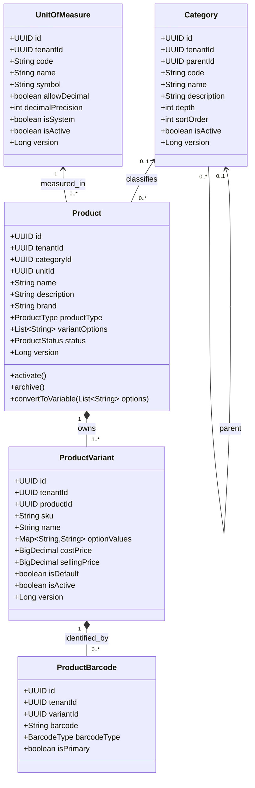
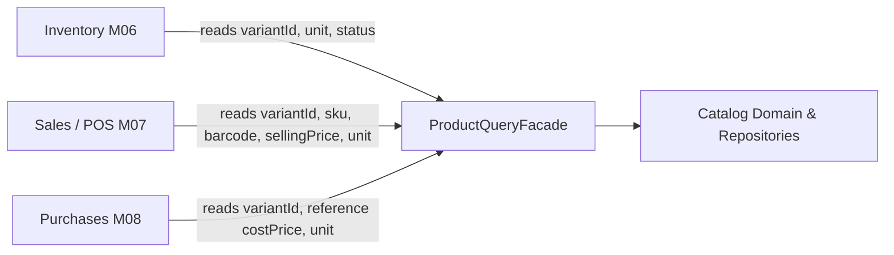

# SAVDOCRM — Milestone 05: Product Catalog & Category Management Architecture

- **Status**: M05.1–M05.4 Implemented (Domain Model, Repositories, Core Services, Public Facade, REST API & RBAC); M05.5 Frontend Pending
- **Version**: 1.2.0
- **Context**: Milestone 05 — `Catalog` Bounded Context (`com.savdocrm.modules.catalog`)
- **Related ADRs**:
  - [ADR-0008](file:///home/izzatbek/Desktop/crm/docs/architecture/decisions/ADR-0008-catalog-product-aggregate-and-variant-model.md)
  - [ADR-0009](file:///home/izzatbek/Desktop/crm/docs/architecture/decisions/ADR-0009-catalog-category-hierarchy-uom-and-lifecycle.md)
  - [ADR-0010](file:///home/izzatbek/Desktop/crm/docs/architecture/decisions/ADR-0010-catalog-pricing-ownership-and-module-integration.md)

---

## 1. Executive Summary & Retail Industry Scope

The **Catalog** bounded context (`com.savdocrm.modules.catalog`) is the single authoritative owner of product identity, SKU/barcode identification, hierarchical product classification, and base measurement unit definitions across SAVDOCRM.

It is designed to support diverse SMB retail verticals without vertical-specific code branches or separate product tables:

| Retail Vertical | Core Modeling Requirement | How M05 Catalog Supports It |
| :--- | :--- | :--- |
| **Grocery & Supermarkets** | Fast barcode scanning, multi-barcode packaging, fractional weight/volume (`kg`, `g`, `l`) | `SIMPLE` product with 1 default `ProductVariant`, `0..N` rows in `product_barcodes` (`EAN13`, `UPC_A`, `INTERNAL`), `UnitOfMeasure` with `allowDecimal = true`, `decimalPrecision = 3` |
| **Clothing & Footwear** | Size × Color matrices under a single style | `VARIABLE` product (`variantOptions = ["Size", "Color"]`) with distinct `ProductVariant` SKUs and `optionValues` JSONB |
| **Electronics & Appliances** | Storage/RAM configurations, distinct pricing per spec, manufacturer barcodes | `VARIABLE` product (`variantOptions = ["Storage", "Color"]`) with variant-level `sellingPrice`, `costPrice`, and barcodes; serial/IMEI tracking deferred to Inventory |
| **Cosmetics & Household Goods** | Shades, volumes, multipacks, brand search | `SIMPLE` or `VARIABLE` product with `brand`, `optionValues` (`Shade`, `Volume`), and multiple barcodes |
| **Building Materials & General Retail** | Pieces, meters, bags, rolls, unbarcoded SKU lookup | System-seeded + tenant-customizable `UnitOfMeasure` (`M`, `PCS`, `BAG`, `ROLL`), optional barcodes (`0..N`), mandatory unique `sku` |

---

## 2. Bounded Context & Strict Ownership Boundaries

### 2.1 What Catalog Owns
- **Product identity & lifecycle**: `Product` conceptual parent (`DRAFT`, `ACTIVE`, `ARCHIVED`).
- **Transactable SKU identity**: `ProductVariant` (SKU, variant display name, `optionValues`, active status, reference `sellingPrice` and reference `costPrice`).
- **Classification**: Self-referential `Category` hierarchy (`product_categories`).
- **Identifiers**: Multi-barcode registry (`ProductBarcode` / `product_barcodes`) per variant.
- **Units of Measurement**: System-seeded and tenant-customizable `UnitOfMeasure` (`units_of_measure`).

### 2.2 What Catalog Does NOT Own
- **Stock quantities, warehouse balances, stock reservations, or Weighted Average Cost (WAC)**: Owned strictly by `Inventory` (`M06`).
- **Purchase orders, supplier quotes, or goods receipts**: Owned strictly by `Purchases` (`M08`).
- **Sales orders, POS checkout lines, cart discounts, promotional rules, or branch price overrides**: Owned strictly by `Sales` (`M07`).
- **Financial accounts, tax ledgers, COGS postings, or AR/AP balances**: Owned strictly by `Finance` (`M09`).
- **Customer or Supplier master data**: Owned strictly by `Parties` (`M07`/`M08`).
- **Binary media storage (S3/MinIO image uploads)**: Explicitly deferred out of M05 to keep M05 focused on core catalog integrity.

### 2.3 Cross-Module Dependency Rule
- `Catalog` depends only on `shared` (`BaseTenantEntity`, `TenantAwareRepository`, `TenantContextHolder`, `ApiResponse`, `GlobalExceptionHandler`) and `Tenancy` (`tenants(id)` FK at DB level; tenant bootstrap integration when seeding default units).
- `Catalog` **never** imports or calls `Inventory`, `Sales`, `Purchases`, `Parties`, or `Finance`.
- Downstream modules (`Inventory`, `Sales`, `Purchases`) reference `variant_id` (UUID) and read catalog snapshots exclusively via `ProductQueryFacade` (`com.savdocrm.modules.catalog.application.facade`), never by injecting Catalog repositories or traversing Catalog JPA entities.

---

## 3. Domain Model Design

### 3.1 Aggregates & Entities

#### Aggregate 1: `Product` (Aggregate Root) + `ProductVariant` + `ProductBarcode`
- **`Product` (Aggregate Root)** owns its child `ProductVariant` entities and each variant's `ProductBarcode` entities.
  - Why single aggregate boundary? A `SIMPLE` product must atomically create its default `ProductVariant` (and optional initial barcode) in the same ACID transaction; a `VARIABLE` product must validate `variantOptions` consistency across its `ProductVariant` children and prevent `ACTIVE` status when zero active variants exist.
  - For large `VARIABLE` products, variants and barcodes also have direct sub-resource endpoints backed by `ProductService` loading/locking the parent `Product` or composite-FK-scoped `ProductVariant` within the aggregate invariant checks.

#### Aggregate 2: `Category`
- Independent aggregate root representing a node in the tenant's category hierarchy (`Adjacency List` via `parentId`).
- Kept separate from `Product` so category restructuring does not lock product rows.

#### Aggregate 3: `UnitOfMeasure`
- Independent aggregate root representing a tenant-owned measurement unit (`PCS`, `KG`, `G`, `L`, `ML`, `M`, `BOX`, `PACK`, or tenant custom units).

### 3.2 Field-by-Field Evaluation (`Product` & `ProductVariant`)

| Candidate Field | Decision | Owner | Mandatory | Rationale |
| :--- | :--- | :--- | :--- | :--- |
| `id` | **Include** | `Product` / `ProductVariant` | Yes | UUID primary key via `BaseEntity` |
| `tenantId` | **Include** | `Product` / `ProductVariant` | Yes | Mandatory tenant discriminator via `BaseTenantEntity` (`NOT NULL`) |
| `name` | **Include** | `Product` | Yes | Conceptual display title (`VARCHAR(200)`) |
| `description` | **Include** | `Product` | No | Optional product notes/specification (`TEXT`) |
| `brand` | **Include (String)** | `Product` | No | Optional `VARCHAR(100)` column in M05; avoids premature `brands` table/CRUD |
| `productType` | **Include** | `Product` | Yes | `SIMPLE` or `VARIABLE` (`ProductType` enum) |
| `variantOptions` | **Include** | `Product` | Conditional | Ordered option keys (e.g. `["Size", "Color"]`, max 3); empty `[]` for `SIMPLE`, non-empty for `VARIABLE` |
| `categoryId` | **Include** | `Product` | No | Nullable UUID referencing `product_categories(tenant_id, id)`; allows fast onboarding without forcing category setup first |
| `unitId` | **Include** | `Product` | Yes | Mandatory UUID referencing `units_of_measure(tenant_id, id)` |
| `status` | **Include** | `Product` | Yes | `ProductStatus` (`DRAFT`, `ACTIVE`, `ARCHIVED`) |
| `sku` | **Move to `ProductVariant`** | `ProductVariant` | Yes | Every sellable/stockable SKU has its own unique code; avoids dual SKU on `Product` + `ProductVariant` |
| `variantName` (`name`) | **Include on `ProductVariant`** | `ProductVariant` | Yes | Computed or explicit label (e.g., `"Default"` or `"Black / M"`) |
| `optionValues` | **Include on `ProductVariant`** | `ProductVariant` | Yes | `JSONB` key-value map matching `Product.variantOptions` (`{}` for `SIMPLE`) |
| `barcode` | **Move to `ProductBarcode`** | `ProductBarcode` | No (`0..N`) | Explicit table allows `0`, `1`, or multiple barcodes per variant without comma-separated hacks |
| `sellingPrice` | **Include on `ProductVariant`** | `ProductVariant` | Yes (`>= 0`) | `BigDecimal` (`NUMERIC(15,4)`). Catalog base list price; `Sales` snapshots `unitPrice` at sale time |
| `costPrice` | **Include as Reference** | `ProductVariant` | Yes (`>= 0`, default `0`) | `BigDecimal` (`NUMERIC(15,4)`). Catalog reference/default purchase cost only; `Inventory` owns true Weighted Average Cost (WAC) |
| `taxRate` | **Defer to Finance/Sales** | Deferred | No | Tax jurisdictions and exemptions belong to Finance/Sales configuration, not M05 Catalog |
| `imageUrl` / images | **Defer to Media milestone** | Deferred | No | S3/MinIO upload lifecycle is out of M05 scope |
| `createdAt/updatedAt/createdBy/updatedBy/version` | **Include** | Both | Yes | Inherited from `BaseEntity` for auditing and optimistic locking (`@Version`) |

### 3.3 Value Objects & Enums
- **`ProductType`**:
  - `SIMPLE`: Exactly 1 default `ProductVariant` (`isDefault = true`, `optionValues = {}`). UI presents a flat product form without variant matrix complexity.
  - `VARIABLE`: `1..N` `ProductVariant` rows differentiated by `Product.variantOptions` (1 to 3 option names).
- **`ProductStatus`**:
  - `DRAFT`: Being prepared; cannot be sold in POS or received in Inventory.
  - `ACTIVE`: Available for sales, purchases, and inventory operations.
  - `ARCHIVED`: Discontinued; hidden from default POS/purchase pickers, **never** physically deleted if referenced, historical records remain readable.
- **`BarcodeType`**:
  - `EAN13`, `EAN8`, `UPC_A`, `CODE128`, `INTERNAL`, `OTHER`.
- **`Money` / Price precision**:
  - `BigDecimal` with scale 4 (`NUMERIC(15,4)`), `RoundingMode.HALF_UP`, strictly `>= 0`.
- **`Quantity` precision (for UOM)**:
  - `BigDecimal` with up to 3 decimal places (`NUMERIC(12,3)`), `decimalPrecision` in `0..3`.

---

## 4. Product Variants Decision (Options Evaluated)

| Criterion | Option A: Simple Products Only | Option B: Unified Product + Variant (`SIMPLE` / `VARIABLE`) *(Selected)* | Option C: Full Attribute Matrix Configurator |
| :--- | :--- | :--- | :--- |
| **Retail Fit** | Fails clothing/electronics (requires 12 duplicate products for 1 shirt) | Supports grocery (1 default variant) AND clothing/electronics (`1..N` variants) | Supports complex B2B manufacturing, overkill for SMB retail |
| **Schema Complexity** | 1 table (`products`) | 2 core tables (`products`, `product_variants`) + `product_barcodes` | 6+ tables (`attribute_definitions`, `attribute_values`, `variant_values`, rules) |
| **Inventory & Sales FK** | References `product_id` -> **breaking redesign** when variants are added later | Always references `variant_id` uniformly (`SIMPLE` and `VARIABLE` identical) | References `variant_id` |
| **UX for Grocery** | Flat form | Flat form for `SIMPLE` (backend auto-creates default variant transparently) | Forces attribute setup before product creation |
| **Migration Path** | Breaking migration required for Inventory, Sales, Purchases | Non-breaking: `SIMPLE` can convert to `VARIABLE` while preserving `variant_id` | High upfront complexity |

**Decision**: Adopt **Option B** — every `Product` owns `1..N` `ProductVariant` rows (`SIMPLE` = 1 auto-managed default variant; `VARIABLE` = `1..N` option-based variants using validated `variantOptions` + `optionValues` JSONB).

---

## 5. Product Categories Design

- **Hierarchy Model**: Self-referential **Adjacency List** (`parent_id UUID NULL` referencing `product_categories(tenant_id, id) ON DELETE RESTRICT`).
- **Depth Limit**: Bounded to **5 levels** (`depth` `0..4`, root categories have `depth = 0`). Prevents pathological recursion and simplifies UI dropdown indentation.
- **Direct Product Assignment**: Products may be assigned to **any active category** (root or child), not only leaf nodes.
- **Ordering**: `sortOrder` (`INT`, default `0`), sorted by `(sortOrder ASC, name ASC)`.
- **Uniqueness**:
  - `code`: Normalized uppercase (`^[A-Z0-9_-]{2,50}$`), unique per tenant (`uq_categories_tenant_code`).
  - `name`: Unique among siblings within the same `(tenant_id, parent_id)` (enforced via partial unique indexes for root vs non-root siblings).
- **Circular Reference Prevention**:
  - DB `CHECK (parent_id IS NULL OR parent_id <> id)` blocks direct self-reference.
  - Application layer (`CategoryService`) walks the parent chain up to `MAX_DEPTH` on create/update/move and rejects any cycle (`A -> B -> A`) or depth overflow (`400 Bad Request` / `409 Conflict`).
- **Deactivation & Deletion Rules**:
  - **Deactivation (`isActive = false`)**: Rejected (`409 Conflict`) if the category still has active child categories (`isActive = true`). Existing products referencing a deactivated category retain their link for historical integrity, but **new** products or category reassignments cannot target an inactive category (`400 Bad Request`).
  - **Deletion (`DELETE`)**: Rejected (`409 Conflict`) if the category has any child categories OR any products (including `ARCHIVED` products) referencing it (`ON DELETE RESTRICT` at PostgreSQL level). Only completely unused categories can be physically deleted.

---

## 6. SKU and Barcode Strategy

- **SKU Ownership & Rules**:
  - Every `ProductVariant` has a mandatory `sku` (`VARCHAR(100)`), trimmed and normalized to uppercase (matching `Branch.code` and `Role.code` conventions).
  - Format: `^[A-Z0-9._-]{2,100}$` (supports retail codes like `COKE-1.5L`, `TSH-BLK-M`, `48200123`).
  - Uniqueness: `UNIQUE (tenant_id, sku)` — different tenants may use the same SKU; within one tenant, SKUs never collide even across `SIMPLE` and `VARIABLE` products.
- **Barcode Ownership & Rules**:
  - Explicitly modeled in `product_barcodes` (`0..N` per `ProductVariant`).
  - **Empty/null**: Never stored as blank strings; variants without barcodes simply have 0 rows in `product_barcodes`.
  - **Normalization**: Trimmed string (`VARCHAR(100)`, non-blank). Preserves exact case for Code-128 or normalized digits for EAN/UPC.
  - **Uniqueness**: `UNIQUE (tenant_id, barcode)` ensures fast, unambiguous `O(log N)` POS scanner lookup (`GET /api/v1/products/lookup?barcode=...` or `ProductQueryFacade.findByBarcode`). Different tenants can sell identical manufacturer EAN-13 codes independently.
  - **Primary Barcode**: At most one `is_primary = true` per variant via PostgreSQL partial unique index.

---

## 7. Unit of Measurement Strategy

- **Ownership**: Tenant-owned (`units_of_measure` with `tenant_id NOT NULL`).
- **System Seeding + Custom Units**:
  - Standard retail units (`PCS` [0 dec], `KG` [3 dec], `G` [0 dec], `L` [3 dec], `ML` [0 dec], `M` [2 dec], `BOX` [0 dec], `PACK` [0 dec]) are seeded per tenant during tenant onboarding/migration with `is_system = true`.
  - Tenants can create additional custom units (`is_system = false`) and deactivate custom units, while system units cannot be deleted.
  - Strict tenant ownership enables a **composite foreign key** `FOREIGN KEY (tenant_id, unit_id) REFERENCES units_of_measure(tenant_id, id) ON DELETE RESTRICT`, impossible with nullable global rows.
- **Quantities & Precision**:
  - `allowDecimal` (`BOOLEAN`) and `decimalPrecision` (`SMALLINT`, `0..3`) guide frontend input validation and downstream `BigDecimal` `NUMERIC(12,3)` quantity rounding.
- **Conversion Factors (Deferred)**:
  - Multi-unit pack-to-base conversion (`1 BOX = 24 PCS`) is **explicitly deferred** to M06 Inventory / M08 Purchases when purchase receipt unit conversion and POS pack-selling are designed. M05 stores the product's canonical stock/base unit.

---

## 8. Domain Invariants & Business Rules

### 8.1 Database-Enforced Invariants
1. `tenant_id UUID NOT NULL` on every Catalog table; composite candidate keys `(tenant_id, id)`.
2. Composite FKs across all relationships (`products -> categories`, `products -> units_of_measure`, `product_variants -> products`, `product_barcodes -> product_variants`, `categories -> categories(parent_id)`).
3. `CHECK` constraints:
   - `product_categories`: `parent_id IS NULL OR parent_id <> id`, `depth >= 0 AND depth <= 4`.
   - `units_of_measure`: `decimal_precision BETWEEN 0 AND 3`, `(allow_decimal = true OR decimal_precision = 0)`.
   - `products`: `product_type IN ('SIMPLE', 'VARIABLE')`, `status IN ('DRAFT', 'ACTIVE', 'ARCHIVED')`.
   - `product_variants`: `cost_price >= 0`, `selling_price >= 0`, `jsonb_typeof(option_values) = 'object'`.
4. Uniqueness constraints:
   - `uq_categories_tenant_code (tenant_id, code)`
   - `uq_uom_tenant_code (tenant_id, code)`
   - `uq_product_variants_tenant_sku (tenant_id, sku)`
   - `uq_product_variants_product_options (tenant_id, product_id, option_values)` (prevents duplicate Size/Color combinations on the same product)
   - `uq_product_barcodes_tenant_code (tenant_id, barcode)`
   - Partial unique index `uq_product_barcodes_primary_variant` on `(tenant_id, variant_id) WHERE is_primary = true`
5. Non-destructive foreign keys (`ON DELETE RESTRICT`) on `category_id`, `unit_id`, and `parent_id`; future `Inventory` and `Sales` tables will reference `product_variants(tenant_id, id) ON DELETE RESTRICT`.

### 8.2 Application-Layer Invariants
1. **Tenant Context**: Every service method resolves `tenantId` via `TenantContextHolder.getRequiredTenantId()`.
2. **Category Cycle & Depth Guard**: Creating or re-parenting a category traverses ancestors inside the transaction, rejecting cycles (`409 Conflict`) and depth > 4 (`400 Bad Request`).
3. **Active Category Assignment Guard**: Assigning a product to an inactive category on create or update is rejected (`400 Bad Request`).
4. **Product Type Integrity**:
   - `SIMPLE` products maintain **exactly 1** default `ProductVariant` (`isDefault = true`, `optionValues = {}`). Direct creation of extra variants on a `SIMPLE` product is rejected (`400 Bad Request`) unless explicitly converted to `VARIABLE`.
   - `VARIABLE` products require `1..3` non-empty unique `variantOptions` keys, and every variant's `optionValues` must contain exact keys matching `Product.variantOptions` with non-blank string values.
5. **Lifecycle & Deletion Rules**:
   - `ProductStatus` transitions: `DRAFT -> ACTIVE | ARCHIVED`, `ACTIVE -> ARCHIVED`, `ARCHIVED -> ACTIVE`.
   - An `ACTIVE` product must have at least 1 active `ProductVariant`.
   - `DELETE /api/v1/products/{productId}`: In M05 (before Inventory/Sales exist, or whenever a product has zero downstream ledger references), unused `DRAFT` products may be physically deleted, while `ACTIVE` or historically referenced products are **archived (`status = ARCHIVED`, variants deactivated)** rather than destroyed.
6. **Variant Deactivation Guard**: Cannot deactivate the sole remaining active variant of an `ACTIVE` product without archiving the product (`400 Bad Request` / `409 Conflict`).

---

## 9. Module Integration & Future Compatibility

- **`ProductQueryFacade` (`com.savdocrm.modules.catalog.application.facade`)**:
  - `Optional<VariantCatalogDto> findVariantById(UUID tenantId, UUID variantId)`
  - `List<VariantCatalogDto> findVariantsByIds(UUID tenantId, Set<UUID> variantIds)`
  - `Optional<VariantCatalogDto> findActiveVariantByBarcode(UUID tenantId, String barcode)`
  - `Optional<VariantCatalogDto> findActiveVariantBySku(UUID tenantId, String sku)`
- **`VariantCatalogDto`** exposes: `variantId`, `productId`, `productName`, `variantName`, `sku`, `primaryBarcode`, `optionValues`, `unitId`, `unitCode`, `unitSymbol`, `allowDecimal`, `decimalPrecision`, `referenceCostPrice`, `sellingPrice`, `productStatus`, `variantActive`, `sellable` (`productStatus == ACTIVE && variantActive`).
- **Zero Circular Dependencies**: `Inventory`, `Sales`, and `Purchases` depend on `Catalog`'s public facade DTOs; `Catalog` has zero dependencies on any downstream module.
- **Cross-Module Deletion Hook (M06+)**: When `Inventory` and `Sales` are introduced, PostgreSQL `ON DELETE RESTRICT` FKs (`inventory_stocks.variant_id`, `inventory_transactions.variant_id`, `sale_items.variant_id`, `purchase_order_items.variant_id`) physically prevent deleting referenced variants, and `ProductService.deleteOrArchiveProduct` falls back to `ARCHIVED` on constraint/reference detection (mirroring M04's `RoleService.deleteOrDeactivateRole` pattern).

---

## 10. Implemented M05.3 Domain, Services & Concurrency Architecture

### 10.1 Implemented Entities & Aggregate Boundaries
- **`ProductCategory` (`product_categories`, extends `BaseTenantEntity`)**: Independent aggregate root managing adjacency-list classification (`parentId`, `depth` `0..4`, `sortOrder`, `isActive`).
- **`UnitOfMeasure` (`units_of_measure`, extends `BaseTenantEntity`)**: Independent aggregate root managing tenant-owned units, `decimalPrecision` (`0..3`), `allowDecimal` consistency, and `isSystem` immutability (`PCS`, `KG`, `G`, `L`, `ML`, `M`, `BOX`, `PACK`).
- **`Product` (`products`, extends `BaseTenantEntity`)**: Aggregate root owning `ProductType` (`SIMPLE` | `VARIABLE`), `ProductStatus` (`DRAFT` | `ACTIVE` | `ARCHIVED`), and bounded `variantOptions` JSONB (`0` for `SIMPLE`, `1..3` unique non-blank keys for `VARIABLE`).
- **`ProductVariant` (`product_variants`, extends `BaseTenantEntity`)**: Child entity belonging to `Product` (`productId` UUID FK), owning normalized uppercase `sku`, `optionValues` JSONB, `BigDecimal` `NUMERIC(15,4)` `costPrice`/`sellingPrice`, `isDefault`, and `isActive`.
- **`ProductBarcode` (`product_barcodes`)**: Child entity belonging to `ProductVariant` (`variantId` UUID FK). Matches the M05.2 schema by omitting `@Version`; concurrent primary-barcode updates are serialized by locking the owning `ProductVariant` (`findByTenantIdAndIdWithLock`).

### 10.2 Repositories & Tenant Isolation
- `ProductCategoryRepository`, `UnitOfMeasureRepository`, `ProductRepository`, and `ProductVariantRepository` extend `TenantAwareRepository<T, UUID>`.
- `ProductBarcodeRepository` extends `JpaRepository<ProductBarcode, UUID>` with explicit `tenantId`-scoped methods (`findByTenantIdAndId`, `findByTenantIdAndIdWithLock`, `findAllByTenantId`, `existsByTenantIdAndId`, `deleteByTenantIdAndId`, `findByTenantIdAndBarcode`, `existsByTenantIdAndBarcode`, `findAllByTenantIdAndVariantId...`) and `InCurrentTenant` helpers. It intentionally cannot extend `TenantAwareRepository<T extends BaseTenantEntity, UUID>` because `BaseTenantEntity` inherits `@Version` from `BaseEntity`, whereas the approved M05.2 `product_barcodes` table omits a `version` column (`hibernate.ddl-auto=validate`).
- All application services (`ProductCategoryService`, `UnitOfMeasureService`, `ProductService`, `ProductVariantService`, `ProductBarcodeService`) and `ProductQueryFacadeImpl` resolve `tenantId` exclusively from `TenantContextHolder.getRequiredTenantId()`, failing closed with `TenantContextMissingException` when absent and returning `*NotFoundException` (or `Optional.empty()` in facade queries) for cross-tenant IDs.

### 10.3 Category Hierarchy Integrity
- All structural category mutations (`createCategory`, `updateCategory`, `moveCategory`, `deactivateCategory`, `activateCategory`, `deleteCategory`) acquire a pessimistic write lock on the owning `Tenant` row (`TenantRepository.findByIdWithLock`) followed by `ProductCategory` (`Tenant -> ProductCategory` lock order) to serialize concurrent hierarchy changes and prevent `A -> B` / `B -> A` race cycles, parent-deactivation/child-creation races, and depth-overflow races.
- `moveCategory` walks at most `MAX_DEPTH + 1` ancestor hops via `findByTenantIdAndId` (cycle detection) and traverses only the moved node's subtree level-by-level via `findAllByTenantIdAndParentIdIn` (avoiding full-tree loading) to validate `newDepth + subtreeHeight <= 4` and atomically shift descendant depths.

### 10.4 Product/Variant Invariants, Lifecycle, Transactions & Concurrency
- All mutating operations run inside `@Transactional` application service boundaries.
- `ProductService.createProduct` atomically validates and persists the `Product`, its initial `ProductVariant`(s) (enforcing `>= 1` variant, `== 1` default variant, and `== 1` variant for `SIMPLE`), and initial `ProductBarcode`(s); any failure rolls back the entire aggregate.
- `ProductService.archiveProduct` transitions the product to `ARCHIVED` and deactivates all variants while preserving `product_variants.is_default` as the historical default marker. `ProductDto.activeDefaultVariant()` and `ProductVariantDto.isActiveDefault()` (as well as `VariantCatalogDto.activeDefault()`) explicitly distinguish active selectable defaults (`false` when `ARCHIVED` or inactive) from the historical default marker (`ProductDto.historicalDefaultVariant()`). `ProductService.restoreProduct` (and `ARCHIVED -> ACTIVE` in `changeProductStatus`) atomically reactivates the historical default variant and restores `ACTIVE` status. Archived products reject direct variant mutations until restored.
- `ProductVariantService` acquires `PESSIMISTIC_WRITE` on the parent `Product` (`findByTenantIdAndIdWithLock`) before adding, updating, deactivating, or changing the default variant, unmarking the old default with `saveAndFlush` prior to promoting the new active default.
- `ProductBarcodeService` acquires `PESSIMISTIC_WRITE` on the owning `ProductVariant` and re-loads the target `ProductBarcode` with `findByTenantIdAndIdWithLock` before updates, primary swaps, or removals.
- `CatalogConstraintTranslator` translates PostgreSQL unique-constraint race exceptions (`uq_product_variants_tenant_sku`, `uq_product_variants_product_options`, `uq_product_barcodes_tenant_barcode`, etc.) into domain exceptions without exposing SQL details.

### 10.5 New-Tenant UOM Bootstrap
- Both `AuthService.register` and `TenantService.createTenant` publish a synchronous in-transaction `TenantCreatedEvent`, handled by `CatalogTenantBootstrapListener` -> `UnitOfMeasureService.initializeStandardUnitsForCurrentTenant()` via `TenantExecutionTemplate`. This establishes a single authoritative, idempotent UOM bootstrap mechanism with zero direct `Identity -> Catalog` dependency; any failure rolls back tenant registration/creation atomically.

### 10.6 Implemented M05.4 REST API & RBAC Integration
- **Controllers (`com.savdocrm.modules.catalog.web`)**: `ProductController` (`/api/v1/products`), `ProductVariantController` (`/api/v1/products/{productId}/variants`), `ProductCategoryController` (`/api/v1/categories`), and `UnitOfMeasureController` (`/api/v1/units`).
- **DTOs & MapStruct**: Request/response records under `web.dto.request` / `web.dto.response` mapped via `CatalogWebMapper`, wrapped in `ApiResponse<T>` and `PageResponse<T>` with RFC 7807 `ProblemDetail` errors.
- **Database-Level Pagination & Tree Query (`CatalogQueryService`)**: Paginated product search uses `JpaSpecificationExecutor<Product>` (`tenantId`-scoped `Criteria` + escaped `LIKE` + `IN`/subqueries), allowlisted sort fields (`name`, `createdAt`, `updatedAt`, `status`, `brand`, `productType`), and O(1) batch assembly; category tree assembly builds the hierarchy in memory from a single sorted query.
- **RBAC Scope Enforcement**: Catalog read endpoints require `TENANT` scope (`hasPermission`) when optional `branchId` is omitted and evaluate `hasBranchPermission` when `branchId` is provided (so single-branch assignments cannot grant unrestricted tenant-wide access without `?branchId=`), while all catalog writes enforce `TENANT` scope via `hasPermission` (with archive and draft deletion gated by `catalog.products.delete`).

### 10.7 Known Limitations & Deferred Scope (M05.5+)
- **M05.4 Behavioral Notes**: `DELETE /api/v1/products/{productId}` physically deletes `DRAFT` products only (`ACTIVE` products use `POST /archive` or `PATCH /status`); UOM writes reuse `catalog.categories.manage` (`TENANT` scope) per `ADR-0010` without adding a 34th permission.
- **Deferred to M05.5 / M06+**: Frontend FSD UI, image upload/storage, inventory stock ledger, pricing history, and multi-unit UOM conversions.
