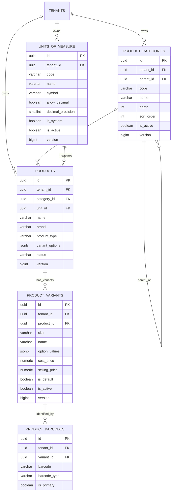

# SAVDOCRM — Milestone 05: Catalog Database Design & Schema Specification

- **Status**: Implemented & Verified in M05.2 (Liquibase changesets `v1.0.0/16-*` through `v1.0.0/21-*`)
- **Version**: 1.0.0
- **Target Migration**: Milestone 05.2 (`v1.0.0/16-create-product-categories.xml` through `v1.0.0/21-create-product-barcodes.xml`)
- **Database Engine**: PostgreSQL 16+

---

## 1. Multi-Tenancy & Relational Integrity Rules

All Catalog tables follow the SAVDOCRM shared-schema multi-tenancy standard established in Milestones 01–04:

1. **Mandatory Tenant Ownership**: Every Catalog table has `tenant_id UUID NOT NULL` referencing `tenants(id)`.
2. **Composite Candidate Keys**: Every parent table declares `UNIQUE (tenant_id, id)` so all child foreign keys reference `(tenant_id, parent_id)`. Cross-tenant category, unit, product, variant, or barcode links are mathematically impossible at the PostgreSQL storage engine level.
3. **Audit & Optimistic Locking**: Core mutable aggregates (`product_categories`, `units_of_measure`, `products`, `product_variants`) include `created_at`, `updated_at`, `created_by`, `updated_by`, and `version BIGINT NOT NULL DEFAULT 0` (matching `BaseEntity` / `BaseTenantEntity`).
4. **Precision Standards**:
   - Monetary values (`cost_price`, `selling_price`): `NUMERIC(15, 4)`
   - Quantities (used by downstream modules guided by UOM precision): `NUMERIC(12, 3)`
5. **Non-Destructive Deletion**: Business references (`category_id`, `unit_id`, `parent_id`, and future `Inventory`/`Sales` references to `variant_id`) use `ON DELETE RESTRICT`.

---

## 2. Entity-Relationship Diagram (Catalog + Downstream Anchors)



---

## 3. Proposed Tables & Necessity Justification

| Table | Purpose | Justification |
| :--- | :--- | :--- |
| `product_categories` | Hierarchical tenant categories (`Adjacency List`) | Required for classification, catalog filtering, and bounded hierarchy (`depth <= 4`). |
| `units_of_measure` | Tenant-scoped measurement units (`PCS`, `KG`, `L`, custom) | Required to validate decimal vs integer retail quantities across grocery, hardware, and clothing using composite FK `(tenant_id, unit_id)`. |
| `products` | Conceptual product parent & shared taxonomy | Holds shared title, brand, category, unit, `product_type`, `variant_options`, and `status`. |
| `product_variants` | Transactable SKU, pricing, and option combination | Eliminates future breaking redesign across Inventory/POS; `SIMPLE` products have 1 default row, `VARIABLE` products have `1..N` rows. |
| `product_barcodes` | Multiple barcodes (`0..N`) per variant | Retail items frequently carry manufacturer EAN-13, inner-pack UPC, and store-printed labels; explicit table enforces `(tenant_id, barcode)` uniqueness without comma-separated values. |

*Explicitly NOT created in M05*: `brands` (stored as indexed optional `brand VARCHAR(100)` on `products`), `attribute_definitions` / `attribute_values` (replaced by bounded `JSONB` `variant_options` / `option_values`), `product_images` (deferred to media/S3 milestone), and `unit_conversions` (deferred to M06 Inventory / M08 Purchases).

---

## 4. Table Definitions, Constraints & Indexes

### 4.1 `product_categories`
```sql
CREATE TABLE product_categories (
    id              UUID PRIMARY KEY,
    tenant_id       UUID NOT NULL,
    parent_id       UUID,
    code            VARCHAR(50) NOT NULL,
    name            VARCHAR(120) NOT NULL,
    description     TEXT,
    depth           INTEGER NOT NULL DEFAULT 0,
    sort_order      INTEGER NOT NULL DEFAULT 0,
    is_active       BOOLEAN NOT NULL DEFAULT TRUE,
    created_at      TIMESTAMP WITH TIME ZONE NOT NULL DEFAULT CURRENT_TIMESTAMP,
    updated_at      TIMESTAMP WITH TIME ZONE NOT NULL DEFAULT CURRENT_TIMESTAMP,
    created_by      UUID,
    updated_by      UUID,
    version         BIGINT NOT NULL DEFAULT 0,

    CONSTRAINT uq_product_categories_tenant_id UNIQUE (tenant_id, id),
    CONSTRAINT uq_product_categories_tenant_code UNIQUE (tenant_id, code),
    CONSTRAINT fk_product_categories_tenant
        FOREIGN KEY (tenant_id) REFERENCES tenants(id) ON DELETE CASCADE,
    CONSTRAINT fk_product_categories_parent
        FOREIGN KEY (tenant_id, parent_id) REFERENCES product_categories(tenant_id, id) ON DELETE RESTRICT,
    CONSTRAINT chk_product_categories_code_format
        CHECK (code ~ '^[A-Z0-9_-]{2,50}$'),
    CONSTRAINT chk_product_categories_name_not_blank
        CHECK (BTRIM(name) <> ''),
    CONSTRAINT chk_product_categories_no_self_parent
        CHECK (parent_id IS NULL OR parent_id <> id),
    CONSTRAINT chk_product_categories_depth
        CHECK (depth >= 0 AND depth <= 4)
);

-- Sibling name uniqueness (case-insensitive) for root and child nodes
CREATE UNIQUE INDEX uq_product_categories_root_name
    ON product_categories (tenant_id, LOWER(name))
    WHERE parent_id IS NULL;

CREATE UNIQUE INDEX uq_product_categories_child_name
    ON product_categories (tenant_id, parent_id, LOWER(name))
    WHERE parent_id IS NOT NULL;

CREATE INDEX idx_product_categories_tenant_parent
    ON product_categories (tenant_id, parent_id, sort_order, name);

CREATE INDEX idx_product_categories_tenant_active
    ON product_categories (tenant_id, is_active);
```

### 4.2 `units_of_measure`
```sql
CREATE TABLE units_of_measure (
    id                  UUID PRIMARY KEY,
    tenant_id           UUID NOT NULL,
    code                VARCHAR(20) NOT NULL,
    name                VARCHAR(80) NOT NULL,
    symbol              VARCHAR(15) NOT NULL,
    allow_decimal       BOOLEAN NOT NULL DEFAULT FALSE,
    decimal_precision   SMALLINT NOT NULL DEFAULT 0,
    is_system           BOOLEAN NOT NULL DEFAULT FALSE,
    is_active           BOOLEAN NOT NULL DEFAULT TRUE,
    created_at          TIMESTAMP WITH TIME ZONE NOT NULL DEFAULT CURRENT_TIMESTAMP,
    updated_at          TIMESTAMP WITH TIME ZONE NOT NULL DEFAULT CURRENT_TIMESTAMP,
    created_by          UUID,
    updated_by          UUID,
    version             BIGINT NOT NULL DEFAULT 0,

    CONSTRAINT uq_units_of_measure_tenant_id UNIQUE (tenant_id, id),
    CONSTRAINT uq_units_of_measure_tenant_code UNIQUE (tenant_id, code),
    CONSTRAINT fk_units_of_measure_tenant
        FOREIGN KEY (tenant_id) REFERENCES tenants(id) ON DELETE CASCADE,
    CONSTRAINT chk_units_of_measure_code_format
        CHECK (code ~ '^[A-Z0-9_-]{1,20}$'),
    CONSTRAINT chk_units_of_measure_name_not_blank
        CHECK (BTRIM(name) <> ''),
    CONSTRAINT chk_units_of_measure_symbol_not_blank
        CHECK (BTRIM(symbol) <> ''),
    CONSTRAINT chk_units_of_measure_precision
        CHECK (decimal_precision >= 0 AND decimal_precision <= 3),
    CONSTRAINT chk_units_of_measure_decimal_consistency
        CHECK (allow_decimal = TRUE OR decimal_precision = 0)
);

CREATE INDEX idx_units_of_measure_tenant_active
    ON units_of_measure (tenant_id, is_active);
```

Seeded system defaults via `v1.0.0/18-seed-standard-units-of-measure.xml` (`NOT EXISTS` idempotent per-tenant seed): `PCS`, `KG`, `G`, `L`, `ML`, `M`, `BOX`, `PACK` (`is_system = true`, `is_active = true`). For newly created tenants post-migration, `TenantBootstrapService` / registration bootstrap must seed these 8 standard units in M05.3.

### 4.3 `products`
```sql
CREATE TABLE products (
    id                  UUID PRIMARY KEY,
    tenant_id           UUID NOT NULL,
    category_id         UUID,
    unit_id             UUID NOT NULL,
    name                VARCHAR(200) NOT NULL,
    description         TEXT,
    brand               VARCHAR(100),
    product_type        VARCHAR(20) NOT NULL,
    variant_options     JSONB NOT NULL DEFAULT '[]'::jsonb,
    status              VARCHAR(20) NOT NULL DEFAULT 'ACTIVE',
    created_at          TIMESTAMP WITH TIME ZONE NOT NULL DEFAULT CURRENT_TIMESTAMP,
    updated_at          TIMESTAMP WITH TIME ZONE NOT NULL DEFAULT CURRENT_TIMESTAMP,
    created_by          UUID,
    updated_by          UUID,
    version             BIGINT NOT NULL DEFAULT 0,

    CONSTRAINT uq_products_tenant_id UNIQUE (tenant_id, id),
    CONSTRAINT fk_products_tenant
        FOREIGN KEY (tenant_id) REFERENCES tenants(id) ON DELETE CASCADE,
    CONSTRAINT fk_products_category
        FOREIGN KEY (tenant_id, category_id) REFERENCES product_categories(tenant_id, id) ON DELETE RESTRICT,
    CONSTRAINT fk_products_unit
        FOREIGN KEY (tenant_id, unit_id) REFERENCES units_of_measure(tenant_id, id) ON DELETE RESTRICT,
    CONSTRAINT chk_products_name_not_blank
        CHECK (BTRIM(name) <> ''),
    CONSTRAINT chk_products_type
        CHECK (product_type IN ('SIMPLE', 'VARIABLE')),
    CONSTRAINT chk_products_status
        CHECK (status IN ('DRAFT', 'ACTIVE', 'ARCHIVED')),
    CONSTRAINT chk_products_variant_options_array
        CHECK (
            jsonb_typeof(variant_options) = 'array'
            AND jsonb_array_length(variant_options) <= 3
            AND (
                (product_type = 'SIMPLE' AND jsonb_array_length(variant_options) = 0) OR
                (product_type = 'VARIABLE' AND jsonb_array_length(variant_options) >= 1)
            )
        )
);

CREATE INDEX idx_products_tenant_unit
    ON products (tenant_id, unit_id);

CREATE INDEX idx_products_tenant_status_created
    ON products (tenant_id, status, created_at DESC);

CREATE INDEX idx_products_tenant_category
    ON products (tenant_id, category_id)
    WHERE category_id IS NOT NULL;

CREATE INDEX idx_products_tenant_brand
    ON products (tenant_id, LOWER(brand))
    WHERE brand IS NOT NULL;

CREATE INDEX idx_products_tenant_name_lower
    ON products (tenant_id, LOWER(name));
```

### 4.4 `product_variants`
```sql
CREATE TABLE product_variants (
    id              UUID PRIMARY KEY,
    tenant_id       UUID NOT NULL,
    product_id      UUID NOT NULL,
    sku             VARCHAR(100) NOT NULL,
    name            VARCHAR(220) NOT NULL,
    option_values   JSONB NOT NULL DEFAULT '{}'::jsonb,
    cost_price      NUMERIC(15, 4) NOT NULL DEFAULT 0.0000,
    selling_price   NUMERIC(15, 4) NOT NULL DEFAULT 0.0000,
    is_default      BOOLEAN NOT NULL DEFAULT FALSE,
    is_active       BOOLEAN NOT NULL DEFAULT TRUE,
    created_at      TIMESTAMP WITH TIME ZONE NOT NULL DEFAULT CURRENT_TIMESTAMP,
    updated_at      TIMESTAMP WITH TIME ZONE NOT NULL DEFAULT CURRENT_TIMESTAMP,
    created_by      UUID,
    updated_by      UUID,
    version         BIGINT NOT NULL DEFAULT 0,

    CONSTRAINT uq_product_variants_tenant_id UNIQUE (tenant_id, id),
    CONSTRAINT uq_product_variants_tenant_sku UNIQUE (tenant_id, sku),
    CONSTRAINT uq_product_variants_product_options UNIQUE (tenant_id, product_id, option_values),
    CONSTRAINT fk_product_variants_tenant
        FOREIGN KEY (tenant_id) REFERENCES tenants(id) ON DELETE CASCADE,
    CONSTRAINT fk_product_variants_product
        FOREIGN KEY (tenant_id, product_id) REFERENCES products(tenant_id, id) ON DELETE RESTRICT,
    CONSTRAINT chk_product_variants_sku_format
        CHECK (sku ~ '^[A-Z0-9._-]{2,100}$'),
    CONSTRAINT chk_product_variants_name_not_blank
        CHECK (BTRIM(name) <> ''),
    CONSTRAINT chk_product_variants_prices
        CHECK (cost_price >= 0 AND selling_price >= 0),
    CONSTRAINT chk_product_variants_option_values_obj
        CHECK (jsonb_typeof(option_values) = 'object')
);

-- At most one default variant per product
CREATE UNIQUE INDEX uq_product_variants_default_per_product
    ON product_variants (tenant_id, product_id)
    WHERE is_default = TRUE;

CREATE INDEX idx_product_variants_tenant_product_active
    ON product_variants (tenant_id, product_id, is_active);
```

### 4.5 `product_barcodes`
```sql
CREATE TABLE product_barcodes (
    id              UUID PRIMARY KEY,
    tenant_id       UUID NOT NULL,
    variant_id      UUID NOT NULL,
    barcode         VARCHAR(100) NOT NULL,
    barcode_type    VARCHAR(30) NOT NULL DEFAULT 'EAN13',
    is_primary      BOOLEAN NOT NULL DEFAULT FALSE,
    created_at      TIMESTAMP WITH TIME ZONE NOT NULL DEFAULT CURRENT_TIMESTAMP,
    updated_at      TIMESTAMP WITH TIME ZONE NOT NULL DEFAULT CURRENT_TIMESTAMP,
    created_by      UUID,
    updated_by      UUID,

    CONSTRAINT uq_product_barcodes_tenant_id UNIQUE (tenant_id, id),
    CONSTRAINT uq_product_barcodes_tenant_barcode UNIQUE (tenant_id, barcode),
    CONSTRAINT fk_product_barcodes_tenant
        FOREIGN KEY (tenant_id) REFERENCES tenants(id) ON DELETE CASCADE,
    CONSTRAINT fk_product_barcodes_variant
        FOREIGN KEY (tenant_id, variant_id) REFERENCES product_variants(tenant_id, id) ON DELETE RESTRICT,
    CONSTRAINT chk_product_barcodes_not_blank
        CHECK (BTRIM(barcode) <> '' AND barcode = BTRIM(barcode)),
    CONSTRAINT chk_product_barcodes_type
        CHECK (barcode_type IN ('EAN13', 'EAN8', 'UPC_A', 'CODE128', 'INTERNAL', 'OTHER'))
);

CREATE UNIQUE INDEX uq_product_barcodes_primary_per_variant
    ON product_barcodes (tenant_id, variant_id)
    WHERE is_primary = TRUE;

CREATE INDEX idx_product_barcodes_tenant_variant
    ON product_barcodes (tenant_id, variant_id);
```

---

## 5. JSONB Justification & Query Performance Notes

- **Why `JSONB` is used ONLY for `variant_options` and `option_values`**:
  1. Different retail verticals define arbitrary option axes (`Size`/`Color`, `Storage`/`RAM`, `Shade`, `Grade`) without schema DDL changes.
  2. `option_values` is validated by `CHECK (jsonb_typeof(option_values) = 'object')` and deduplicated at the database level via `uq_product_variants_product_options (tenant_id, product_id, option_values)` (PostgreSQL `jsonb` equality is key-order independent).
  3. Transactional lookups (`sku`, `barcode`, `category_id`, `brand`, `status`) all live on typed relational B-Tree indexed columns (`VARCHAR`, `UUID`, `NUMERIC`), NOT inside `JSONB`.
- **Search Strategy (PostgreSQL 16, No Elasticsearch)**:
  - Prefix/exact SKU and barcode scans use unique B-Tree indexes on `(tenant_id, sku)` and `(tenant_id, barcode)`.
  - Name/SKU/barcode substring search (`ILIKE '%term%'`) for SMB tenant catalogs (`1,000`–`50,000` SKUs) uses `(tenant_id, ...)` composite scoping; if search volume grows, PostgreSQL `pg_trgm` GIN indexes can be added in a non-breaking migration with zero API or domain changes.

---

## 6. Deletion & Decommissioning Matrix

| Foreign Key | Action | Rationale |
| :--- | :--- | :--- |
| `fk_*_tenant` -> `tenants(id)` | `CASCADE` | Hard tenant deletion cleanly removes tenant catalog records when child dependencies are absent or cleared bottom-up. |
| `fk_product_categories_parent` -> `product_categories(tenant_id, id)` | `RESTRICT` | Prevents orphaned subtrees; parent cannot be deleted while children exist. |
| `fk_products_category` -> `product_categories(tenant_id, id)` | `RESTRICT` | Prevents silent loss of product classification; categories with products must be deactivated, not deleted. |
| `fk_products_unit` -> `units_of_measure(tenant_id, id)` | `RESTRICT` | Prevents deleting a unit of measure referenced by products. |
| `fk_product_variants_product` -> `products(tenant_id, id)` | `RESTRICT` | M05.2 hardening override: prevents accidental physical cascade deletion of products that have variants; operational lifecycle transitions use `status = 'ARCHIVED'`. |
| `fk_product_barcodes_variant` -> `product_variants(tenant_id, id)` | `RESTRICT` | M05.2 hardening override: prevents accidental physical cascade deletion of variants while barcodes remain attached; barcodes must be explicitly unassigned before variant purge. |

---

## 7. Database-Enforced vs Application-Layer Invariants

| Invariant | Enforcement Layer | Mechanism |
| :--- | :--- | :--- |
| Tenant isolation across all Catalog FKs | **Database** | Composite candidate keys `UNIQUE (tenant_id, id)` + composite FKs on `(tenant_id, *_id)` |
| Bounded hierarchy depth (`0..4`) & no self-parent | **Database** | `chk_product_categories_depth`, `chk_product_categories_no_self_parent` |
| Multi-hop ancestor cycle detection (`A -> B -> C -> A`) | **Application (M05.3)** | Service-layer ancestor walk prior to category reparenting (cannot be enforced cleanly with a row CHECK constraint) |
| At most one default variant / primary barcode | **Database** | Partial unique indexes `uq_product_variants_default_per_product`, `uq_product_barcodes_primary_per_variant` |
| At least one active/default variant & option schema parity | **Application (M05.3)** | Domain service validates variant presence, default promotion, and `Product.variantOptions` vs `ProductVariant.optionValues` keys |
| Seeding 8 standard UOMs for newly registered tenants | **Application (M05.3)** | `v1.0.0-18` seeds existing tenants idempotently at migration time; M05.3 registration bootstrap must create them for new tenants |
