# M06 — Inventory Management: Logical Database Schema & Design

> **Status**: Logical Schema Specification (M06.1 — Design Only; NO Liquibase XML written yet)  
> **Target Engine**: PostgreSQL 16 (shared database, shared `public` schema, row-level `tenant_id` isolation)  
> **Target Liquibase Sequence**: `v1.0.0/23` onwards (continuing after M05's `v1.0.0/22`)

---

## 1. Schema Design Principles & Classification

Every table in the Inventory schema obeys SAVDOCRM's multi-tenant relational invariants:

1. **Tenant Scoping**: Every business table carries `tenant_id UUID NOT NULL` (`FK -> tenants(id) ON DELETE RESTRICT`).
2. **Composite Uniqueness & Foreign Keys**: Parent entities expose `UNIQUE (tenant_id, id)` so every child and cross-reference uses composite foreign keys `(tenant_id, parent_id) -> parent(tenant_id, id)`. This prevents cross-tenant pointer forgery even at the SQL layer.
3. **Strict `ON DELETE RESTRICT` Policy**: Consistent with M04 (`v1.0.0/15`) and M05 (`v1.0.0/22`), **no `ON DELETE CASCADE`** is used on tenant, branch, catalog, warehouse, or ledger foreign keys.
4. **Standard Numeric Precision**:
   - Physical quantities: `NUMERIC(12,3)` (supports fractional weights/volumes up to 3 decimal places matching UOM rules)
   - Unit costs (`WAC`, receipt/return cost): `NUMERIC(15,4)`
   - Extended valuations & total costs: `NUMERIC(18,4)`
5. **Audit & Optimistic Locking**: Mutable tables inherit `created_at`, `updated_at`, `created_by`, `updated_by` (`TIMESTAMPTZ` / `UUID`), and `version BIGINT NOT NULL DEFAULT 0`. Immutable ledger tables omit mutable updates (`updated_at` absent or fixed; `version = 0`).

### Table Role Classification

| Classification | Tables | Mutability Rule |
|---|---|---|
| **Master Configuration** | `warehouses`, `stock_locations` | Mutable with stock/document deactivation guards; never hard-deleted once referenced |
| **Immutable Ledger (System of Record for Movements)** | `inventory_transactions`, `inventory_transaction_lines` | Strictly append-only (`INSERT` only; corrections via `REVERSAL` transaction) |
| **Materialized Stock Projections** | `inventory_balances` (location-level), `inventory_warehouse_stocks` (warehouse rollup), `inventory_costs` (WAC valuation) | Synchronized inside the same ACID transaction as ledger & reservation mutations; rebuildable from ledger/reservations/transfers |
| **Operational Documents** | `stock_receipts`, `stock_receipt_lines`, `stock_counts`, `stock_count_lines`, `stock_adjustments`, `stock_adjustment_lines`, `stock_transfers`, `stock_transfer_lines` | Mutable while pre-posted (`DRAFT`/`IN_PROGRESS`/`APPROVED`), immutable once posted/terminal |
| **Reservation Subsystem** | `inventory_reservations`, `inventory_reservation_lines` | Mutable lifecycle (`ACTIVE -> CONSUMED/RELEASED/EXPIRED`); updates `quantity_reserved` without writing ledger rows |
| **Shared Infrastructure** | `idempotency_records` (cross-module in `shared`) | Prevents duplicate ledger postings across network retries |

---

## 2. Entity-Relationship Diagram

```mermaid
erDiagram
    TENANTS ||--o{ WAREHOUSES : owns
    BRANCHES ||--o{ WAREHOUSES : "optionally links (0..N)"
    WAREHOUSES ||--o{ STOCK_LOCATIONS : contains

    WAREHOUSES ||--o{ INVENTORY_BALANCES : holds
    STOCK_LOCATIONS ||--o{ INVENTORY_BALANCES : segregates
    PRODUCT_VARIANTS ||--o{ INVENTORY_BALANCES : tracks

    WAREHOUSES ||--o{ INVENTORY_WAREHOUSE_STOCKS : summarizes
    PRODUCT_VARIANTS ||--o{ INVENTORY_WAREHOUSE_STOCKS : summarizes

    WAREHOUSES ||--o{ INVENTORY_COSTS : values
    PRODUCT_VARIANTS ||--o{ INVENTORY_COSTS : values

    WAREHOUSES ||--o{ INVENTORY_TRANSACTIONS : records
    INVENTORY_TRANSACTIONS ||--o{ INVENTORY_TRANSACTION_LINES : contains
    INVENTORY_TRANSACTIONS ||--o| INVENTORY_TRANSACTIONS : "reverses (self FK)"
    STOCK_LOCATIONS ||--o{ INVENTORY_TRANSACTION_LINES : touches
    PRODUCT_VARIANTS ||--o{ INVENTORY_TRANSACTION_LINES : moves

    WAREHOUSES ||--o{ STOCK_RECEIPTS : receives
    STOCK_RECEIPTS ||--o{ STOCK_RECEIPT_LINES : has
    STOCK_LOCATIONS ||--o{ STOCK_RECEIPT_LINES : "puts to"
    PRODUCT_VARIANTS ||--o{ STOCK_RECEIPT_LINES : receives

    WAREHOUSES ||--o{ STOCK_COUNTS : counts
    STOCK_COUNTS ||--o{ STOCK_COUNT_LINES : has
    STOCK_LOCATIONS ||--o{ STOCK_COUNT_LINES : inspects
    PRODUCT_VARIANTS ||--o{ STOCK_COUNT_LINES : counts

    WAREHOUSES ||--o{ STOCK_ADJUSTMENTS : adjusts
    STOCK_COUNTS ||--o| STOCK_ADJUSTMENTS : "optionally generates"
    STOCK_ADJUSTMENTS ||--o{ STOCK_ADJUSTMENT_LINES : has
    STOCK_LOCATIONS ||--o{ STOCK_ADJUSTMENT_LINES : targets
    PRODUCT_VARIANTS ||--o{ STOCK_ADJUSTMENT_LINES : adjusts

    WAREHOUSES ||--o{ STOCK_TRANSFERS : "sources / receives"
    STOCK_TRANSFERS ||--o{ STOCK_TRANSFER_LINES : ships
    STOCK_LOCATIONS ||--o{ STOCK_TRANSFER_LINES : "from / to location"
    PRODUCT_VARIANTS ||--o{ STOCK_TRANSFER_LINES : transfers

    WAREHOUSES ||--o{ INVENTORY_RESERVATIONS : reserves
    INVENTORY_RESERVATIONS ||--o{ INVENTORY_RESERVATION_LINES : allocates
    STOCK_LOCATIONS ||--o{ INVENTORY_RESERVATION_LINES : locks
    PRODUCT_VARIANTS ||--o{ INVENTORY_RESERVATION_LINES : reserves

    TENANTS ||--o{ USER_ROLE_ASSIGNMENTS : "scopes"
    WAREHOUSES ||--o{ USER_ROLE_ASSIGNMENTS : "explicit WAREHOUSE RBAC"
```

---

## 3. Logical Table Definitions (PostgreSQL 16)

> **Notation**: Common audit columns `(created_at TIMESTAMPTZ NOT NULL, updated_at TIMESTAMPTZ NOT NULL, created_by UUID, updated_by UUID, version BIGINT NOT NULL DEFAULT 0)` apply to all mutable entity tables unless noted as append-only. Composite uniqueness `UNIQUE (tenant_id, id)` is declared on every parent table referenced by composite FKs.

### 3.1 Master Tables: `warehouses` & `stock_locations`

#### `warehouses`
| Column | Type | Null | Default / Constraints |
|---|---|---|---|
| `id` | `UUID` | NO | PK |
| `tenant_id` | `UUID` | NO | FK `tenants(id) ON DELETE RESTRICT` |
| `branch_id` | `UUID` | YES | Composite FK `(tenant_id, branch_id) -> branches(tenant_id, id) ON DELETE RESTRICT` |
| `code` | `VARCHAR(32)` | NO | Uppercase normalized `[A-Z0-9_-]` |
| `name` | `VARCHAR(120)` | NO | |
| `warehouse_type` | `VARCHAR(24)` | NO | `CHECK IN ('RETAIL_STORE', 'CENTRAL_HUB', 'TRANSIT_HUB', 'RETURNS_CENTER')` |
| `status` | `VARCHAR(16)` | NO | `CHECK IN ('ACTIVE', 'INACTIVE', 'ARCHIVED')` |
| `is_default_for_branch` | `BOOLEAN` | NO | `false`; `CHECK (NOT is_default_for_branch OR branch_id IS NOT NULL)` |
| `allow_negative_stock` | `BOOLEAN` | NO | `false`; MVP service enforces `false` |
| `address` | `VARCHAR(255)` | YES | |
| `phone` | `VARCHAR(32)` | YES | |
| `notes` | `TEXT` | YES | |
| *Audit + Lock* | | NO | `created_at, updated_at, created_by, updated_by, version` |

**Constraints & Indexes**:
- `CONSTRAINT uq_warehouses_tenant_id UNIQUE (tenant_id, id)`
- `CONSTRAINT uq_warehouses_tenant_code UNIQUE (tenant_id, code)`
- `CREATE UNIQUE INDEX uq_warehouses_branch_default ON warehouses (tenant_id, branch_id) WHERE is_default_for_branch = true AND branch_id IS NOT NULL`
- `CREATE INDEX idx_warehouses_tenant_status ON warehouses (tenant_id, status)`
- `CREATE INDEX idx_warehouses_tenant_branch ON warehouses (tenant_id, branch_id) WHERE branch_id IS NOT NULL`

#### `stock_locations`
| Column | Type | Null | Default / Constraints |
|---|---|---|---|
| `id` | `UUID` | NO | PK |
| `tenant_id` | `UUID` | NO | FK `tenants(id) ON DELETE RESTRICT` |
| `warehouse_id` | `UUID` | NO | Composite FK `(tenant_id, warehouse_id) -> warehouses(tenant_id, id) ON DELETE RESTRICT` |
| `code` | `VARCHAR(48)` | NO | Uppercase normalized |
| `name` | `VARCHAR(120)` | NO | |
| `location_type` | `VARCHAR(24)` | NO | `CHECK IN ('STORAGE', 'PICKING', 'RECEIVING_DOCK', 'DAMAGED', 'QUARANTINE')` |
| `status` | `VARCHAR(16)` | NO | `CHECK IN ('ACTIVE', 'INACTIVE')` |
| `is_default` | `BOOLEAN` | NO | `false`; `CHECK (NOT is_default OR location_type = 'STORAGE')` |
| `zone` | `VARCHAR(32)` | YES | |
| `aisle` | `VARCHAR(32)` | YES | |
| `rack` | `VARCHAR(32)` | YES | |
| `bin` | `VARCHAR(32)` | YES | |
| *Audit + Lock* | | NO | `created_at, updated_at, created_by, updated_by, version` |

**Constraints & Indexes**:
- `CONSTRAINT uq_stock_locations_tenant_wh_id UNIQUE (tenant_id, warehouse_id, id)`
- `CONSTRAINT uq_stock_locations_tenant_id UNIQUE (tenant_id, id)`
- `CONSTRAINT uq_stock_locations_code UNIQUE (tenant_id, warehouse_id, code)`
- `CREATE UNIQUE INDEX uq_stock_locations_wh_default ON stock_locations (tenant_id, warehouse_id) WHERE is_default = true`
- `CREATE INDEX idx_stock_locations_tenant_wh_type ON stock_locations (tenant_id, warehouse_id, location_type, status)`

---

### 3.2 Materialized Balance & Costing Tables

#### `inventory_balances` (Location-Level Authoritative Balance Row)
| Column | Type | Null | Constraints / Meaning |
|---|---|---|---|
| `id` | `UUID` | NO | PK |
| `tenant_id` | `UUID` | NO | FK `tenants(id) ON DELETE RESTRICT` |
| `warehouse_id` | `UUID` | NO | Composite FK `(tenant_id, warehouse_id) -> warehouses(tenant_id, id)` |
| `location_id` | `UUID` | NO | Composite FK `(tenant_id, warehouse_id, location_id) -> stock_locations(tenant_id, warehouse_id, id)` |
| `variant_id` | `UUID` | NO | Composite FK `(tenant_id, variant_id) -> product_variants(tenant_id, id) ON DELETE RESTRICT` |
| `quantity_on_hand` | `NUMERIC(12,3)` | NO | `DEFAULT 0.000 CHECK (quantity_on_hand >= 0)` |
| `quantity_reserved` | `NUMERIC(12,3)` | NO | `DEFAULT 0.000 CHECK (quantity_reserved >= 0 AND quantity_reserved <= quantity_on_hand)` |
| `last_movement_at` | `TIMESTAMPTZ` | YES | |
| *Audit + Lock* | | NO | `created_at, updated_at, version` |

**Constraints & Indexes**:
- `CONSTRAINT uq_inv_balances_key UNIQUE (tenant_id, warehouse_id, location_id, variant_id)`
- `CREATE INDEX idx_inv_balances_tenant_variant ON inventory_balances (tenant_id, variant_id)`
- `CREATE INDEX idx_inv_balances_wh_variant ON inventory_balances (tenant_id, warehouse_id, variant_id)`

#### `inventory_warehouse_stocks` (Warehouse-Level Materialized Projection)
| Column | Type | Null | Constraints / Meaning |
|---|---|---|---|
| `id` | `UUID` | NO | PK |
| `tenant_id` | `UUID` | NO | FK `tenants(id) ON DELETE RESTRICT` |
| `warehouse_id` | `UUID` | NO | Composite FK `(tenant_id, warehouse_id) -> warehouses(tenant_id, id)` |
| `variant_id` | `UUID` | NO | Composite FK `(tenant_id, variant_id) -> product_variants(tenant_id, id)` |
| `quantity_on_hand` | `NUMERIC(12,3)` | NO | `>= 0` (sum of sellable + staging + damaged + quarantined) |
| `quantity_sellable` | `NUMERIC(12,3)` | NO | `>= 0` (`STORAGE` + `PICKING`) |
| `quantity_reserved` | `NUMERIC(12,3)` | NO | `>= 0 AND <= quantity_sellable` |
| `quantity_available` | `NUMERIC(12,3)` | NO | `GENERATED ALWAYS AS (quantity_sellable - quantity_reserved) STORED` |
| `quantity_staging` | `NUMERIC(12,3)` | NO | `>= 0` (`RECEIVING_DOCK`) |
| `quantity_damaged` | `NUMERIC(12,3)` | NO | `>= 0` (`DAMAGED`) |
| `quantity_quarantined` | `NUMERIC(12,3)` | NO | `>= 0` (`QUARANTINE`) |
| `quantity_in_transit` | `NUMERIC(12,3)` | NO | `>= 0` (inbound open transfers to this `warehouse_id`) |
| `reorder_point` | `NUMERIC(12,3)` | YES | Optional warehouse-variant low-stock threshold |
| `last_movement_at` | `TIMESTAMPTZ` | YES | |
| *Audit + Lock* | | NO | `created_at, updated_at, version` |

**Constraints & Indexes**:
- `CONSTRAINT uq_inv_wh_stocks_key UNIQUE (tenant_id, warehouse_id, variant_id)`
- `CONSTRAINT chk_inv_wh_stocks_sum CHECK (quantity_on_hand = quantity_sellable + quantity_staging + quantity_damaged + quantity_quarantined)`
- `CREATE INDEX idx_inv_wh_stocks_variant ON inventory_warehouse_stocks (tenant_id, variant_id)`
- `CREATE INDEX idx_inv_wh_stocks_low_stock ON inventory_warehouse_stocks (tenant_id, warehouse_id) WHERE reorder_point IS NOT NULL AND quantity_available <= reorder_point`

#### `inventory_costs` (WAC Valuation Table)
| Column | Type | Null | Constraints / Meaning |
|---|---|---|---|
| `id` | `UUID` | NO | PK |
| `tenant_id` | `UUID` | NO | FK `tenants(id) ON DELETE RESTRICT` |
| `warehouse_id` | `UUID` | NO | Composite FK `(tenant_id, warehouse_id) -> warehouses(tenant_id, id)` |
| `variant_id` | `UUID` | NO | Composite FK `(tenant_id, variant_id) -> product_variants(tenant_id, id)` |
| `costing_method` | `VARCHAR(16)` | NO | `DEFAULT 'WAC' CHECK (costing_method = 'WAC')` |
| `unit_cost` | `NUMERIC(15,4)` | NO | `DEFAULT 0.0000 CHECK (unit_cost >= 0)` |
| `total_value` | `NUMERIC(18,4)` | NO | `DEFAULT 0.0000 CHECK (total_value >= 0)` |
| `valued_quantity` | `NUMERIC(12,3)` | NO | `DEFAULT 0.000 CHECK (valued_quantity >= 0)` |
| `last_cost_updated_at` | `TIMESTAMPTZ` | NO | |
| *Audit + Lock* | | NO | `created_at, updated_at, version` |

- `CONSTRAINT uq_inv_costs_key UNIQUE (tenant_id, warehouse_id, variant_id)`

---

### 3.3 Immutable Ledger Tables

#### `inventory_transactions` (Append-Only Ledger Header)
| Column | Type | Null | Constraints |
|---|---|---|---|
| `id` | `UUID` | NO | PK |
| `tenant_id` | `UUID` | NO | FK `tenants(id) ON DELETE RESTRICT` |
| `transaction_number` | `VARCHAR(48)` | NO | Unique per tenant (`INV-TXN-...`) |
| `warehouse_id` | `UUID` | NO | Composite FK `(tenant_id, warehouse_id) -> warehouses(tenant_id, id)` |
| `movement_type` | `VARCHAR(32)` | NO | `OPENING_BALANCE`, `PURCHASE_RECEIPT`, `PURCHASE_RETURN`, `SALE_ISSUE`, `SALE_RETURN`, `ADJUSTMENT_IN`, `ADJUSTMENT_OUT`, `WRITE_OFF`, `TRANSFER_OUT`, `TRANSFER_IN`, `INTERNAL_MOVE_OUT`, `INTERNAL_MOVE_IN`, `REVERSAL` |
| `reference_type` | `VARCHAR(32)` | NO | `STOCK_RECEIPT`, `PURCHASE_ORDER`, `SALES_ORDER`, `SALES_RETURN`, `PURCHASE_RETURN`, `STOCK_ADJUSTMENT`, `STOCK_COUNT`, `STOCK_TRANSFER`, `INTERNAL_MOVE`, `REVERSAL`, `OPENING_BALANCE` |
| `reference_id` | `UUID` | NO | ID of source document or external order |
| `reversed_transaction_id` | `UUID` | YES | Self composite FK `(tenant_id, reversed_transaction_id) -> inventory_transactions(tenant_id, id)` |
| `idempotency_key` | `VARCHAR(128)` | YES | Propagated from request when present |
| `occurred_at` | `TIMESTAMPTZ` | NO | Business posting timestamp |
| `posted_by` | `UUID` | NO | User ID initiating posting |
| `notes` | `TEXT` | YES | |
| `created_at` | `TIMESTAMPTZ` | NO | Immutable insertion time |

**Constraints & Indexes**:
- `CONSTRAINT uq_inv_txn_tenant_id UNIQUE (tenant_id, id)`
- `CONSTRAINT uq_inv_txn_number UNIQUE (tenant_id, transaction_number)`
- `CONSTRAINT chk_inv_txn_reversal CHECK ((movement_type = 'REVERSAL' AND reversed_transaction_id IS NOT NULL) OR (movement_type <> 'REVERSAL'))`
- `CREATE UNIQUE INDEX uq_inv_txn_reversal_once ON inventory_transactions (tenant_id, reversed_transaction_id) WHERE reversed_transaction_id IS NOT NULL` *(prevents double-reversing the same ledger transaction)*
- `CREATE INDEX idx_inv_txn_wh_occurred ON inventory_transactions (tenant_id, warehouse_id, occurred_at DESC)`
- `CREATE INDEX idx_inv_txn_ref ON inventory_transactions (tenant_id, reference_type, reference_id)`

#### `inventory_transaction_lines` (Append-Only Ledger Lines)
| Column | Type | Null | Constraints |
|---|---|---|---|
| `id` | `UUID` | NO | PK |
| `tenant_id` | `UUID` | NO | FK `tenants(id) ON DELETE RESTRICT` |
| `transaction_id` | `UUID` | NO | Composite FK `(tenant_id, transaction_id) -> inventory_transactions(tenant_id, id)` |
| `line_number` | `INTEGER` | NO | `> 0` |
| `warehouse_id` | `UUID` | NO | Composite FK `(tenant_id, warehouse_id) -> warehouses(tenant_id, id)` |
| `location_id` | `UUID` | NO | Composite FK `(tenant_id, warehouse_id, location_id) -> stock_locations(tenant_id, warehouse_id, id)` |
| `variant_id` | `UUID` | NO | Composite FK `(tenant_id, variant_id) -> product_variants(tenant_id, id)` |
| `quantity_delta` | `NUMERIC(12,3)` | NO | `CHECK (quantity_delta <> 0)` |
| `quantity_before` | `NUMERIC(12,3)` | NO | `CHECK (quantity_before >= 0)` |
| `quantity_after` | `NUMERIC(12,3)` | NO | `CHECK (quantity_after >= 0 AND quantity_after = quantity_before + quantity_delta)` |
| `unit_cost` | `NUMERIC(15,4)` | NO | `CHECK (unit_cost >= 0)` |
| `total_cost` | `NUMERIC(18,4)` | NO | Signed valuation impact |
| `wac_before` | `NUMERIC(15,4)` | NO | `>= 0` |
| `wac_after` | `NUMERIC(15,4)` | NO | `>= 0` |
| `created_at` | `TIMESTAMPTZ` | NO | |

- `CONSTRAINT uq_inv_txn_line_no UNIQUE (tenant_id, transaction_id, line_number)`
- `CREATE INDEX idx_inv_txn_lines_variant_time ON inventory_transaction_lines (tenant_id, variant_id, created_at DESC)`
- `CREATE INDEX idx_inv_txn_lines_loc_variant ON inventory_transaction_lines (tenant_id, warehouse_id, location_id, variant_id, created_at DESC)`

---

### 3.4 Operational Document Tables

#### `stock_receipts` & `stock_receipt_lines`
- **`stock_receipts`**: `id`, `tenant_id`, `receipt_number` (`uq (tenant_id, receipt_number)`), `warehouse_id` (FK), `source_type` (`PURCHASE_ORDER`, `MANUAL`, `OPENING_BALANCE`, `RETURN`), `source_reference_id` (nullable `UUID`), `status` (`DRAFT`, `POSTED`, `CANCELLED`), `received_at`, `posted_at`, `posted_by`, `ledger_transaction_id` (nullable composite FK to `inventory_transactions`), `notes`, audit + `version`.
- **`stock_receipt_lines`**: `id`, `tenant_id`, `receipt_id` (composite FK -> `stock_receipts`), `line_number`, `variant_id` (FK), `location_id` (composite FK -> `stock_locations`), `quantity` (`NUMERIC(12,3) > 0`), `unit_cost` (`NUMERIC(15,4) >= 0`), `line_total_cost` (`NUMERIC(18,4) >= 0`), `notes`.
- Partial/Filtered Indexes: `(tenant_id, warehouse_id, status)`, `(tenant_id, source_type, source_reference_id) WHERE source_reference_id IS NOT NULL`.

#### `stock_counts` & `stock_count_lines`
- **`stock_counts`**: `id`, `tenant_id`, `count_number` (`uq`), `warehouse_id` (FK), `count_scope` (`FULL_WAREHOUSE`, `PARTIAL_SCOPE`), `status` (`DRAFT`, `IN_PROGRESS`, `PENDING_APPROVAL`, `APPROVED_AND_POSTED`, `CANCELLED`), `snapshot_at`, `started_at`, `submitted_at`, `approved_at`, `approved_by`, `generated_adjustment_id` (nullable FK -> `stock_adjustments`), `notes`, audit + `version`.
- **`stock_count_lines`**: `id`, `tenant_id`, `count_id` (FK), `warehouse_id`, `location_id` (FK), `variant_id` (FK), `system_quantity_snapshot` (`NUMERIC(12,3) >= 0`), `counted_quantity` (`NUMERIC(12,3) >= 0`, nullable while uncounted), `variance_quantity` (`NUMERIC(12,3)`, nullable), `reconciled_system_quantity` (`NUMERIC(12,3)`, captured at posting time), `notes`.
- Uniqueness: `UNIQUE (tenant_id, count_id, location_id, variant_id)`.

#### `stock_adjustments` & `stock_adjustment_lines`
- **`stock_adjustments`**: `id`, `tenant_id`, `adjustment_number` (`uq`), `warehouse_id` (FK), `reason` (`CYCLE_COUNT`, `DAMAGE`, `EXPIRY`, `THEFT_SHRINKAGE`, `FOUND_STOCK`, `QUALITY_HOLD`, `CORRECTION`, `OTHER`), `status` (`DRAFT`, `PENDING_APPROVAL`, `APPROVED`, `REJECTED`, `CANCELLED`), `stock_count_id` (nullable FK), `submitted_by`, `approved_by`, `approved_at`, `rejection_reason`, `ledger_transaction_id` (nullable composite FK), `notes`, audit + `version`.
- **`stock_adjustment_lines`**: `id`, `tenant_id`, `adjustment_id` (FK), `line_number`, `warehouse_id`, `location_id` (FK), `variant_id` (FK), `adjustment_direction` (`INCREASE`, `DECREASE`), `movement_type` (`ADJUSTMENT_IN`, `ADJUSTMENT_OUT`, `WRITE_OFF`), `quantity` (`NUMERIC(12,3) > 0`), `unit_cost` (`NUMERIC(15,4) >= 0`), `notes`.

#### `stock_transfers` & `stock_transfer_lines`
- **`stock_transfers`**: `id`, `tenant_id`, `transfer_number` (`uq`), `source_warehouse_id` (FK), `destination_warehouse_id` (FK, `CHECK (source_warehouse_id <> destination_warehouse_id)`), `status` (`DRAFT`, `REQUESTED`, `APPROVED`, `DISPATCHED`, `PARTIALLY_RECEIVED`, `RECEIVED`, `CLOSED_WITH_VARIANCE`, `CANCELLED`), `requested_at`, `approved_at`, `approved_by`, `dispatched_at`, `dispatched_by`, `dispatch_transaction_id` (nullable FK), `received_at`, `notes`, audit + `version`.
- **`stock_transfer_lines`**: `id`, `tenant_id`, `transfer_id` (FK), `line_number`, `variant_id` (FK), `source_location_id` (FK -> `stock_locations(tenant_id, source_warehouse_id, id)`), `destination_location_id` (FK -> `stock_locations(tenant_id, destination_warehouse_id, id)`), `requested_quantity` (`> 0`), `dispatched_quantity` (`>= 0`), `received_good_quantity` (`>= 0`), `received_damaged_quantity` (`>= 0`), `shortage_quantity` (`>= 0`), `unit_cost_snapshot` (`NUMERIC(15,4) >= 0`), `variance_reason` (nullable `VARCHAR(255)`).
- Constraint on line: `CHECK (received_good_quantity + received_damaged_quantity + shortage_quantity <= dispatched_quantity)`

---

### 3.5 Reservation Tables

#### `inventory_reservations` & `inventory_reservation_lines`
- **`inventory_reservations`**: `id`, `tenant_id`, `reservation_number` (`uq`), `warehouse_id` (FK), `source_type` (`SALES_ORDER`, `QUOTE`, `POS_HOLD`, `MANUAL`), `source_reference_id` (`UUID`, NOT NULL), `status` (`ACTIVE`, `PARTIALLY_CONSUMED`, `CONSUMED`, `RELEASED`, `EXPIRED`), `expires_at` (`TIMESTAMPTZ`, nullable), `released_at`, `notes`, audit + `version`.
- **`inventory_reservation_lines`**: `id`, `tenant_id`, `reservation_id` (FK), `warehouse_id`, `location_id` (FK), `variant_id` (FK), `reserved_quantity` (`NUMERIC(12,3) > 0`), `consumed_quantity` (`NUMERIC(12,3) >= 0`), `released_quantity` (`NUMERIC(12,3) >= 0`), `CHECK (consumed_quantity + released_quantity <= reserved_quantity)`.
- **Indexes**:
  - `CREATE INDEX idx_inv_res_expiry ON inventory_reservations (tenant_id, expires_at) WHERE status IN ('ACTIVE', 'PARTIALLY_CONSUMED') AND expires_at IS NOT NULL`
  - `CREATE INDEX idx_inv_res_source ON inventory_reservations (tenant_id, source_type, source_reference_id)`

---

### 3.6 Shared Idempotency & RBAC Schema Extensions

#### `idempotency_records` (Shared Platform Table — introduced in M06.2)
| Column | Type | Null | Constraints |
|---|---|---|---|
| `id` | `UUID` | NO | PK |
| `tenant_id` | `UUID` | NO | FK `tenants(id) ON DELETE RESTRICT` |
| `idempotency_key` | `VARCHAR(128)` | NO | Client header value |
| `endpoint` | `VARCHAR(160)` | NO | HTTP method + canonical route template |
| `request_hash` | `CHAR(64)` | NO | SHA-256 hex digest of normalized payload |
| `status` | `VARCHAR(20)` | NO | `CHECK IN ('IN_PROGRESS', 'COMPLETED', 'FAILED')` |
| `response_status` | `INTEGER` | YES | HTTP status code |
| `response_body` | `JSONB` | YES | Serialized response payload |
| `created_at` | `TIMESTAMPTZ` | NO | |
| `expires_at` | `TIMESTAMPTZ` | NO | Retention window (e.g., 24h–72h) |

- `CONSTRAINT uq_idempotency_tenant_key_ep UNIQUE (tenant_id, idempotency_key, endpoint)`
- `CREATE INDEX idx_idempotency_expires ON idempotency_records (expires_at)`

#### `user_role_assignments` Extension (RBAC `WAREHOUSE` Scope)
Updates planned for M06 Liquibase migration following creation of `warehouses`:
- Add `warehouse_id UUID NULL` with composite FK `fk_assignments_warehouse (tenant_id, warehouse_id) REFERENCES warehouses(tenant_id, id) ON DELETE RESTRICT`.
- Replace `chk_assignments_scope_type` -> `scope_type IN ('TENANT', 'BRANCH', 'WAREHOUSE')`.
- Replace `chk_assignments_scope_branch` ->
  - `(scope_type = 'TENANT' AND branch_id IS NULL AND warehouse_id IS NULL)`
  - `OR (scope_type = 'BRANCH' AND branch_id IS NOT NULL AND warehouse_id IS NULL)`
  - `OR (scope_type = 'WAREHOUSE' AND warehouse_id IS NOT NULL AND branch_id IS NULL)`
- Add partial unique index `uq_assignments_active_warehouse ON user_role_assignments (tenant_id, user_id, role_id, warehouse_id) WHERE is_active = true AND scope_type = 'WAREHOUSE'`.

> **Design Note**: Keeping `branch_id IS NULL` on `WAREHOUSE`-scoped assignments prevents dual-scope ambiguity when a warehouse belongs to a branch or changes administrative structure; the warehouse itself retains its optional `branch_id`.

---

## 4. Schema Migration Verification Checklist (For M06.2)

1. Verify `(tenant_id, id)` unique constraint presence on `branches` and `product_variants` prior to creating composite FKs (add idempotent `UNIQUE` constraint only if absent).
2. Execute Liquibase migrations on clean PostgreSQL 16 AND on a database pre-populated with M01–M05 seed/integration data (tenants, users, custom roles, system roles).
3. Verify RBAC scope migration leaves existing `TENANT` and `BRANCH` assignments untouched and valid under updated `CHECK` constraints.
