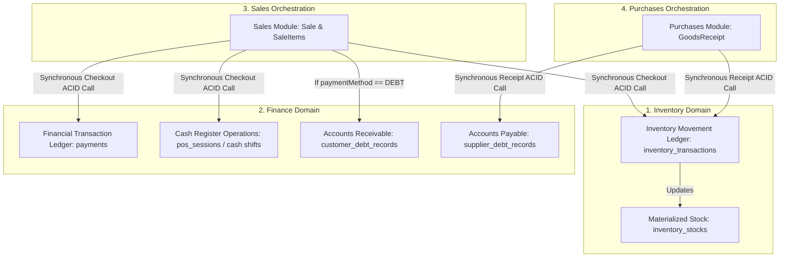
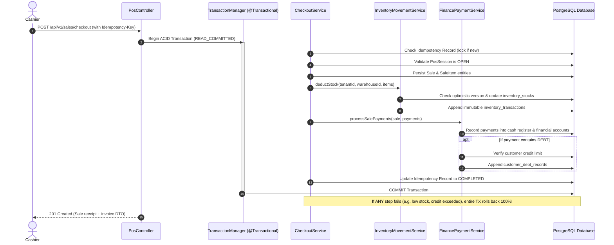

# SAVDOCRM — Backend Architecture & Engineering Guidelines

## 1. Architectural Philosophy: The Modular Monolith

SAVDOCRM adopts a **Modular Monolith** architecture. This avoids the operational complexity, network latency, distributed transaction hazards, and deployment overhead of microservices, while enforcing the strict boundaries, loose coupling, and domain isolation of Domain-Driven Design (DDD).

### Core Principles:
- **Explicit Bounded Contexts**: Every module is an independent business component located under `com.savdocrm.modules.<module_name>`.
- **Package Encapsulation**: Domain entities and repositories are package-private or restricted to their module. Other modules cannot directly inject another module's repository or manipulate its JPA entities.
- **DTO-Based Cross-Module Contracts**: Inter-module communication uses explicit DTOs. Entity references across boundaries use primitive/value IDs (e.g., `UUID customerId`, `UUID variantId`), never JPA `@ManyToOne` foreign entity links.
- **Strict Layering**: Controllers $\rightarrow$ Application Services $\rightarrow$ Domain Model $\rightarrow$ Repositories. Controllers never access repositories directly.

---

## 2. Technology Stack & Framework Version Evaluation (Java 21)

### 2.1. Spring Boot Release Line Comparison for Java 21:

| Release Line | Status | Java 21 Compatibility | Ecosystem Stability (Springdoc, Liquibase, MapStruct) | Verdict |
| :--- | :--- | :--- | :--- | :--- |
| **Spring Boot 3.3.x** | GA (May 2024) | Native support | Excellent (widely adopted, rock solid) | **Viable Baseline** |
| **Spring Boot 3.4.x** | **Current GA (Nov 2024)** | **Optimized for Java 21 (Virtual Threads, GraalVM)** | **Fully verified across all core dependencies** | **Recommended Production Choice** |
| **Spring Boot 3.5.x** | In Development | Experimental | Many third-party starters unreleased | Rejected (Not production ready) |
| **Spring Boot 4.x** | Pre-Alpha / Concept | Requires JDK 21/25 & Jakarta EE 11 | Complete ecosystem breaking changes | **Rejected (Dangerous premature choice)** |

### 2.2. Recommended Stack Strategy:
- **Java**: OpenJDK 21 (LTS)
- **Framework**: **Spring Boot 3.4.0+** (leveraging Spring Framework 6.2, enhanced Docker Compose integration, native virtual thread optimization for POS checkout).
- **Build Tool**: **Gradle Wrapper 8.10.2** (Explicitly committed in repo; prevents reliance on outdated system Gradle 4.4.1).

---

## 3. Module Internal Architecture (Clean / Hexagonal Pattern)

Each domain module follows a standardized 4-layer internal layout:

```mermaid
graph TD
    subgraph Module Boundary: e.g., catalog
        subgraph Web / Presentation Layer
            CTRL[RestController]
            REQ[Request DTOs & Validation]
            RES[Response DTOs]
        end

        subgraph Application Layer
            SVC[Application Services / Use Cases]
            FACADE[Public Module Facade]
            MAP[MapStruct Mappers]
        end

        subgraph Domain Layer
            ENT[Domain Entities]
            VO[Value Objects]
            EVT[Domain Events]
            DSVC[Domain Services & Invariants]
        end

        subgraph Infrastructure Layer
            REPO[Spring Data JPA Repositories]
            ADAPT[External Adapters / Clients]
        end
    end

    CTRL --> SVC
    CTRL --> REQ
    CTRL --> RES
    SVC --> ENT
    SVC --> DSVC
    SVC --> REPO
    SVC --> MAP
    FACADE --> SVC
    REPO --> ENT
```

---

## 4. Separation of Inventory, Finance, and Sales (Zero Circular Dependencies)

A critical architectural pitfall in retail ERPs is tangling stock movements with money ledgers. In SAVDOCRM, these domains are strictly delineated:



### Domain Distinctions:
1. **Inventory Movement Ledger** (`inventory_transactions`): Tracks physical items (`quantity_delta`, `unit_cost`, `quantity_after`, `warehouse_id`, `variant_id`). Cares only about physical items and Weighted Average Cost (COGS). It has **zero awareness** of cash drawers, customer balances, or credit limits.
2. **Financial Transaction Ledger** (`payments`): Tracks money inflow and outflow (`amount`, `payment_method`, `account_id`). Cares about cash, cards, and bank accounts.
3. **Accounts Receivable (AR)** (`customer_debt_records`): Tracks debt owed by customers. Increments on credit sales; decrements on customer cash repayments.
4. **Accounts Payable (AP)** (`supplier_debt_records`): Tracks debt owed to suppliers. Increments on purchase receipt on credit; decrements on supplier disbursements.
5. **Cash Register Operations** (`pos_sessions`, `cash_shifts`): Physical cash drawer sessions. Manages opening cash, cash sales, cash drops, and end-of-shift discrepancies.

*Rule*: `Inventory` never calls `Finance`. `Finance` never calls `Inventory`. Both are leaf ledgers invoked by `Sales` (at checkout) or `Purchases` (at goods receipt). This guarantees **zero circular dependencies**.

---

## 5. POS Transaction Consistency & Atomicity

In retail POS systems, eventual consistency creates catastrophic real-world errors (e.g., cash collected from customer but inventory deduction fails silently, or stock deducted but sale was not persisted).

### 5.1. Synchronous Local ACID Transaction Boundary for POS Checkout
Because SAVDOCRM operates as a Modular Monolith over a shared PostgreSQL database, the POS checkout executes within a **single atomic database transaction**:



### 5.2. Idempotency Key Pattern & Duplicate Defense
To prevent double charging or double stock deduction from rapid double-clicks or unstable Wi-Fi:
- Every checkout request includes `Idempotency-Key: <UUID>`.
- The database table `idempotency_records` enforces `UNIQUE(tenant_id, idempotency_key)`.
- If a duplicate key is received:
  - If status is `COMPLETED`: Instantly returns the cached response with `200 OK` without re-executing transactions.
  - If status is `IN_PROGRESS`: Returns `409 Conflict` ("Request currently processing. Please wait.").

### 5.3. Sales Returns & Refund Transaction Boundary
Sales returns follow the same atomic pattern:
1. Verify original sale and ensure `returned_quantity <= (sold_quantity - prior_returns)`.
2. Insert `sale_returns` and `sale_return_items`.
3. If items are marked `RESTOCKABLE`, invoke `InventoryMovementService.restockItem(...)` (`type = SALE_RETURN`).
4. Issue refund via `FinancePaymentService` (reverse cash in active cash shift or reduce customer debt balance in AR).
5. Commit atomically.

---

## 6. Complete Backend Package Hierarchy

```
com.savdocrm
├── SavdoCrmApplication.java
│
├── shared/                                 # Cross-cutting infrastructure
│   ├── config/                             # SecurityConfig, JpaConfig, OpenApiConfig, AsyncConfig
│   ├── domain/                             # BaseEntity, BaseTenantEntity, AggregateRoot
│   ├── multitenancy/                       # TenantContext, TenantContextHolder, TenantSecurityFilter,
│   │                                       # TenantContextTaskDecorator, TenantExecutionTemplate
│   ├── repository/                         # TenantAwareRepository (base repository with safety checks)
│   ├── exception/                          # GlobalExceptionHandler, BusinessException, ProblemDetail
│   ├── security/                           # JwtProvider, JwtAuthFilter, UserPrincipal, BranchSecurityEvaluator
│   ├── audit/                              # AuditLogService, AuditableEntityListener
│   ├── dto/                                # ApiResponse<T>, PageResponse<T>, ErrorResponse
│   └── util/                               # MoneyUtils, DateTimeUtils, SecurityUtils
│
└── modules/                                # Bounded Contexts
    ├── tenancy/
    │   ├── web/                            # TenantController, BranchController, WarehouseController
    │   ├── application/                    # TenantService, BranchService, WarehouseService
    │   ├── domain/                         # Tenant, Branch, Warehouse, TenantSubscription
    │   └── infrastructure/                 # TenantRepository, BranchRepository, WarehouseRepository
    │
    ├── identity/
    │   ├── web/                            # AuthController, UserController, RoleController
    │   ├── application/                    # AuthService, UserService, PermissionService
    │   ├── application/facade/             # SecurityFacade
    │   ├── domain/                         # User, TenantMembership, Role, Permission, MembershipRole
    │   └── infrastructure/                 # UserRepository, MembershipRepository, RoleRepository
    │
    ├── catalog/
    │   ├── web/                            # ProductController, CategoryController, UnitController
    │   ├── application/                    # ProductService, CategoryService, BarcodeService
    │   ├── application/facade/             # ProductQueryFacade
    │   ├── domain/                         # Product, ProductVariant, Category, Brand, Barcode, UnitOfMeasure
    │   └── infrastructure/                 # ProductRepository, VariantRepository, CategoryRepository
    │
    ├── inventory/
    │   ├── web/                            # StockController, InventoryTransferController, AdjustmentController
    │   ├── application/                    # StockMovementService, TransferService, StockAuditService
    │   ├── application/facade/             # StockLevelQueryFacade
    │   ├── domain/                         # InventoryStock, InventoryTransaction, InventoryTransfer
    │   └── infrastructure/                 # InventoryStockRepository, TransactionRepository
    │
    ├── sales/
    │   ├── web/                            # PosController, SaleController, SaleReturnController
    │   ├── application/                    # CheckoutService, PosShiftService, ReturnService
    │   ├── domain/                         # Sale, SaleItem, PosSession, SaleReturn, IdempotencyRecord
    │   ├── domain/event/                   # SaleCompletedEvent (for non-critical async side effects)
    │   └── infrastructure/                 # SaleRepository, PosSessionRepository, IdempotencyRepository
    │
    ├── purchases/
    │   ├── web/                            # PurchaseOrderController, GoodsReceiptController
    │   ├── application/                    # PurchaseOrderService, GoodsReceiptService
    │   ├── domain/                         # PurchaseOrder, PurchaseOrderItem, GoodsReceipt
    │   └── infrastructure/                 # PurchaseOrderRepository, GoodsReceiptRepository
    │
    ├── parties/
    │   ├── web/                            # CustomerController, SupplierController
    │   ├── application/                    # CustomerService, SupplierService
    │   ├── application/facade/             # CustomerFacade, SupplierFacade
    │   ├── domain/                         # Customer, CustomerGroup, Supplier
    │   └── infrastructure/                 # CustomerRepository, SupplierRepository
    │
    ├── finance/
    │   ├── web/                            # FinancialAccountController, ExpenseController, DebtController
    │   ├── application/                    # PaymentSettlementService, ExpenseService, DebtService
    │   ├── domain/                         # FinancialAccount, Payment, CustomerDebtRecord, SupplierDebtRecord, Expense
    │   └── infrastructure/                 # PaymentRepository, DebtRecordRepository
    │
    ├── analytics/
    │   ├── web/                            # DashboardController, ReportController
    │   ├── application/                    # SalesAnalyticsService, StockValuationService
    │   └── infrastructure/                 # AnalyticsNativeQueryRepository
    │
    └── system/
        ├── web/                            # AuditController, SystemSettingsController
        ├── application/                    # AuditLogService, SystemSettingService
        ├── domain/                         # AuditLog, SystemSetting
        └── infrastructure/                 # AuditLogRepository
```

---

## 7. Structured Logging with MDC

Every request passes through `TenantSecurityFilter`, which populates contextual metadata before execution:
- `traceId`: Distributed tracing identifier (propagated via `X-Trace-Id` or generated UUID).
- `tenantId`: Active tenant identifier.
- `userId`: Authenticated user UUID.
- `branchId`: Selected branch context.

```json
{
  "timestamp": "2026-11-23T14:48:00.123Z",
  "level": "INFO",
  "thread": "http-nio-8080-exec-4",
  "logger": "com.savdocrm.modules.sales.application.CheckoutService",
  "message": "Sale checkout completed successfully: saleId=e3b0c442-98fc-11ef-bd8f-0242ac120002, total=125.5000",
  "context": {
    "traceId": "9b1deb4d-3b7d-4bad-9bdd-2b0d7b3dcb6d",
    "tenantId": "c4ca4238-a0b9-3382-8dcc-509a6f75849b",
    "userId": "d3b07384-d113-4e4b-9e22-87289d0f4d3d",
    "branchId": "a1b2c3d4-e5f6-7a8b-9c0d-1e2f3a4b5c6d"
  }
}
```

---

## 8. Testing Architecture & Verification

The testing strategy guarantees reliability across three testing tiers:
1. **Unit Tests (Fast, Isolated)**: JUnit 5 & Mockito for pure domain logic.
2. **Integration Tests (Realistic Multi-Tenant Environment)**: Testcontainers PostgreSQL 16 verifying tenant isolation, composite foreign keys, and rollbacks.
3. **ArchUnit Tests (Architectural Guardrails)**:
   - Verifies that controllers never call repositories.
   - Verifies that modules never depend on another module's internal infrastructure.
   - Verifies that all tenant entities extend `BaseTenantEntity`.
   - Verifies that native queries without `tenant_id` fail compilation tests.
