# SAVDOCRM — Database Design & Schema Architecture

## 1. Relational Database Overview & Technology Selection

SAVDOCRM utilizes **PostgreSQL 16+** as its primary relational engine. PostgreSQL provides:
- Enterprise ACID transactional guarantees essential for inventory and financial consistency.
- Native UUID v4/v7 support.
- Arbitrary precision decimals (`NUMERIC`) for zero-loss financial accounting.
- Native `JSONB` support for flexible attribute definitions, variant matrices, and audit diffs.
- Composite unique and foreign key constraints enforcing multi-tenant isolation at the engine level.

---

## 2. Complete Entity-Relationship Diagram (ERD)

```mermaid
erDiagram
    TENANTS ||--o{ BRANCHES : "has"
    BRANCHES ||--o{ WAREHOUSES : "operates"
    TENANTS ||--o{ TENANT_MEMBERSHIPS : "enrolls"
    USERS ||--o{ TENANT_MEMBERSHIPS : "belongs_to"
    TENANT_MEMBERSHIPS ||--o{ MEMBERSHIP_ROLES : "assigned"
    ROLES ||--o{ MEMBERSHIP_ROLES : "grants"
    ROLES ||--o{ ROLE_PERMISSIONS : "contains"
    PERMISSIONS ||--o{ ROLE_PERMISSIONS : "defined_in"

    TENANTS ||--o{ CATEGORIES : "owns"
    TENANTS ||--o{ BRANDS : "owns"
    TENANTS ||--o{ UNITS_OF_MEASURE : "defines"
    TENANTS ||--o{ PRODUCTS : "manages"
    PRODUCTS ||--o{ PRODUCT_VARIANTS : "has_variants"
    PRODUCT_VARIANTS ||--o{ BARCODES : "identified_by"

    WAREHOUSES ||--o{ INVENTORY_STOCKS : "stores"
    PRODUCT_VARIANTS ||--o{ INVENTORY_STOCKS : "tracked_in"
    WAREHOUSES ||--o{ INVENTORY_TRANSACTIONS : "logs_movement"
    PRODUCT_VARIANTS ||--o{ INVENTORY_TRANSACTIONS : "moves"

    TENANTS ||--o{ SUPPLIERS : "purchases_from"
    SUPPLIERS ||--o{ PURCHASE_ORDERS : "receives"
    PURCHASE_ORDERS ||--o{ PURCHASE_ORDER_ITEMS : "contains"
    PURCHASE_ORDERS ||--o{ GOODS_RECEIPTS : "fulfilled_by"

    TENANTS ||--o{ CUSTOMERS : "serves"
    BRANCHES ||--o{ POS_SESSIONS : "hosts"
    POS_SESSIONS ||--o{ SALES : "records"
    CUSTOMERS ||--o{ SALES : "makes"
    SALES ||--o{ SALE_ITEMS : "contains"
    PRODUCT_VARIANTS ||--o{ SALE_ITEMS : "sold_as"
    SALES ||--o{ SALE_PAYMENTS : "paid_by"
    SALES ||--o{ SALE_RETURNS : "refunds"
    TENANTS ||--o{ IDEMPOTENCY_RECORDS : "protects"

    TENANTS ||--o{ FINANCIAL_ACCOUNTS : "maintains"
    TENANTS ||--o{ EXPENSES : "tracks"
    CUSTOMERS ||--o{ CUSTOMER_DEBT_RECORDS : "owes"
    SUPPLIERS ||--o{ SUPPLIER_DEBT_RECORDS : "claims"
```



---

## 3. Strict Composite Foreign Key Enforcement

In naive multi-tenant databases, a child table foreign key only references the parent table's `id`. This creates a vulnerability where a bug or malicious query can link Tenant B's record to Tenant A's parent.

**SAVDOCRM Rule**: Every tenant-scoped table declares a composite unique key on `(tenant_id, id)`, and all child foreign keys explicitly reference `(tenant_id, parent_id)`. This mathematically prevents cross-tenant references inside PostgreSQL:

```mermaid
graph LR
    subgraph Parent Table: products
        P[tenant_id: Tenant A<br/>id: Product 123<br/>UNIQUE(tenant_id, id)]
    end

    subgraph Child Table: product_variants
        V1[tenant_id: Tenant A<br/>product_id: Product 123<br/>STATUS: ALLOWED]
        V2[tenant_id: Tenant B<br/>product_id: Product 123<br/>STATUS: BLOCKED BY DB CONSTRAINT]
    end

    V1 -->|Composite FK matches (tenant_id, id)| P
    V2 -.->|FK Violation: (Tenant B, Product 123) does not exist!| P
```

---

## 4. Core DDL Specifications with Audit Fields & Precise Decimals

### 4.1. Tenancy & Infrastructure Domain
```sql
-- 1. Tenants (Independent Store SaaS Accounts)
CREATE TABLE tenants (
    id                  UUID PRIMARY KEY DEFAULT gen_random_uuid(),
    name                VARCHAR(150) NOT NULL,
    subdomain           VARCHAR(50) UNIQUE NOT NULL,
    currency_code       VARCHAR(3) NOT NULL DEFAULT 'USD',
    timezone            VARCHAR(50) NOT NULL DEFAULT 'UTC',
    status              VARCHAR(30) NOT NULL DEFAULT 'ACTIVE', -- ACTIVE, SUSPENDED, TRIAL
    created_at          TIMESTAMP WITH TIME ZONE NOT NULL DEFAULT CURRENT_TIMESTAMP,
    updated_at          TIMESTAMP WITH TIME ZONE NOT NULL DEFAULT CURRENT_TIMESTAMP,
    created_by          UUID,
    updated_by          UUID,
    version             BIGINT NOT NULL DEFAULT 0,
    CONSTRAINT uq_tenants_tenant_id UNIQUE (id)
);

-- 2. Branches (Physical Stores / Outlets)
CREATE TABLE branches (
    id                  UUID DEFAULT gen_random_uuid(),
    tenant_id           UUID NOT NULL REFERENCES tenants(id) ON DELETE CASCADE,
    name                VARCHAR(150) NOT NULL,
    code                VARCHAR(30) NOT NULL,
    address             TEXT,
    phone               VARCHAR(30),
    is_active           BOOLEAN NOT NULL DEFAULT TRUE,
    created_at          TIMESTAMP WITH TIME ZONE NOT NULL DEFAULT CURRENT_TIMESTAMP,
    updated_at          TIMESTAMP WITH TIME ZONE NOT NULL DEFAULT CURRENT_TIMESTAMP,
    created_by          UUID,
    updated_by          UUID,
    version             BIGINT NOT NULL DEFAULT 0,
    PRIMARY KEY (id),
    CONSTRAINT uq_branches_tenant_id UNIQUE (tenant_id, id),
    CONSTRAINT uq_branches_tenant_code UNIQUE (tenant_id, code)
);

-- 3. Warehouses (Stock Storage Facilities)
CREATE TABLE warehouses (
    id                  UUID DEFAULT gen_random_uuid(),
    tenant_id           UUID NOT NULL,
    branch_id           UUID,
    name                VARCHAR(150) NOT NULL,
    code                VARCHAR(30) NOT NULL,
    is_default          BOOLEAN NOT NULL DEFAULT FALSE,
    is_active           BOOLEAN NOT NULL DEFAULT TRUE,
    created_at          TIMESTAMP WITH TIME ZONE NOT NULL DEFAULT CURRENT_TIMESTAMP,
    updated_at          TIMESTAMP WITH TIME ZONE NOT NULL DEFAULT CURRENT_TIMESTAMP,
    created_by          UUID,
    updated_by          UUID,
    version             BIGINT NOT NULL DEFAULT 0,
    PRIMARY KEY (id),
    CONSTRAINT uq_warehouses_tenant_id UNIQUE (tenant_id, id),
    CONSTRAINT uq_warehouses_tenant_code UNIQUE (tenant_id, code),
    CONSTRAINT fk_warehouses_tenant_branch 
        FOREIGN KEY (tenant_id, branch_id) REFERENCES branches(tenant_id, id) ON DELETE SET NULL
);
```

### 4.2. Identity & Access Domain
```sql
-- 4. Global Users
CREATE TABLE users (
    id                  UUID PRIMARY KEY DEFAULT gen_random_uuid(),
    email               VARCHAR(150) UNIQUE NOT NULL,
    phone               VARCHAR(30) UNIQUE,
    password_hash       VARCHAR(255) NOT NULL,
    first_name          VARCHAR(100) NOT NULL,
    last_name           VARCHAR(100) NOT NULL,
    is_active           BOOLEAN NOT NULL DEFAULT TRUE,
    created_at          TIMESTAMP WITH TIME ZONE NOT NULL DEFAULT CURRENT_TIMESTAMP,
    updated_at          TIMESTAMP WITH TIME ZONE NOT NULL DEFAULT CURRENT_TIMESTAMP,
    version             BIGINT NOT NULL DEFAULT 0
);

-- 5. Tenant Memberships
CREATE TABLE tenant_memberships (
    id                  UUID DEFAULT gen_random_uuid(),
    tenant_id           UUID NOT NULL REFERENCES tenants(id) ON DELETE CASCADE,
    user_id             UUID NOT NULL REFERENCES users(id) ON DELETE CASCADE,
    status              VARCHAR(30) NOT NULL DEFAULT 'ACTIVE', -- ACTIVE, INVITED, SUSPENDED
    created_at          TIMESTAMP WITH TIME ZONE NOT NULL DEFAULT CURRENT_TIMESTAMP,
    updated_at          TIMESTAMP WITH TIME ZONE NOT NULL DEFAULT CURRENT_TIMESTAMP,
    version             BIGINT NOT NULL DEFAULT 0,
    PRIMARY KEY (id),
    CONSTRAINT uq_memberships_tenant_id UNIQUE (tenant_id, id),
    CONSTRAINT uq_memberships_tenant_user UNIQUE (tenant_id, user_id)
);

-- 6. Roles & Permissions
CREATE TABLE roles (
    id                  UUID DEFAULT gen_random_uuid(),
    tenant_id           UUID REFERENCES tenants(id) ON DELETE CASCADE, -- NULL for global system roles
    name                VARCHAR(50) NOT NULL,
    description         TEXT,
    is_system_role      BOOLEAN NOT NULL DEFAULT FALSE,
    created_at          TIMESTAMP WITH TIME ZONE NOT NULL DEFAULT CURRENT_TIMESTAMP,
    PRIMARY KEY (id),
    CONSTRAINT uq_roles_tenant_id UNIQUE (tenant_id, id),
    CONSTRAINT uq_roles_tenant_name UNIQUE (tenant_id, name)
);

CREATE TABLE permissions (
    id                  VARCHAR(100) PRIMARY KEY, -- e.g. 'catalog:product:create', 'sales:pos:checkout'
    category            VARCHAR(50) NOT NULL,
    description         TEXT NOT NULL
);

CREATE TABLE role_permissions (
    role_id             UUID NOT NULL REFERENCES roles(id) ON DELETE CASCADE,
    permission_id       VARCHAR(100) NOT NULL REFERENCES permissions(id) ON DELETE CASCADE,
    PRIMARY KEY (role_id, permission_id)
);

-- Membership Roles Scoped to Branch (Null branch_id means tenant-wide access)
CREATE TABLE membership_roles (
    id                  UUID DEFAULT gen_random_uuid(),
    tenant_id           UUID NOT NULL,
    membership_id       UUID NOT NULL,
    role_id             UUID NOT NULL REFERENCES roles(id) ON DELETE CASCADE,
    branch_id           UUID,
    created_at          TIMESTAMP WITH TIME ZONE NOT NULL DEFAULT CURRENT_TIMESTAMP,
    PRIMARY KEY (id),
    CONSTRAINT fk_mem_roles_tenant_membership 
        FOREIGN KEY (tenant_id, membership_id) REFERENCES tenant_memberships(tenant_id, id) ON DELETE CASCADE,
    CONSTRAINT fk_mem_roles_tenant_branch 
        FOREIGN KEY (tenant_id, branch_id) REFERENCES branches(tenant_id, id) ON DELETE CASCADE,
    CONSTRAINT uq_membership_role_branch UNIQUE (membership_id, role_id, branch_id)
);
```

### 4.3. Product Catalog Domain
```sql
-- 7. Units of Measure
CREATE TABLE units_of_measure (
    id                  UUID DEFAULT gen_random_uuid(),
    tenant_id           UUID NOT NULL REFERENCES tenants(id) ON DELETE CASCADE,
    name                VARCHAR(50) NOT NULL,
    symbol              VARCHAR(10) NOT NULL,
    allow_decimal       BOOLEAN NOT NULL DEFAULT FALSE,
    decimal_places      INT NOT NULL DEFAULT 0, -- 0 for pieces, 3 for kg/liters
    PRIMARY KEY (id),
    CONSTRAINT uq_uom_tenant_id UNIQUE (tenant_id, id),
    CONSTRAINT uq_uom_tenant_symbol UNIQUE (tenant_id, symbol)
);

-- 8. Products & Matrix Variants
CREATE TABLE products (
    id                  UUID DEFAULT gen_random_uuid(),
    tenant_id           UUID NOT NULL REFERENCES tenants(id) ON DELETE CASCADE,
    unit_id             UUID NOT NULL,
    category_id         UUID,
    brand_id            UUID,
    name                VARCHAR(255) NOT NULL,
    code                VARCHAR(50),
    description         TEXT,
    has_variants        BOOLEAN NOT NULL DEFAULT FALSE,
    tax_rate            NUMERIC(5, 2) NOT NULL DEFAULT 0.00,
    is_active           BOOLEAN NOT NULL DEFAULT TRUE,
    created_at          TIMESTAMP WITH TIME ZONE NOT NULL DEFAULT CURRENT_TIMESTAMP,
    updated_at          TIMESTAMP WITH TIME ZONE NOT NULL DEFAULT CURRENT_TIMESTAMP,
    created_by          UUID,
    updated_by          UUID,
    version             BIGINT NOT NULL DEFAULT 0,
    PRIMARY KEY (id),
    CONSTRAINT uq_products_tenant_id UNIQUE (tenant_id, id),
    CONSTRAINT fk_products_tenant_unit 
        FOREIGN KEY (tenant_id, unit_id) REFERENCES units_of_measure(tenant_id, id)
);

CREATE TABLE product_variants (
    id                  UUID DEFAULT gen_random_uuid(),
    tenant_id           UUID NOT NULL,
    product_id          UUID NOT NULL,
    sku                 VARCHAR(100) NOT NULL,
    variant_name        VARCHAR(255) NOT NULL,
    attributes          JSONB NOT NULL DEFAULT '{}'::jsonb,
    cost_price          NUMERIC(15, 4) NOT NULL DEFAULT 0.0000,
    selling_price       NUMERIC(15, 4) NOT NULL DEFAULT 0.0000,
    min_stock_level     NUMERIC(12, 3) NOT NULL DEFAULT 0.000,
    is_active           BOOLEAN NOT NULL DEFAULT TRUE,
    created_at          TIMESTAMP WITH TIME ZONE NOT NULL DEFAULT CURRENT_TIMESTAMP,
    updated_at          TIMESTAMP WITH TIME ZONE NOT NULL DEFAULT CURRENT_TIMESTAMP,
    created_by          UUID,
    updated_by          UUID,
    version             BIGINT NOT NULL DEFAULT 0,
    PRIMARY KEY (id),
    CONSTRAINT uq_variants_tenant_id UNIQUE (tenant_id, id),
    CONSTRAINT uq_variants_tenant_sku UNIQUE (tenant_id, sku),
    CONSTRAINT fk_variants_tenant_product 
        FOREIGN KEY (tenant_id, product_id) REFERENCES products(tenant_id, id) ON DELETE CASCADE
);

CREATE TABLE barcodes (
    id                  UUID DEFAULT gen_random_uuid(),
    tenant_id           UUID NOT NULL,
    variant_id          UUID NOT NULL,
    barcode_value       VARCHAR(100) NOT NULL,
    type                VARCHAR(30) NOT NULL DEFAULT 'EAN13',
    is_primary          BOOLEAN NOT NULL DEFAULT TRUE,
    PRIMARY KEY (id),
    CONSTRAINT uq_barcodes_tenant_id UNIQUE (tenant_id, id),
    CONSTRAINT uq_barcodes_tenant_value UNIQUE (tenant_id, barcode_value),
    CONSTRAINT fk_barcodes_tenant_variant 
        FOREIGN KEY (tenant_id, variant_id) REFERENCES product_variants(tenant_id, id) ON DELETE CASCADE
);
```

### 4.4. Inventory & Warehouse Domain
```sql
-- 9. Materialized Inventory Stock Balance (Optimistic Locking)
CREATE TABLE inventory_stocks (
    id                      UUID DEFAULT gen_random_uuid(),
    tenant_id               UUID NOT NULL,
    warehouse_id            UUID NOT NULL,
    variant_id              UUID NOT NULL,
    quantity_on_hand        NUMERIC(12, 3) NOT NULL DEFAULT 0.000,
    quantity_reserved       NUMERIC(12, 3) NOT NULL DEFAULT 0.000,
    weighted_average_cost   NUMERIC(15, 4) NOT NULL DEFAULT 0.0000,
    updated_at              TIMESTAMP WITH TIME ZONE NOT NULL DEFAULT CURRENT_TIMESTAMP,
    version                 BIGINT NOT NULL DEFAULT 0,
    PRIMARY KEY (id),
    CONSTRAINT uq_stock_tenant_id UNIQUE (tenant_id, id),
    CONSTRAINT uq_stock_tenant_wh_variant UNIQUE (tenant_id, warehouse_id, variant_id),
    CONSTRAINT fk_stock_tenant_warehouse 
        FOREIGN KEY (tenant_id, warehouse_id) REFERENCES warehouses(tenant_id, id) ON DELETE RESTRICT,
    CONSTRAINT fk_stock_tenant_variant 
        FOREIGN KEY (tenant_id, variant_id) REFERENCES product_variants(tenant_id, id) ON DELETE RESTRICT
);

-- 10. Immutable Inventory Movement Ledger
CREATE TABLE inventory_transactions (
    id                  UUID DEFAULT gen_random_uuid(),
    tenant_id           UUID NOT NULL,
    warehouse_id        UUID NOT NULL,
    variant_id          UUID NOT NULL,
    transaction_type    VARCHAR(50) NOT NULL, -- PURCHASE_RECEIPT, SALE_DEDUCTION, SALE_RETURN, TRANSFER_OUT, TRANSFER_IN, ADJUSTMENT_INCREASE, ADJUSTMENT_DECREASE, WRITE_OFF
    quantity_delta      NUMERIC(12, 3) NOT NULL,
    quantity_after      NUMERIC(12, 3) NOT NULL,
    unit_cost           NUMERIC(15, 4) NOT NULL,
    reference_type      VARCHAR(50) NOT NULL, -- SALE, PURCHASE_ORDER, TRANSFER, AUDIT
    reference_id        UUID,
    notes               TEXT,
    created_at          TIMESTAMP WITH TIME ZONE NOT NULL DEFAULT CURRENT_TIMESTAMP,
    created_by          UUID REFERENCES users(id),
    PRIMARY KEY (id),
    CONSTRAINT fk_inv_tx_tenant_warehouse 
        FOREIGN KEY (tenant_id, warehouse_id) REFERENCES warehouses(tenant_id, id) ON DELETE RESTRICT,
    CONSTRAINT fk_inv_tx_tenant_variant 
        FOREIGN KEY (tenant_id, variant_id) REFERENCES product_variants(tenant_id, id) ON DELETE RESTRICT
);
```

### 4.5. Sales, POS & Idempotency Domain
```sql
-- 11. Idempotency Records
CREATE TABLE idempotency_records (
    id                  UUID DEFAULT gen_random_uuid(),
    tenant_id           UUID NOT NULL REFERENCES tenants(id) ON DELETE CASCADE,
    idempotency_key     VARCHAR(100) NOT NULL,
    request_hash        VARCHAR(64) NOT NULL,
    status              VARCHAR(30) NOT NULL DEFAULT 'IN_PROGRESS', -- IN_PROGRESS, COMPLETED, FAILED
    response_body       JSONB,
    created_at          TIMESTAMP WITH TIME ZONE NOT NULL DEFAULT CURRENT_TIMESTAMP,
    PRIMARY KEY (id),
    CONSTRAINT uq_idempotency_tenant_key UNIQUE (tenant_id, idempotency_key)
);

-- 12. POS Sessions / Cash Register Shifts
CREATE TABLE pos_sessions (
    id                  UUID DEFAULT gen_random_uuid(),
    tenant_id           UUID NOT NULL,
    branch_id           UUID NOT NULL,
    cashier_id          UUID NOT NULL REFERENCES users(id) ON DELETE RESTRICT,
    opened_at           TIMESTAMP WITH TIME ZONE NOT NULL DEFAULT CURRENT_TIMESTAMP,
    closed_at           TIMESTAMP WITH TIME ZONE,
    opening_cash        NUMERIC(15, 4) NOT NULL DEFAULT 0.0000,
    closing_cash_actual NUMERIC(15, 4),
    status              VARCHAR(30) NOT NULL DEFAULT 'OPEN',
    created_at          TIMESTAMP WITH TIME ZONE NOT NULL DEFAULT CURRENT_TIMESTAMP,
    updated_at          TIMESTAMP WITH TIME ZONE NOT NULL DEFAULT CURRENT_TIMESTAMP,
    version             BIGINT NOT NULL DEFAULT 0,
    PRIMARY KEY (id),
    CONSTRAINT uq_pos_sessions_tenant_id UNIQUE (tenant_id, id),
    CONSTRAINT fk_pos_sessions_tenant_branch 
        FOREIGN KEY (tenant_id, branch_id) REFERENCES branches(tenant_id, id) ON DELETE RESTRICT
);

-- 13. Sales and Line Items
CREATE TABLE sales (
    id                  UUID DEFAULT gen_random_uuid(),
    tenant_id           UUID NOT NULL,
    branch_id           UUID NOT NULL,
    warehouse_id        UUID NOT NULL,
    pos_session_id      UUID,
    cashier_id          UUID NOT NULL REFERENCES users(id),
    customer_id         UUID,
    sale_number         VARCHAR(50) NOT NULL,
    subtotal            NUMERIC(15, 4) NOT NULL,
    discount_amount     NUMERIC(15, 4) NOT NULL DEFAULT 0.0000,
    tax_amount          NUMERIC(15, 4) NOT NULL DEFAULT 0.0000,
    total_amount        NUMERIC(15, 4) NOT NULL,
    paid_amount         NUMERIC(15, 4) NOT NULL DEFAULT 0.0000,
    debt_amount         NUMERIC(15, 4) NOT NULL DEFAULT 0.0000,
    status              VARCHAR(30) NOT NULL DEFAULT 'COMPLETED',
    created_at          TIMESTAMP WITH TIME ZONE NOT NULL DEFAULT CURRENT_TIMESTAMP,
    updated_at          TIMESTAMP WITH TIME ZONE NOT NULL DEFAULT CURRENT_TIMESTAMP,
    version             BIGINT NOT NULL DEFAULT 0,
    PRIMARY KEY (id),
    CONSTRAINT uq_sales_tenant_id UNIQUE (tenant_id, id),
    CONSTRAINT uq_sales_tenant_number UNIQUE (tenant_id, sale_number),
    CONSTRAINT fk_sales_tenant_branch 
        FOREIGN KEY (tenant_id, branch_id) REFERENCES branches(tenant_id, id) ON DELETE RESTRICT,
    CONSTRAINT fk_sales_tenant_warehouse 
        FOREIGN KEY (tenant_id, warehouse_id) REFERENCES warehouses(tenant_id, id) ON DELETE RESTRICT,
    CONSTRAINT fk_sales_tenant_pos 
        FOREIGN KEY (tenant_id, pos_session_id) REFERENCES pos_sessions(tenant_id, id) ON DELETE RESTRICT
);

CREATE TABLE sale_items (
    id                  UUID DEFAULT gen_random_uuid(),
    tenant_id           UUID NOT NULL,
    sale_id             UUID NOT NULL,
    variant_id          UUID NOT NULL,
    quantity            NUMERIC(12, 3) NOT NULL,
    unit_price          NUMERIC(15, 4) NOT NULL,
    unit_cost           NUMERIC(15, 4) NOT NULL,
    discount_amount     NUMERIC(15, 4) NOT NULL DEFAULT 0.0000,
    tax_amount          NUMERIC(15, 4) NOT NULL DEFAULT 0.0000,
    total_price         NUMERIC(15, 4) NOT NULL,
    PRIMARY KEY (id),
    CONSTRAINT fk_sale_items_tenant_sale 
        FOREIGN KEY (tenant_id, sale_id) REFERENCES sales(tenant_id, id) ON DELETE CASCADE,
    CONSTRAINT fk_sale_items_tenant_variant 
        FOREIGN KEY (tenant_id, variant_id) REFERENCES product_variants(tenant_id, id) ON DELETE RESTRICT
);
```

### 4.6. Parties, Debts & Finance Domain
```sql
-- 14. Customers & Customer Debt Ledger (Accounts Receivable)
CREATE TABLE customers (
    id                  UUID DEFAULT gen_random_uuid(),
    tenant_id           UUID NOT NULL REFERENCES tenants(id) ON DELETE CASCADE,
    name                VARCHAR(150) NOT NULL,
    phone               VARCHAR(30),
    credit_limit        NUMERIC(15, 4) NOT NULL DEFAULT 0.0000,
    current_debt        NUMERIC(15, 4) NOT NULL DEFAULT 0.0000,
    loyalty_points      INTEGER NOT NULL DEFAULT 0,
    created_at          TIMESTAMP WITH TIME ZONE NOT NULL DEFAULT CURRENT_TIMESTAMP,
    updated_at          TIMESTAMP WITH TIME ZONE NOT NULL DEFAULT CURRENT_TIMESTAMP,
    version             BIGINT NOT NULL DEFAULT 0,
    PRIMARY KEY (id),
    CONSTRAINT uq_customers_tenant_id UNIQUE (tenant_id, id),
    CONSTRAINT uq_customers_tenant_phone UNIQUE (tenant_id, phone)
);

CREATE TABLE customer_debt_records (
    id                  UUID DEFAULT gen_random_uuid(),
    tenant_id           UUID NOT NULL,
    customer_id         UUID NOT NULL,
    sale_id             UUID,
    record_type         VARCHAR(30) NOT NULL, -- DEBT_INCURRED, DEBT_REPAID
    amount              NUMERIC(15, 4) NOT NULL,
    balance_after       NUMERIC(15, 4) NOT NULL,
    notes               TEXT,
    created_at          TIMESTAMP WITH TIME ZONE NOT NULL DEFAULT CURRENT_TIMESTAMP,
    created_by          UUID REFERENCES users(id),
    PRIMARY KEY (id),
    CONSTRAINT fk_debt_rec_tenant_customer 
        FOREIGN KEY (tenant_id, customer_id) REFERENCES customers(tenant_id, id) ON DELETE RESTRICT,
    CONSTRAINT fk_debt_rec_tenant_sale 
        FOREIGN KEY (tenant_id, sale_id) REFERENCES sales(tenant_id, id) ON DELETE SET NULL
);

-- 15. Suppliers & Supplier Debt Ledger (Accounts Payable)
CREATE TABLE suppliers (
    id                  UUID DEFAULT gen_random_uuid(),
    tenant_id           UUID NOT NULL REFERENCES tenants(id) ON DELETE CASCADE,
    company_name        VARCHAR(150) NOT NULL,
    contact_person      VARCHAR(100),
    phone               VARCHAR(30),
    current_payable     NUMERIC(15, 4) NOT NULL DEFAULT 0.0000,
    created_at          TIMESTAMP WITH TIME ZONE NOT NULL DEFAULT CURRENT_TIMESTAMP,
    updated_at          TIMESTAMP WITH TIME ZONE NOT NULL DEFAULT CURRENT_TIMESTAMP,
    version             BIGINT NOT NULL DEFAULT 0,
    PRIMARY KEY (id),
    CONSTRAINT uq_suppliers_tenant_id UNIQUE (tenant_id, id)
);

CREATE TABLE supplier_debt_records (
    id                  UUID DEFAULT gen_random_uuid(),
    tenant_id           UUID NOT NULL,
    supplier_id         UUID NOT NULL,
    record_type         VARCHAR(30) NOT NULL, -- PAYABLE_INCURRED, PAYABLE_DISBURSED
    amount              NUMERIC(15, 4) NOT NULL,
    balance_after       NUMERIC(15, 4) NOT NULL,
    notes               TEXT,
    created_at          TIMESTAMP WITH TIME ZONE NOT NULL DEFAULT CURRENT_TIMESTAMP,
    created_by          UUID REFERENCES users(id),
    PRIMARY KEY (id),
    CONSTRAINT fk_supp_debt_tenant_supplier 
        FOREIGN KEY (tenant_id, supplier_id) REFERENCES suppliers(tenant_id, id) ON DELETE RESTRICT
);
```

---

## 5. Liquibase Migration Implementation & Standards

All database schema evolutions are versioned via Liquibase:
- Master file: `backend/src/main/resources/db/changelog/db.changelog-master.xml`

### Implemented Changesets:
1. `v1.0.0/00-baseline.xml` (Milestone 01):
   - Table `system_metadata`: Tracks system initialization and core platform metadata.
2. `v1.0.0/01-create-tenants.xml` (Milestone 02):
   - Table `tenants`: Primary entity for multi-tenancy with `code` unique index, currency, timezone, status, and audit fields.
3. `v1.0.0/02-create-branches.xml` (Milestone 02):
   - Table `branches`: Branch network scoped to tenant with `fk_branches_tenant`, composite unique constraints `uq_branches_tenant_code` and `uq_branches_tenant_id`, and index `idx_branches_tenant`.

### Planned Changesets (Subsequent Milestones):
- `v1.0.0/03-create-identity-schema.xml` (Milestone 03: Users, Memberships, Refresh Tokens)
- `v1.0.0/04-create-rbac-schema.xml` (Milestone 04: Roles, Permissions, Scoped Assignments)
- `v1.0.0/05-create-catalog-schema.xml` (Milestone 05: Categories, Units, Products, Variants, Barcodes)
- `v1.0.0/06-create-inventory-schema.xml` (Milestone 06: Stocks, Transactions, Warehouses)
- `v1.0.0/07-create-sales-schema.xml` (Milestone 07: POS Sessions, Sales, Items, Idempotency)
- `v1.0.0/08-create-parties-finance-schema.xml` (Milestones 08 & 09: Customers, Suppliers, Debts, Accounts)
- `v1.0.0/09-create-audit-schema.xml` (Milestone 10: Audit Log)
