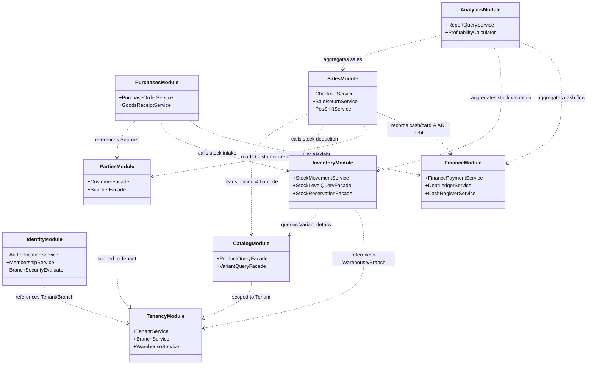
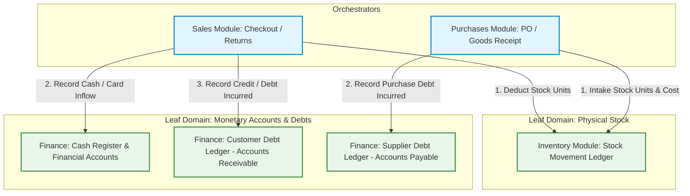

# SAVDOCRM — Domain Modules & Bounded Contexts

## 1. Domain-Driven Design (DDD) Bounded Contexts Overview

SAVDOCRM is organized as a **Modular Monolith** where each business capability is encapsulated inside an autonomous Bounded Context (Module). Modules have:
1. **High Cohesion**: All business logic, entities, and database tables for a specific domain belong together.
2. **Loose Coupling**: Modules never directly query or mutate another module's internal database tables or JPA entities.
3. **Explicit Public Contracts**: Modules interact synchronously via Java Interface Facades for queries or participate in orchestrations initiated by upstream business services.

---

## 2. Interaction Matrix & Separation of Ledgers (Zero Circular Dependencies)

To prevent domain coupling, **Inventory and Finance are independent leaf execution domains**:
- `Inventory` knows only about physical stock units, locations, and unit costs. It has zero knowledge of money, debts, or cash registers.
- `Finance` knows only about monetary amounts, accounts, customer credit balances (AR), and supplier balances (AP). It has zero knowledge of SKU quantities or warehouses.
- `Sales` acts as the orchestrator for customer-facing checkout: it instructs `Inventory` to deduct stock and instructs `Finance` to collect payment/record debt.
- `Purchases` acts as the orchestrator for supplier procurement: it instructs `Inventory` to intake stock and instructs `Finance` to record supplier debt.

---

## 3. Module Specifications & Boundaries

### 3.1. Tenancy Module (`com.savdocrm.modules.tenancy`)
* **Core Purpose**: Manages SaaS account subscriptions, tenant provisioning, store profiles, branch networks, and physical warehouse mapping.
* **Entities**:
  - `Tenant`: Top-level legal/business entity.
  - `Branch`: Physical store or sales outlet.
  - `Warehouse`: Storage facility attached to a branch or designated as a central hub.
  - `TenantSubscription`: SaaS billing tier and limits.

---

### 3.2. Identity & Access Module (`com.savdocrm.modules.identity`)
* **Core Purpose**: Manages user accounts, authentication (JWT), tenant memberships, and fine-grained role-based permissions (RBAC) scoped to specific branches and warehouses.
* **Entities**:
  - `User`: Global human identity.
  - `TenantMembership`: Associates a user with a tenant.
  - `Role`: Defined roles (`TENANT_OWNER`, `BRANCH_MANAGER`, `CASHIER`, `INVENTORY_CLERK`, `ACCOUNTANT`).
  - `Permission`: Fine-grained privilege (`catalog:product:create`, `sales:pos:checkout`).
  - `MembershipRole`: Associates membership with a role, **explicitly scoped to a `branch_id`** or applying tenant-wide if `branch_id` is null.

---

### 3.3. Catalog Module (`com.savdocrm.modules.catalog`)
* **Core Purpose**: Owns product identity, SKU/barcode identification, hierarchical categories, measurement unit definitions, and variant option structures across retail verticals. Explicitly does **not** own stock quantities, inventory valuation (WAC), tax regimes, sales orders, or financial transactions.
* **Implementation Status**: M05.1–M05.6 Completed — Pass With Limitations (Architecture, Liquibase Schema, Domain Model, Repositories, Application Services, `ProductQueryFacade`, REST API/RBAC, React FSD Frontend & Integration/Security Audit in [m05-integration-security-quality-audit.md](../testing/m05-integration-security-quality-audit.md)); M06 Inventory not started.
* **Entities & Tables**:
  - `ProductCategory` (`product_categories`): Self-referential Adjacency List (`parent_id`, bounded depth `0..4`, `ON DELETE RESTRICT`), with bounded cycle/depth enforcement in `ProductCategoryService`.
  - `UnitOfMeasure` (`units_of_measure`): Tenant-owned system-seeded (`PCS`, `KG`, `G`, `L`, `ML`, `M`, `BOX`, `PACK`) and custom units with `allow_decimal` and `decimal_precision` (`0..3`), seeded automatically on new tenant registration via `UnitOfMeasureService`.
  - `Product` (`products`): Conceptual product parent (`name`, `description`, optional `brand` string, `category_id`, `unit_id`, `product_type` [`SIMPLE` | `VARIABLE`], `variant_options` JSONB, `status` [`DRAFT` | `ACTIVE` | `ARCHIVED`]).
  - `ProductVariant` (`product_variants`): Transactable SKU (`sku`, `name`, `option_values` JSONB, reference `cost_price`, base `selling_price`, `is_default`, `is_active`). All downstream modules (`Inventory`, `Sales`, `Purchases`) reference `variant_id`.
  - `ProductBarcode` (`product_barcodes`): Explicit multi-barcode registry (`0..N` per variant, `EAN13`, `EAN8`, `UPC_A`, `CODE128`, `INTERNAL`, `OTHER`) with tenant-scoped uniqueness managed by `ProductBarcodeService`.
* **Application Services & Public Contracts**:
  - `ProductCategoryService`, `UnitOfMeasureService`, `ProductService`, `ProductVariantService`, `ProductBarcodeService`.
  - `ProductQueryFacade` (`ProductQueryFacadeImpl`): Provides immutable DTO projections (`VariantCatalogDto`) to `Inventory`, `Sales`, and `Purchases` without exposing JPA entities or repositories.
* **Architecture Docs**: [05-product-catalog.md](file:///home/izzatbek/Desktop/crm/docs/architecture/05-product-catalog.md), [05-product-database-design.md](file:///home/izzatbek/Desktop/crm/docs/architecture/05-product-database-design.md), [05-product-api-contracts.md](file:///home/izzatbek/Desktop/crm/docs/architecture/05-product-api-contracts.md), [05-product-frontend-architecture.md](file:///home/izzatbek/Desktop/crm/docs/architecture/05-product-frontend-architecture.md)

---

### 3.4. Inventory Module (`com.savdocrm.modules.inventory`)
* **Core Purpose**: Tracks real-time stock balances across warehouses using an immutable double-entry style inventory ledger.
* **Entities**:
  - `InventoryStock`: Materialized current balance for a `(tenant_id, warehouse_id, variant_id)` tuple. Protected by `@Version` for optimistic concurrency.
  - `InventoryTransaction`: Immutable record of every physical stock movement (`quantity_delta`, `quantity_after`, `unit_cost`, `type`: `PURCHASE_RECEIPT`, `SALE_DEDUCTION`, `SALE_RETURN`, `TRANSFER_OUT`, `TRANSFER_IN`, `ADJUSTMENT_INCREASE`, `ADJUSTMENT_DECREASE`, `WRITE_OFF`).
  - `InventoryTransfer`: Document tracking stock dispatched between warehouses.
* **Public Contracts**:
  - `StockMovementService`: Invoked synchronously by Sales for stock deduction/return, and by Purchases for stock intake.
  - `StockLevelQueryFacade`: Exposes available and reserved stock balances.

---

### 3.5. Purchases Module (`com.savdocrm.modules.purchases`)
* **Core Purpose**: Manages supplier procurement, purchase orders, goods receipt verification, and landed cost recalculation.
* **Entities**:
  - `PurchaseOrder`: Document representing an order to a supplier (`status`: `DRAFT`, `ORDERED`, `PARTIALLY_RECEIVED`, `COMPLETED`).
  - `PurchaseOrderItem`: Items ordered with ordered quantity and unit cost price.
  - `GoodsReceipt`: Document recording actual physical quantities received at a designated warehouse.

---

### 3.6. Sales & Point of Sale (POS) Module (`com.savdocrm.modules.sales`)
* **Core Purpose**: Fast, touch-and-barcode-optimized checkout, cash register shift management, multi-payment processing, discounts, receipts, and returns.
* **Entities**:
  - `PosSession`: Cashier register session (`OPEN`, `CLOSED`). Records opening float, total cash sales, card sales, expected cash in drawer, cash drops, and end-of-shift discrepancies.
  - `Sale`: The completed retail transaction (`status`: `COMPLETED`, `REFUNDED`, `PARTIALLY_REFUNDED`). Contains branch, warehouse, cashier, customer, totals, and debt amount.
  - `SaleItem`: Variant ID, quantity, unit price, applied discount, and total item cost.
  - `SaleReturn`: Customer return document referencing the original `Sale`.
  - `IdempotencyRecord`: Stores unique checkout request hashes and cached responses to prevent duplicate billing.

---

### 3.7. Parties Module (`com.savdocrm.modules.parties`)
* **Core Purpose**: Manages customer profiles, loyalty balances, credit limits, and supplier profiles.
* **Entities**:
  - `Customer`: Individual or wholesale customer. Holds phone, credit limit, and current debt balance.
  - `CustomerGroup`: Classification (e.g., `VIP`, `Wholesale`).
  - `Supplier`: External vendor profiles.

---

### 3.8. Finance Module (`com.savdocrm.modules.finance`)
* **Core Purpose**: Manages cash drawers, bank accounts, operational expenses, incomes, customer debt settlements (AR), and supplier payments (AP).
* **Entities**:
  - `FinancialAccount`: Cash drawer, bank account, or digital wallet.
  - `Payment`: Financial transaction record (`payment_method`: `CASH`, `CARD`, `BANK_TRANSFER`, `DEBT`, `LOYALTY_POINTS`).
  - `CustomerDebtRecord`: Ledger entry tracking money owed by a customer or repayments made (Accounts Receivable).
  - `SupplierDebtRecord`: Ledger entry tracking money owed to a supplier or disbursements made (Accounts Payable).
  - `Expense`: Operating expense (Rent, Salaries, Utilities) categorized by `ExpenseCategory`.

---

### 3.9. Analytics Module (`com.savdocrm.modules.analytics`)
* **Core Purpose**: Read-only business performance queries and executive dashboards.
* **Capabilities**: Sales turnover, gross profit margins, inventory valuation (FIFO/Weighted Average), low-stock warnings, and AR aging reports.

---

### 3.10. System & Audit Module (`com.savdocrm.modules.system`)
* **Core Purpose**: Cross-cutting compliance, audit logging, outbox pattern message delivery, and system configurations.
* **Entities**:
  - `AuditLog`: Immutable change log recording `tenant_id`, `user_id`, `action`, `entity_type`, `entity_id`, `before_state`, `after_state`, and `ip_address`.
