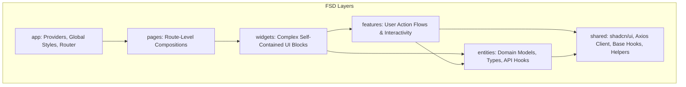
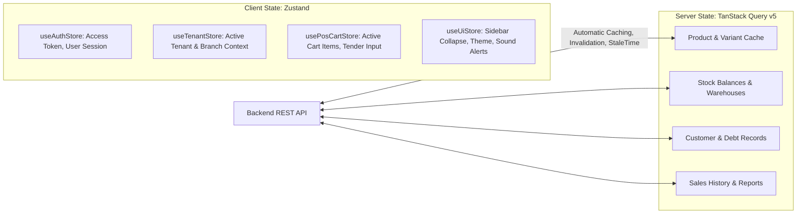

# SAVDOCRM — Frontend Architecture & UI/UX Guidelines

## 1. Architectural Philosophy: Feature-Sliced Design (FSD 2.0)

The frontend application is structured using **Feature-Sliced Design (FSD)**. FSD standardizes component hierarchy, eliminates circular dependencies, ensures predictable scaling as features grow, and enforces a strict unidirectional dependency rule:

$$\text{app} \longrightarrow \text{pages} \longrightarrow \text{widgets} \longrightarrow \text{features} \longrightarrow \text{entities} \longrightarrow \text{shared}$$



### Golden Rules of FSD:
1. **Unidirectional Import Rule**: A layer may only import from layers strictly below it. An `entity` can never import a `feature` or a `widget`.
2. **Slice Isolation**: Slices within the same layer (e.g., `features/checkout` and `features/barcode-scan`) cannot import from each other. If shared logic is needed, it must be extracted to `entities` or `shared`.
3. **Public API (`index.ts`)**: Every slice exposes its public members exclusively through an `index.ts` file. Deep imports into another slice's internals (e.g., `import { Foo } from '@/features/auth/internal/Foo'`) are strictly prohibited by ESLint.

---

## 2. Strict TypeScript Standards

To guarantee enterprise robustness, the frontend enforces strict TypeScript compilation:
- `"strict": true`, `"noImplicitAny": true`, `"strictNullChecks": true`, `"noUncheckedIndexedAccess": true`.
- **Zero `any` Policy**: The `any` keyword is disallowed in code reviews and CI lint checks. If an input type is unknown, use `unknown` combined with Zod schema parsing or TypeScript type narrowing guards.
- **Branded Types for Identifiers**: Prevents accidental argument swapping (e.g., passing a `warehouseId` where a `branchId` was expected):
```typescript
export type Brand<T, B> = T & { readonly __brand: B };

export type TenantId = Brand<string, 'TenantId'>;
export type BranchId = Brand<string, 'BranchId'>;
export type WarehouseId = Brand<string, 'WarehouseId'>;
export type ProductId = Brand<string, 'ProductId'>;
export type VariantId = Brand<string, 'VariantId'>;
export type CustomerId = Brand<string, 'CustomerId'>;
```

---

## 3. Dual-State Management Architecture

State is cleanly partitioned into **Server State** and **Client State** to avoid synchronization bugs and stale cache issues.



### 3.1. Server State: TanStack Query v5
- Manages all remote API data fetching, caching, deduplication, and optimistic updates.
- Uses strict **Query Key Factories** to prevent typo-driven cache invalidation bugs:
```typescript
export const catalogKeys = {
  all: ['catalog'] as const,
  products: (tenantId: string) => [...catalogKeys.all, tenantId, 'products'] as const,
  productList: (tenantId: string, filters: ProductFilterParams) =>
    [...catalogKeys.products(tenantId), 'list', filters] as const,
  productDetail: (tenantId: string, id: ProductId) =>
    [...catalogKeys.products(tenantId), 'detail', id] as const,
};
```
- Standard caching defaults: `staleTime: 60 * 1000` (1 minute) for master data, `staleTime: 0` for inventory and cash registers.

### 3.2. Client State: Zustand
- Restricted strictly to transient, client-only UI state:
  1. `useAuthStore`: Holds JWT token, refresh timer, and decoded user claims.
  2. `useTenantStore`: Tracks active tenant and active branch/warehouse selection.
  3. `usePosCartStore`: High-performance local cart state for POS checkout (cart lines, active customer, discounts, cash/card split tenders).
  4. `useUiStore`: Dark/light mode, sidebar collapsed state, sound effects on barcode scan.
- *Strict Rule*: Server data is never replicated into Zustand.

---

## 4. Complete Frontend Directory Structure

```
frontend/src/
├── app/
│   ├── index.css                           # Tailwind base directives and CSS variables
│   ├── providers/                          # QueryClientProvider, ThemeProvider, ToastProvider
│   ├── routes/                             # AppRouter, protected route configurations
│   └── main.tsx                            # React root mount
│
├── pages/
│   ├── auth/                               # LoginPage, RegisterPage, AcceptInvitePage
│   ├── dashboard/                          # Executive Dashboard Page
│   ├── pos/                                # High-speed POS Checkout Page (distraction-free)
│   ├── catalog/                            # ProductListPage, ProductDetailPage, CategoryPage
│   ├── inventory/                          # StockBalancesPage, StockMovementsPage, TransfersPage
│   ├── sales/                              # SalesHistoryPage, SaleDetailPage, ReturnsPage
│   ├── purchases/                          # PurchaseOrdersPage, GoodsReceiptPage
│   ├── parties/                            # CustomersPage, CustomerDetailPage, SuppliersPage
│   ├── finance/                            # CashRegistersPage, ExpensesPage, DebtLedgerPage
│   └── settings/                           # StoreSettingsPage, BranchesPage, UsersRolesPage
│
├── widgets/
│   ├── app-header/                         # Top navigation, branch switcher, user menu
│   ├── app-sidebar/                        # Collapsible role-filtered sidebar
│   ├── pos-cart/                           # Fast interactive cart panel for POS checkout
│   ├── pos-catalog-grid/                   # Visual fast-tap category & product grid
│   ├── stock-summary-card/                 # Low-stock warning widget
│   └── revenue-chart-widget/               # Recharts daily/monthly sales metrics
│
├── features/
│   ├── auth-by-credentials/                # Login form, validation, MFA prompt
│   ├── scan-barcode/                       # Global hardware barcode scanner interceptor
│   ├── checkout-sale/                      # Tender calculation, split payment modal, receipt print
│   ├── create-product/                     # Multi-step product + variant generator form
│   ├── transfer-stock/                     # Warehouse-to-warehouse stock transfer wizard
│   ├── record-expense/                     # Cash register payout & expense logger
│   └── settle-customer-debt/               # Customer debt repayment dialog
│
├── entities/
│   ├── tenant/                             # model/types, api/tenantApi, ui/BranchSelect
│   ├── user/                               # model/types, api/userApi, ui/UserAvatar
│   ├── product/                            # model/types, api/productApi, ui/ProductCard, ui/VariantBadge
│   ├── inventory/                          # model/types, api/stockApi, ui/StockLevelBadge
│   ├── sale/                               # model/types, api/saleApi, ui/SaleStatusBadge
│   ├── customer/                           # model/types, api/customerApi, ui/CustomerSearchSelect
│   └── payment/                            # model/types, api/financeApi, ui/PaymentMethodIcon
│
└── shared/
    ├── api/                                # Axios instance with JWT interceptors, base query helper
    ├── config/                             # Env variables, app constants, route definitions
    ├── lib/                                # Utility functions: formatMoney, formatDate, soundPlayer
    ├── hooks/                              # useBarcodeScanner, useDebounce, useHotkeys
    ├── types/                              # Common API responses (ApiResponse, PageResponse, ProblemDetail)
    └── ui/                                 # shadcn/ui components (Button, Input, Dialog, Table, Sheet...)
```

---

## 5. UI/UX Design System with shadcn/ui & Tailwind CSS

1. **Design System & Components**: Built on **shadcn/ui** (accessible Radix UI primitives styled with Tailwind CSS).
2. **Typography & Spacing**: High contrast, compact density for data tables, large readable fonts for POS numeric displays.
3. **Dual Layout Experience**:
   - **Back-Office Admin Layout**: Standard sidebar navigation, breadcrumbs, search bars, rich data grids, filters, and analytics charts.
   - **Point of Sale (POS) Layout**: Full-screen, edge-to-edge UI optimized for touch screens and rapid barcode scanning. Zero unnecessary menus or scrolling.

---

## 6. High-Speed POS UI/UX Engineering

The Point of Sale interface is optimized for speed, error resilience, and high cashier throughput:

### 6.1. Global Hardware Barcode Scanner Listener
Hardware barcode scanners emulate rapid keyboard typing followed by an `Enter` keystroke. The `useBarcodeScanner` hook intercepts this input globally without requiring an active input focus:
```typescript
// Detects high-speed burst input (<30ms between characters) ending with Enter key
useBarcodeScanner({
  onScan: (barcode) => {
    cartStore.addItemByBarcode(barcode);
    soundPlayer.playBeepSuccess();
  },
  onError: () => soundPlayer.playBeepError()
});
```

### 6.2. Keyboard Hotkey Acceleration
- `Space`: Open Quick Checkout Modal (Cash Tender).
- `F2`: Search Product Catalog.
- `F4`: Select / Search Customer.
- `F8`: Apply Line Discount.
- `Escape`: Cancel Modal / Clear Cart Selection.

### 6.3. Audio-Tactile Feedback
- Positive chime on successful item scan.
- Low buzz warning on out-of-stock warning or invalid barcode.

---

## 7. Form Handling & Client Validation

All forms use **React Hook Form** paired with **Zod** schemas or explicit client-side validation for runtime type safety, alongside the centralized `parseApiError` utility (`src/shared/api/errorHandler.ts`):
- Instant client-side validation before network transmission.
- Seamless backend error mapping: When the backend returns an RFC 7807 `ProblemDetail` (`400`, `401`, `403`, `404`, `409`, `422`, `500`), network errors, or timeouts, `parseApiError` extracts user-friendly messages and field-level `errors` without exposing internal stack traces.

## 8. RBAC UI & Permission Gating (M04.5)

- **Entities**:
  - `entities/permission`: `permissionApi` (`/permissions`, `/me/permissions`), `useMyPermissions`, `usePermissionsCatalog` (tenant-scoped query keys), `useHasPermission`, `useHasAnyScopePermission`, `PermissionGuard`, and `getPermissionLabel` / `getModuleLabel` (dynamic 33-permission label mapping with safe fallback for future codes).
  - `entities/role`: `roleApi` (`/roles`, `/roles/{id}/permissions`, `/role-assignments`, `/members/{membershipId}/roles`), tenant-scoped query keys, and mutations invalidating role & effective permission caches.
  - `entities/branch`: `branchApi` (`/branches`), aligned with `BranchDto` (`isMain`, no `timezone`), tenant-scoped query keys.
- **Route & Element Guards**:
  - `PermissionRoute` (`src/app/routes/PermissionRoute.tsx`) enforces fail-closed route authorization on `/branches`, `/roles`, and `/assignments` during loading, on API errors (with Retry), and on permission denial.
  - `PermissionGuard` gates action buttons (create/edit/delete role, create branch, assign/revoke role).
- **Dashboard & Tenant Isolation**:
  - `HomePage` gates `useBranches`, `useRoles`, and `useRoleAssignments` by user permissions, displays loading/restricted/error states without misleading zero values, and renders both `TENANT` and `BRANCH` scoped effective permissions.
  - `TenantSelectPage` and `authApi.logout` cancel in-flight queries and clear TanStack Query cache (`queryClient.cancelQueries()` + `queryClient.clear()`).
