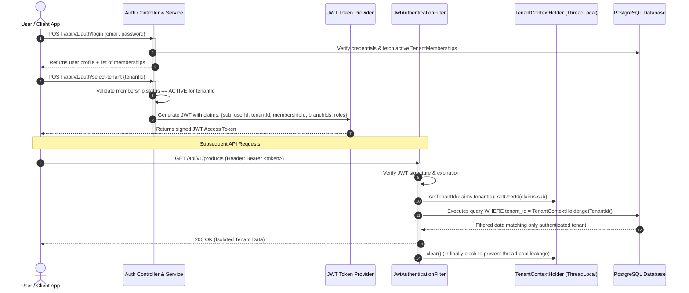
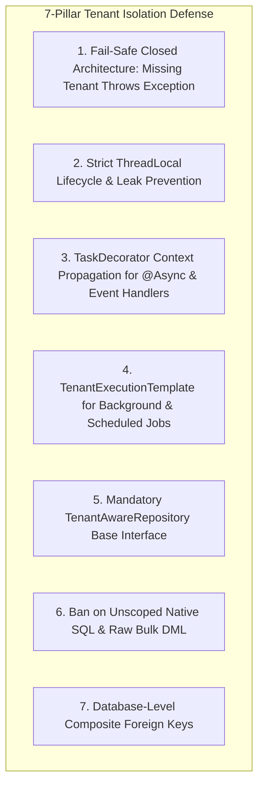
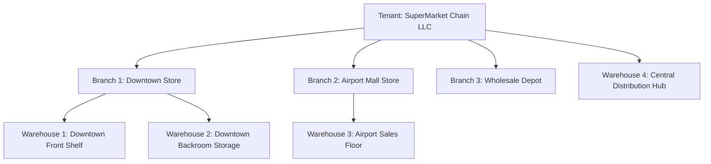

# SAVDOCRM — Multi-Tenancy Architecture & Isolation Strategy

## 1. Multi-Tenancy Model: Shared Database with Shared Schema

SAVDOCRM adopts a **Shared Database, Shared Schema** multi-tenancy model utilizing a discriminator column (`tenant_id`) across all tenant-scoped database tables.

```mermaid
graph TD
    subgraph Multi-Tenant Database: PostgreSQL 16+
        subgraph Shared Schema public
            T1[Tenant A: Grocery Store<br/>tenant_id = '1111...']
            T2[Tenant B: Boutique Fashion<br/>tenant_id = '2222...']
            T3[Tenant C: Electronics Hub<br/>tenant_id = '3333...']
        end
    end

    APP[Spring Boot Backend Tier] -->|TenantContext Filter: Injects tenant_id| Shared Schema public
```

### Trade-Off Evaluation & Strategy Justification:

| Strategy | Operational Cost | Migration Complexity | Connection Pooling | Tenant Scalability | Verdict for SMB Retail |
| :--- | :--- | :--- | :--- | :--- | :--- |
| **Database per Tenant** | Extremely High (idle DBs, RAM explosion) | Catastrophic (run Liquibase 10,000 times) | Exhausts pool limits quickly | Low (expensive to onboard micro-retailers) | Rejected (premature overhead) |
| **Schema per Tenant** | Medium | High (DDL changes across thousands of schemas) | Complex connection routing | Medium (PostgreSQL catalog lock overhead at >1,000 schemas) | Rejected (maintenance nightmare) |
| **Shared Database + Shared Schema (`tenant_id`)** | **Optimal (Single DB, max resource sharing)** | **Trivial (Single Liquibase migration run)** | **Standard, highly efficient HikariCP pool** | **Very High (instantly onboard unlimited tenants)** | **Selected Architecture** |

---

## 2. Zero-Trust Frontend Tenant Resolution

A critical security flaw in naive multi-tenant systems is accepting `tenant_id` or `X-Tenant-ID` directly from frontend HTTP headers or request bodies. In SAVDOCRM:
> **The frontend is never trusted to identify or alter the tenant context.**

### Cryptographic Tenant Verification Flow:



---

## 3. Defense-in-Depth Multi-Tenancy Security (Beyond Hibernate `@Filter`)

Hibernate `@Filter` is a convenient development tool, but treating it as the sole security boundary is dangerous:
- **Native SQL Queries** completely bypass Hibernate filters.
- **Bulk DML (HQL/JPQL `UPDATE` / `DELETE`)** may bypass filter conditions in certain execution paths.
- **Background Jobs & Schedulers** run without an HTTP request and have empty thread locals.
- **Async Workers (`@Async`)** execute on separate thread pools where `ThreadLocal` context is lost unless explicitly propagated.
- **Thread Pool Contamination**: Tomcat worker threads reused from pool could retain previous tenant IDs if not cleaned in a strict `finally` block.

To achieve enterprise-grade isolation, SAVDOCRM enforces a **7-Pillar Multi-Tenancy Security Architecture**:



### Pillar 1: Fail-Safe Closed Architecture (Missing Tenant Context)
The system is closed by default. If any tenant-scoped entity repository or domain service is invoked without an active tenant, it **never falls back to querying all data**. Instead, it immediately halts execution with an exception:
```java
public final class TenantContextHolder {
    private static final ThreadLocal<TenantContext> CONTEXT = new ThreadLocal<>();

    public static UUID getRequiredTenantId() {
        TenantContext ctx = CONTEXT.get();
        if (ctx == null || ctx.getTenantId() == null) {
            throw new TenantContextMissingException("Security Violation: Operation invoked without valid tenant context");
        }
        return ctx.getTenantId();
    }
}
```

### Pillar 2: Strict ThreadLocal Lifecycle & Pool Contamination Defense
Web server worker threads are recycled. The `TenantSecurityFilter` wraps all execution in a mandatory `try-finally` block to guarantee context eradication:
```java
public class TenantSecurityFilter extends OncePerRequestFilter {
    @Override
    protected void doFilterInternal(HttpServletRequest request, HttpServletResponse response, FilterChain filterChain)
            throws ServletException, IOException {
        try {
            Claims claims = jwtProvider.resolveClaims(request);
            if (claims != null && claims.get("tenantId") != null) {
                UUID tenantId = UUID.fromString(claims.get("tenantId", String.class));
                TenantContextHolder.set(new TenantContext(tenantId, claims.getSubject()));
                MDC.put("tenantId", tenantId.toString());
            }
            filterChain.doFilter(request, response);
        } finally {
            // Absolute guarantee: context cleared before thread returns to pool
            TenantContextHolder.clear();
            MDC.remove("tenantId");
        }
    }
}
```

### Pillar 3: Async Context Propagation (`TaskDecorator`)
When Spring dispatches tasks to an `@Async` executor or asynchronous event listener, the `TenantContextTaskDecorator` clones the security and tenant context onto the spawned thread and clears it upon completion:
```java
public class TenantContextTaskDecorator implements TaskDecorator {
    @Override
    public Runnable decorate(Runnable runnable) {
        TenantContext context = TenantContextHolder.get();
        Map<String, String> mdcContext = MDC.getCopyOfContextMap();
        return () -> {
            try {
                if (context != null) {
                    TenantContextHolder.set(context);
                }
                if (mdcContext != null) {
                    MDC.setContextMap(mdcContext);
                }
                runnable.run();
            } finally {
                TenantContextHolder.clear();
                MDC.clear();
            }
        };
    }
}
```

### Pillar 4: Background Jobs & Scheduled Tasks (`TenantExecutionTemplate`)
Background schedulers (`@Scheduled`) have no HTTP context. They must never query tables globally. Instead, they execute via `TenantExecutionTemplate`, iterating over active tenants one-by-one with isolated transaction boundaries:
```java
@Component
@RequiredArgsConstructor
public class TenantExecutionTemplate {

    public void executeAsTenant(UUID tenantId, Runnable task) {
        try {
            TenantContextHolder.set(new TenantContext(tenantId, "SYSTEM_JOB"));
            MDC.put("tenantId", tenantId.toString());
            task.run();
        } finally {
            TenantContextHolder.clear();
            MDC.remove("tenantId");
        }
    }

    public void executeForAllActiveTenants(Consumer<UUID> tenantConsumer) {
        List<UUID> activeTenantIds = tenantRepository.findAllActiveTenantIds();
        for (UUID tenantId : activeTenantIds) {
            executeAsTenant(tenantId, () -> tenantConsumer.accept(tenantId));
        }
    }
}
```

### Pillar 5: Mandatory `TenantAwareRepository` Pattern
All repositories managing tenant data extend a customized `TenantAwareRepository`:
```java
@NoRepositoryBean
public interface TenantAwareRepository<T extends BaseTenantEntity, ID> extends JpaRepository<T, ID> {
    Optional<T> findByTenantIdAndId(UUID tenantId, ID id);
    Page<T> findAllByTenantId(UUID tenantId, Pageable pageable);
    boolean existsByTenantIdAndId(UUID tenantId, ID id);
    void deleteByTenantIdAndId(UUID tenantId, ID id);
}
```
*Rule*: Direct calls to standard unparameterized `findById(ID id)` or `deleteById(ID id)` are explicitly shadowed or forbidden on tenant entities.

### Pillar 6: Ban on Unscoped Native SQL & Bulk DML
- Native SQL queries (`@Query(nativeQuery = true)`) are strictly forbidden unless they explicitly include `WHERE tenant_id = :tenantId`. Every native query must undergo code review and ArchUnit inspection.
- Bulk updates/deletes in JPQL (`@Modifying @Query("UPDATE Product p SET p.isActive = false ...")`) must explicitly bind `:tenantId`:
```java
@Modifying
@Query("UPDATE Product p SET p.isActive = false WHERE p.tenantId = :tenantId AND p.category.id = :categoryId")
int deactivateByCategory(@Param("tenantId") UUID tenantId, @Param("categoryId") UUID categoryId);
```

### Pillar 7: Database-Level Composite Foreign Keys
Even if application logic suffers an injection bug or coding error, cross-tenant references are mathematically impossible at the database engine level via composite foreign keys:
```sql
-- Parent table declares composite unique key
ALTER TABLE products ADD CONSTRAINT uq_products_tenant_id UNIQUE (tenant_id, id);

-- Child table declares composite foreign key
ALTER TABLE product_variants ADD CONSTRAINT fk_variants_tenant_product 
    FOREIGN KEY (tenant_id, product_id) REFERENCES products(tenant_id, id) ON DELETE CASCADE;
```
If a rogue query attempts to link Tenant B's variant to Tenant A's product, PostgreSQL aborts the transaction immediately with a foreign key violation!

---

## 4. Tenant-Branch-Warehouse Hierarchy

Tenancy models a strict organizational tree:



- **Tenant**: Top-level billing account. All master catalog items (products, categories, units) belong to the Tenant and are shared across all its branches.
- **Branch**: Operational business unit where sales and cash register sessions occur.
- **Warehouse**: Physical or virtual stock holding location. A branch can fulfill sales from its attached local warehouses or request a stock transfer from the tenant's central warehouse.

---

## 5. Multi-Tenant Membership & Context Switching

A single user account (`users` table) can hold memberships across multiple retail businesses.
- Example: An investor owns a Grocery store (Tenant A) and an Electronics boutique (Tenant B).
- The user logs in once with global credentials.
- The UI presents a **Store Switcher**.
- Switching stores invokes:
  ```http
  POST /api/v1/auth/switch-context
  Content-Type: application/json
  {
    "tenantId": "c4ca4238-a0b9-3382-8dcc-509a6f75849b",
    "branchId": "a1b2c3d4-e5f6-7a8b-9c0d-1e2f3a4b5c6d"
  }
  ```
- The backend verifies that the user holds an active membership in `tenantId`, validates that `branchId` belongs to that tenant, and issues a newly signed scoped JWT.

---

## 6. Automated Multi-Tenancy Isolation Test Suite

To prove tenant isolation mathematically, automated integration tests run in CI using **Testcontainers PostgreSQL 16**:
1. **Cross-Tenant Read Test**: Seed Branch in Tenant A. Set `TenantContext` to Tenant B. Assert query returns `Optional.empty()`.
2. **Cross-Tenant Write / Deletion Test**: Attempt to delete Tenant B branch while authenticated as Tenant A. Assert Branch B remains untouched.
3. **Missing Context Test (Fail-Closed)**: Execute query with `TenantContextHolder.clear()`. Assert `TenantContextMissingException` is thrown.
4. **Thread Contamination Test**: Execute parallel worker threads and task decorators. Assert zero cross-thread context bleeding.
5. **Database Constraint Test**: Unique composite constraint `(tenant_id, code)` prevents duplicate branch codes in Tenant A, while allowing different tenants to share the same code.

---

## 7. Implemented Milestone 02 Architecture vs. Planned Behavior

### Implemented Behavior (Milestone 02):
- **Core Domain Entities**: `Tenant` (with `TenantStatus`, `currencyCode`, `timezone`, audit fields, `@Version`) and `Branch` (extending `BaseTenantEntity` with `(tenant_id, code)` uniqueness and optimistic locking).
- **Fail-Closed Context**: `TenantContextHolder` throws `TenantContextMissingException` if an unauthenticated or unscoped call is made.
- **Execution Template**: `TenantExecutionTemplate.executeAsTenant(tenantId, action)` safely wraps background/system execution with guaranteed `finally` cleanup and nested context restoration.
- **Async Propagation**: `TenantContextTaskDecorator` implements Spring's `TaskDecorator` to copy `TenantContext` to worker threads and clean up upon termination.
- **Data Access Contract**: `TenantAwareRepository` contract provides explicit `findByTenantIdAndId`, `findAllByTenantId`, `existsByTenantIdAndId`, `deleteByTenantIdAndId`, and contextual helper methods.
- **Liquibase Migrations**: `v1.0.0/01-create-tenants.xml` and `v1.0.0/02-create-branches.xml` with foreign key `fk_branches_tenant`, composite unique constraints `uq_branches_tenant_code` and `uq_branches_tenant_id`, and index `idx_branches_tenant`.

---

## 8. Authentication Boundary & Milestone 03 Integration Contract

To avoid premature abstractions and preserve zero-trust security:
- **No Temporary Authentication**: No mock users or unverified headers (e.g. `X-Tenant-Id`) are accepted in Milestone 02.
- **No Unauthenticated Exposure**: Tenant data is not exposed over unauthenticated REST endpoints.
- **Integration Contract for Milestone 03**:
  1. User authenticates via `/api/v1/auth/login` (email + password).
  2. Identity module verifies active `TenantMembership` for the user.
  3. Server issues signed JWT containing verified `tenantId` and `membershipId`.
  4. Incoming API requests are intercepted by `TenantSecurityFilter` (Milestone 03), which parses the cryptographically verified JWT claims, sets `TenantContextHolder.setContext(...)`, and executes the request.
  5. If an unauthenticated request reaches tenant-scoped code, it fails closed immediately (`TenantContextMissingException`).
