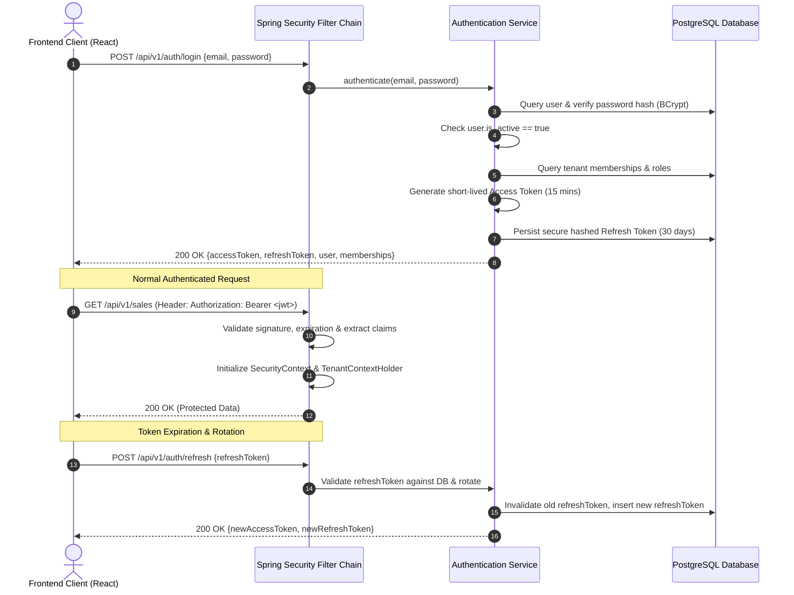
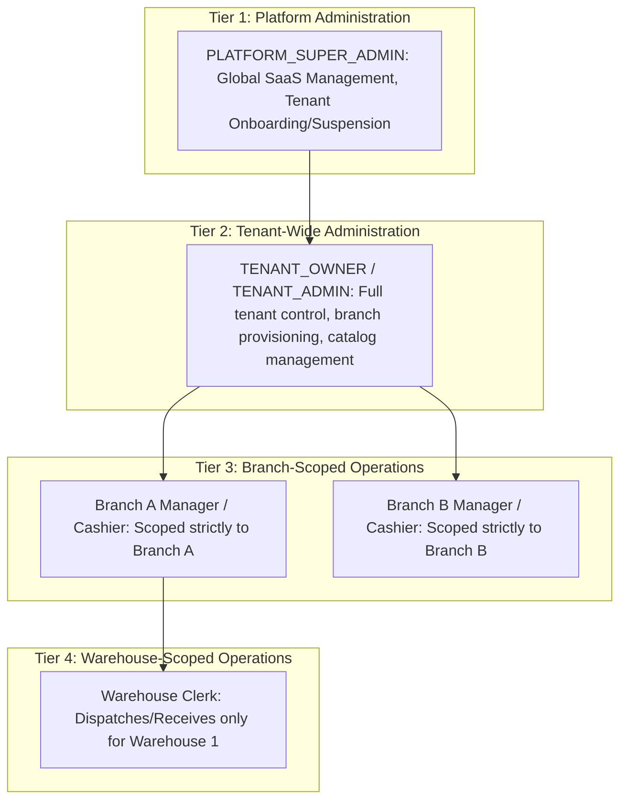

# SAVDOCRM — Security, Authentication & Scoped RBAC Architecture

## 1. Authentication Architecture: Stateless JWT with In-Memory Access & HttpOnly Cookies

SAVDOCRM implements a stateless **Dual-Phase JWT Authentication Architecture** designed for high security, horizontal scalability, and multi-tenant isolation:
- **Access Token**: Stored strictly in-memory (Zustand state); never persisted to `localStorage` or `sessionStorage`. Valid for 15 minutes.
- **Refresh Token**: Stored in a browser-managed `HttpOnly`, `Secure` (in production), `SameSite=Lax` cookie (`savdocrm_refresh_token`) scoped to `/api/v1/auth`. Valid for 30 days. Never exposed to client JavaScript.
- **Concurrency & Locking**: `RefreshTokenRepository.findByTokenHashWithLock` uses PostgreSQL `PESSIMISTIC_WRITE` row locks (`SELECT ... FOR UPDATE`) to serialize concurrent refresh calls.
- **Concurrency Grace Window**: A 10-second rotation grace window prevents race conditions from multiple browser tabs while revoking the entire session family if replayed outside the window.
- **Live Account Status**: Every tenant-scoped request executes live database verification in `JwtAuthenticationFilter` confirming `user.isActive()`, `tenant.isActive()`, `membership.isActive()`, and membership claim consistency before setting `TenantContextHolder`.




---

## 2. 4-Tier Permission & Scope Hierarchy

A major vulnerability in multi-branch systems is accidentally granting a cashier access to all branches. In SAVDOCRM:
> **A user never receives access to all branches simply by belonging to a tenant.**

Access is evaluated across four distinct authorization tiers:



### 2.1. Authorization Tier Breakdown:
1. **Tier 1: Platform-Level Administration (`SUPER_ADMIN`)**:
   - Scope: Platform SaaS infrastructure.
   - Independent of individual tenants. Can provision tenants, suspend delinquent accounts, and inspect platform system health.
2. **Tier 2: Tenant-Level Administration (`TENANT_OWNER`, `TENANT_ADMIN`)**:
   - Scope: Across the entire tenant business.
   - Allowed to configure company profiles, add/remove branches, onboard staff, define roles, and view consolidated financial statements.
   - Identified by `membership_roles.branch_id IS NULL` for administrative roles.
3. **Tier 3: Branch-Scoped Permissions (`BRANCH_MANAGER`, `CASHIER`)**:
   - Scope: Restricted exclusively to specific branches (`membership_roles.branch_id = <branch_id>`).
   - A cashier assigned to "Branch Downtown" cannot view sales, open cash sessions, or process orders for "Branch Airport".
4. **Tier 4: Warehouse-Scoped Permissions (`INVENTORY_CLERK`)**:
   - Scope: Restricted to physical inventory operations (transfers, audits, goods receipts) at designated warehouses attached to their branch.

---

## 3. JWT Claims Structure & Context Scoping

When a user switches into an active branch context, the JWT token embeds their scoped authorities:

```json
{
  "iss": "savdocrm-auth-server",
  "sub": "d3b07384-d113-4e4b-9e22-87289d0f4d3d",
  "email": "sarah.cashier@megamart.com",
  "tenantId": "c4ca4238-a0b9-3382-8dcc-509a6f75849b",
  "membershipId": "f7c3bc8d-6490-4a81-bb03-4f1128796541",
  "activeBranchId": "a1b2c3d4-e5f6-7a8b-9c0d-1e2f3a4b5c6d",
  "allowedBranchIds": [
    "a1b2c3d4-e5f6-7a8b-9c0d-1e2f3a4b5c6d"
  ],
  "roles": [
    "CASHIER"
  ],
  "permissions": [
    "sales:pos:open_shift",
    "sales:pos:checkout",
    "catalog:product:read"
  ],
  "iat": 1795444800,
  "exp": 1795445700
}
```

---

## 4. Method-Level Security & Custom Branch Evaluator

Controllers and Application Services enforce branch-scoped security checks via Spring Security SpEL expressions:

```java
@Component("branchSecurity")
public class BranchSecurityEvaluator {

    public boolean canAccessBranch(UUID branchId) {
        UserPrincipal principal = SecurityUtils.getAuthenticatedPrincipal();
        
        // Tenant owners with tenant-wide privileges can access all branches
        if (principal.hasTenantWideAccess()) {
            return true;
        }

        // Branch-scoped users must match active branch assignment
        return principal.getAllowedBranchIds().contains(branchId);
    }
}
```

### Declarative Usage in Controllers & Services:
```java
@RestController
@RequestMapping("/api/v1/pos")
public class PosController {

    @PostMapping("/shifts/open")
    @PreAuthorize("hasAuthority('sales:pos:open_shift') and @branchSecurity.canAccessBranch(#command.branchId)")
    public ResponseEntity<ApiResponse<PosSessionDto>> openShift(@Valid @RequestBody OpenShiftCommand command) {
        return ResponseEntity.ok(ApiResponse.success(posShiftService.openShift(command)));
    }
}
```

If an authenticated user attempts to pass another branch's ID in `OpenShiftCommand`, `BranchSecurityEvaluator` returns `false`, resulting in an instant `403 Forbidden` response.

---

## 5. Defense Against OWASP Top 10 Vulnerabilities

1. **Broken Object Level Authorization (BOLA / IDOR)**:
   - Enforced by database composite foreign keys and mandatory `tenant_id` filter. Attempting to query an ID outside the tenant returns `404 Not Found`.
2. **SQL Injection**:
   - Zero raw SQL concatenation. 100% parameter-bound queries via Spring Data JPA and Hibernate Criteria.
3. **Cross-Site Scripting (XSS)**:
   - React JSX automatic entity escaping, strict CSP headers:
     `Content-Security-Policy: default-src 'self'; script-src 'self'; style-src 'self' 'unsafe-inline';`
4. **Credential Brute-Force & Rate Limiting**:
   - Authentication endpoints throttled to 5 requests per minute per IP.
   - Passwords hashed using **BCrypt (work factor 12)**.
5. **Cross-Site Request Forgery (CSRF)**:
   - API is stateless; Bearer token authorization headers cannot be forged via ambient browser cross-origin requests.

---

## 6. Implementation Status: Milestone 02 vs. Planned Milestones

### Implemented in Milestone 02:
- **Fail-Closed Execution**: `TenantContextHolder` strictly rejects execution without a trusted context.
- **Context Lifecycle**: Guaranteed `ThreadLocal` cleanup prevents pooled thread contamination.
- **Asynchronous Safety**: `TenantContextTaskDecorator` safely propagates tenant context to task executor worker threads.
- **Zero Client Trust**: No client-provided `X-Tenant-Id` header is accepted or processed.
- **Database-Level Ownership Enforcement**: Composite unique constraints and foreign keys physically block cross-tenant assignment in PostgreSQL.

### Planned for Milestone 03:
- User registration, password hashing (BCrypt work factor 12), and credential verification.
- Stateless dual-token JWT architecture (access tokens + refresh rotation).
- Extraction of trusted `tenantId` from cryptographically signed JWT claims to populate `TenantContextHolder`.

### Planned for Milestone 04:
- 4-tier scoped role assignments and `BranchSecurityEvaluator`.
