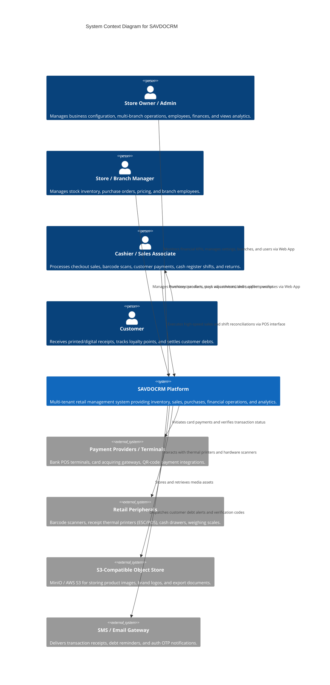
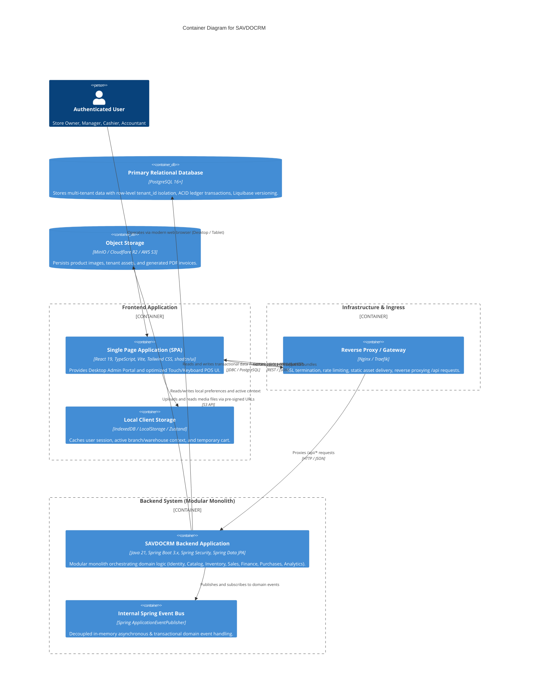

# SAVDOCRM — System Overview & Architecture Vision

## 1. Executive Summary

**SAVDOCRM** is a production-grade Store Management & Point of Sale (POS) CRM platform engineered specifically for small and medium-sized retail businesses (SMBs). The platform addresses the full operational lifecycle of modern retail:
- Multi-store, multi-branch, and multi-warehouse operations
- Dynamic product catalog supporting matrix variants, multiple barcodes, and flexible units of measure
- Real-time inventory tracking with immutable double-entry style stock ledger
- Rapid Point of Sale (POS) with split payment methods, customer loyalty, and returns
- Comprehensive purchase management and supplier debt (Accounts Payable) tracking
- Customer relationships, credit accounts (Accounts Receivable), and debt collection
- Cash register session management, financial accounts, and expense/income tracking
- Multi-tenant SaaS architecture enabling independent retail businesses to operate securely in an isolated logical environment.

The system is designed as a **Modular Monolith** on the backend (Java 21, Spring Boot 3.4.x, PostgreSQL 16+) and **Feature-Sliced Design (FSD)** on the frontend (React, Vite, TypeScript, Tailwind CSS, shadcn/ui). This delivers high development velocity, minimal operational overhead, strict domain boundaries, and an evolutionary path to independent services if scale warrants in the future.

---

## 2. System Context Diagram (C4 Level 1)

The following diagram illustrates how users, external systems, and SAVDOCRM interact within the broader retail ecosystem.



---

## 3. Container Diagram (C4 Level 2)

The container diagram illustrates the runtime components, protocols, and data stores comprising SAVDOCRM.



---

## 4. Retail Business Scope & Category Flexibility

Retail stores span wildly different operational workflows. SAVDOCRM avoids hardcoded vertical-specific logic by designing generalized, composable domain primitives:

| Retail Category | Operational Challenges | SAVDOCRM Architectural Solution |
| :--- | :--- | :--- |
| **Grocery & Supermarkets** | High item turnover, fast barcode scanning, weighed produce, expiration dates. | Multi-barcode per SKU (EAN-13, UPC, custom), fractional units of measure (`kg`, `g`, `l`), batch & expiry tracking in inventory ledger. |
| **Fashion & Apparel** | Multiple sizes, colors, fabrics for identical product models. | Matrix Variant model (`Product` -> `ProductVariant` + dynamic attributes: Size, Color, Season) with distinct SKUs, barcodes, and stock levels. |
| **Electronics & Appliances** | High value, unique serial numbers, warranty tracking, supplier returns. | Serialized inventory tracking capability, detailed purchase order receipt verification, supplier warranty metadata. |
| **Household & Hardware** | Bundles, packaged bulk goods, dual-unit sales (piece vs box). | Multi-unit conversion ratio (`1 box = 24 pcs`), tiered pricing, bulk volume discount models. |
| **Boutiques & General Retail** | Mixed payment methods, customer debts, partial payments, credit limits. | Native split payments (`Cash` + `Card` + `Debt`), Customer credit ledger (Accounts Receivable) with credit limit validation. |

---

## 5. Non-Functional Requirements & Architecture Quality Attributes

### 5.1. Data Isolation & Security
- **Strict Multi-Tenancy**: Shared database, shared schema with mandatory `tenant_id` column. Tenant resolution occurs on the backend via authenticated JWT claims; client-provided tenant headers are never trusted.
- **Role-Based Access Control (RBAC)**: Hierarchical permissions scoped to Tenant and optionally Branch. A user cannot view data belonging to other tenants or unauthorized branches.
- **Data Protection**: Passwords hashed using Argon2id/BCrypt (work factor 12). All external traffic strictly HTTPS (TLS 1.3).

### 5.2. Data Integrity & Financial Precision
- **Immutable Inventory Ledger**: Stock is never simply updated with `UPDATE inventory SET quantity = quantity + 10`. Every stock change requires an immutable `InventoryTransaction` (Receipt, Sale, Adjustment, Transfer, Return). Materialized stock balances are maintained with optimistic locking (`@Version`) for high-concurrency protection.
- **Zero Floating-Point Drift**: All monetary amounts, unit costs, discounts, and exchange rates use SQL `NUMERIC(15, 4)` and Java `BigDecimal` with explicit rounding modes (`RoundingMode.HALF_UP`).
- **Idempotent Operations**: High-impact transactional endpoints (Sale Checkout, Payment Settlement, Goods Receipt) support `Idempotency-Key` headers to prevent accidental duplicate charges.

### 5.3. Performance & Low Latency
- **POS Checkout Latency**: 95th percentile response time $< 120\text{ ms}$ for sale completion and barcode lookups.
- **Indexed Tenant Scoping**: Every table index is prefixed with `tenant_id` (e.g., `CREATE INDEX idx_products_tenant_sku ON products(tenant_id, sku)`), ensuring lightning-fast index lookups within tenant data partitions.
- **Stateless Application Tier**: The backend stores no HTTP session state; all state is encapsulated in JWT claims or the database, enabling seamless horizontal container scaling.

### 5.4. Maintainability & Clean Boundaries
- **Modular Monolith**: Modules communicate through explicit Java contracts (Facades/Service SPI) and Spring Domain Events. No circular module dependencies are permitted.
- **Automated Architectural Enforcement**: Automated ArchUnit tests verify that modules do not access internal packages or repositories of other modules.
- **Frontend FSD Standard**: Strict dependency flow (`app` -> `pages` -> `widgets` -> `features` -> `entities` -> `shared`). Cross-imports between modules on the same layer are prohibited.

---

## 6. High-Level Directory & Repository Layout

The project is structured as a unified monorepo to maintain synchronized API contracts and unified CI/CD pipelines while preserving clean architectural separation:

```
savdocrm/
├── docs/                           # Architecture, database, security, and API documentation
│   └── architecture/
├── backend/                        # Java 21 / Spring Boot 3.x Modular Monolith
│   ├── gradle/wrapper/             # Gradle 8.10.2 wrapper binaries and configuration
│   ├── gradlew / gradlew.bat
│   ├── build.gradle.kts            # Root backend build configuration
│   ├── settings.gradle.kts
│   └── src/
│       ├── main/
│       │   ├── java/com/savdocrm/
│       │   │   ├── SavdoCrmApplication.java
│       │   │   ├── shared/         # Cross-cutting infrastructure, base entities, utilities
│       │   │   └── modules/        # Bounded contexts (tenancy, identity, catalog, inventory, etc.)
│       │   └── resources/
│       │       ├── application.yml
│       │       └── db/changelog/   # Liquibase migrations (master.xml + domain changelogs)
│       └── test/                   # Unit, integration, and ArchUnit architecture tests
├── frontend/                       # React 19 / TypeScript / Vite / Tailwind CSS / shadcn/ui
│   ├── package.json
│   ├── tsconfig.json               # Strict TypeScript configuration
│   ├── vite.config.ts
│   ├── tailwind.config.ts
│   └── src/                        # Feature-Sliced Design layout
│       ├── app/                    # Providers, global styles, router
│       ├── pages/                  # Page compositions
│       ├── widgets/                # Self-contained UI blocks (Header, Sidebar, CartWidget)
│       ├── features/               # User interactions (AuthLoginForm, BarcodeScanner, CheckoutModal)
│       ├── entities/               # Business models & API hooks (Product, Sale, Customer, Stock)
│       └── shared/                 # Reusable UI primitives (shadcn), API client, utils
├── docker/                         # Docker Compose configurations for local dev & staging
│   ├── docker-compose.yml          # PostgreSQL 16, MinIO, MailHog
│   └── Dockerfile.backend
└── README.md
```
